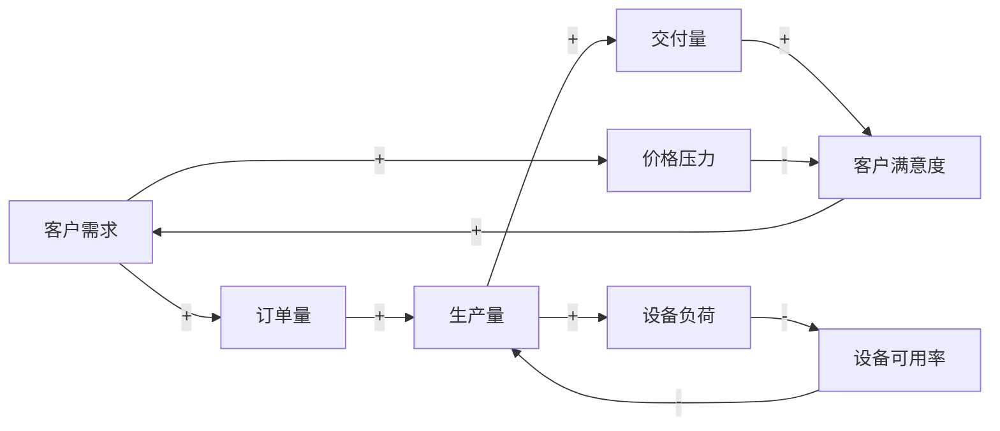
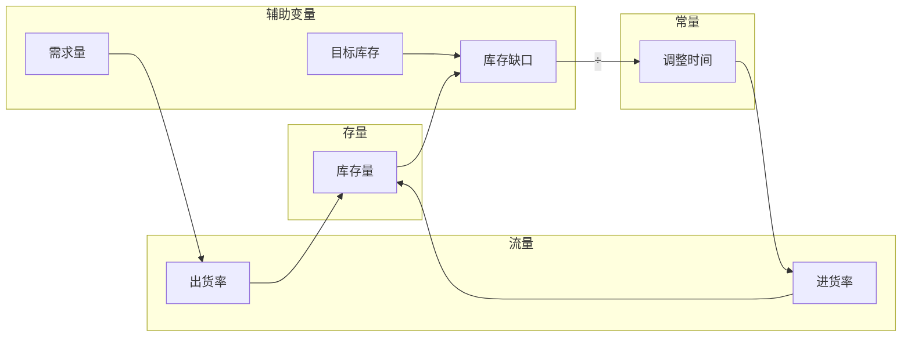

# 附录D：常见系统分析工具清单

本附录汇集了四层十维框架中常用的四种系统分析工具，并提供详细的使用方法、绘制规范和示例。这些工具覆盖了从定性关系分析到定量评估的全过程，读者可根据分析需要选择使用。

## D.1 工具概览

| 工具 | 主要用途 | 适用阶段 | 对应框架维度 |
|------|---------|---------|-------------|
| **因果回路图** | 识别反馈回路与因果关系 | 系统理解、初步诊断 | 道、熵 |
| **存量-流量图** | 量化系统动态行为 | 深入分析、仿真建模 | 道、法、果 |
| **雷达图** | 可视化多维成熟度 | 系统评估、对比分析 | 全维度 |
| **成熟度评估表** | 结构化评估各维度状态 | 系统诊断、项目交付 | 全维度 |

## D.2 因果回路图（Causal Loop Diagram, CLD）

### D.2.1 工具定位

因果回路图是系统思考的核心工具，用于可视化系统要素之间的因果关系和反馈回路，帮助分析者理解系统的结构性行为模式。CLD是定性分析工具，不涉及量化计算。

### D.2.2 基本符号

| 符号 | 名称 | 含义 |
|------|------|------|
| A → B | 正向因果关系 | A 增加 → B 增加；A 减少 → B 减少 |
| A ─┐ B | 负向因果关系 | A 增加 → B 减少；A 减少 → B 增加 |
| R | 增强回路标识 | 回路产生放大效应（正反馈） |
| B | 平衡回路标识 | 回路产生稳定效应（负反馈） |
| // | 时间延迟标识 | 因果作用存在滞后 |

### D.2.3 绘制步骤

1. **识别关键变量**：列出与系统问题直接相关的核心变量（5-12个为宜）
2. **确定因果关系**：逐对判断变量之间是否存在因果关系及其方向
3. **标注极性**：在因果链上标注正（+）或负（-）极性
4. **识别回路**：追踪因果链，识别闭合的反馈回路
5. **标注回路类型**：标记 R（增强回路）或 B（平衡回路）
6. **标注延迟**：在存在明显滞后的因果链上标注 //

### D.2.4 回路类型判断方法

**增强回路（R）** ：回路中负号数量为偶数 → 整体效应为放大（增长或衰退）
**平衡回路（B）** ：回路中负号数量为奇数 → 整体效应为稳定（趋向目标）

### D.2.5 绘制规范

- 变量名称使用名词短语（如“库存水平”“客户数量”）
- 箭头方向表示因果方向（从因到果）
- 因果链上的极性标注在箭头中间位置
- 回路标识（R/B）标注在回路中心或明显位置
- 保持布局清晰，尽量减少交叉线

### D.2.6 示例：企业增长与产能约束

**回路解读**：
- **增强回路 R1**（客户需求→订单量→生产量→交付量→满意度→需求）：增长飞轮
- **平衡回路 B1**（生产量→设备负荷→设备可用率→生产量）：产能约束
- **平衡回路 B2**（需求→价格压力→满意度→需求）：价格弹性约束

### D.2.7 常见误区

| 误区 | 正确做法 |
|------|---------|
| 变量过多（>15个） | 聚焦核心变量，拆分为多个子图 |
| 忽略延迟 | 关键延迟处标注 // |
| 极性判断错误 | 逐链检查：A增加→中间变量→B如何变化 |
| 回路漏标 | 系统检查所有闭合路径 |

## D.3 存量-流量图（Stock-Flow Diagram）

### D.3.1 工具定位

存量-流量图是系统动力学建模的核心工具，在因果回路图的基础上进一步量化系统的动态行为。它区分了“累积量”（存量）和“变化率”（流量），是进行计算机仿真的基础。

### D.3.2 基本符号

| 符号 | 名称 | 含义 | 示例 |
|------|------|------|------|
| 矩形（□） | 存量 | 系统中累积的量，随时间变化 | 库存、人口、资金余额 |
| 阀门（↕） | 流量 | 存量变化的速率 | 进货率、出生率、存款率 |
| 圆形（○） | 辅助变量 | 中间计算变量 | 价格、效率系数 |
| 菱形（◇） | 常量 | 固定参数 | 税率、折旧率 |
| 箭头（→） | 信息流 | 变量之间的信息传递 | 数据输入 |
| 管状箭头（⇒） | 物质流 | 物质或能量的流动 | 货物运输 |

### D.3.3 绘制步骤

1. **从CLD转换**：识别CLD中的存量变量（累积量），将其转换为存量节点
2. **确定流量**：为每个存量识别流入和流出
3. **连接变量**：用信息流连接影响流量的辅助变量和常量
4. **建立方程**：为每个流量设定数学表达式
5. **设置初始条件**：为存量设定初始值

### D.3.4 存量识别的关键问题

- 这个变量可以累积吗？
- 这个变量会随时间增加或减少吗？
- 这个变量的变化需要时间吗？

如果三个问题中至少两个为“是”，该变量通常是存量。

### D.3.5 示例：库存管理

**方程**：
- 进货率 = (目标库存 - 当前库存) / 调整时间
- 出货率 = 需求量
- 库存量变化 = 进货率 - 出货率

### D.3.6 常见误区

| 误区 | 正确做法 |
|------|---------|
| 将流量误认为存量 | 流量是速率（/时间单位），存量为累积量 |
| 存量缺少流入或流出 | 每个存量至少有一个流入或一个流出 |
| 忽略了初始条件 | 为每个存量设定合理的初始值 |

## D.4 雷达图（Radar Chart）

### D.4.1 工具定位

雷达图是可视化系统各维度成熟度的核心工具。它将十个维度的评分（1-5）在一个圆形图表上同时呈现，帮助分析者快速识别系统的强项和弱项。

### D.4.2 评分标准

| 评分 | 境界 | 特征 |
|------|------|------|
| 5 | 衍 | 自进化、涌现、自我超越 |
| 4 | 合 | 灵活应对，融会贯通，内外归一，不器之始 |
| 3 | 定 | 成熟稳定，可量化可验证 |
| 2 | 有 | 初步建立，机械不灵活 |
| 1 | 无 | 维度缺失或完全混沌 |

### D.4.3 绘制步骤（电子版）

**Excel / Google Sheets**：
1. 输入十个维度的名称和评分
2. 选择数据 → 插入 → 图表 → 雷达图
3. 调整样式：添加数据标签、调整颜色、设置坐标轴范围（0-5）
4. 添加标题和维度标签

**手动绘制**：
1. 画一个正十边形，各顶点标记维度名称
2. 从中心向外等距标记五个同心圆（对应1-5分）
3. 在各维度方向标出评分点
4. 依次连接各点，形成轮廓

### D.4.4 解读方法

| 特征 | 含义 | 建议行动 |
|------|------|---------|
| 轮廓面积大 | 整体成熟度高 | 维持现有水平，寻找突破点 |
| 轮廓面积小 | 整体成熟度低 | 优先补充最弱维度 |
| 轮廓对称 | 各维度均衡 | 维持平衡，识别协同机会 |
| 轮廓不对称 | 维度间失衡 | 识别“低谷”维度作为优先改进点 |
| 一处凹陷 | 单一维度薄弱 | 分析该维度是否为系统瓶颈 |
| 多处凹陷 | 多个维度薄弱 | 优先修复对系统影响最大的维度 |

### D.4.5 示例

**评分数据**：理4、念3、心2、道4、熵3、法4、术3、器3、行4、果3

| 维度 | 理 | 念 | 心 | 道 | 熵 | 法 | 术 | 器 | 行 | 果 |
|------|----|----|----|----|----|----|----|----|----|----|
| 评分 | 4 | 3 | 2 | 4 | 3 | 4 | 3 | 3 | 4 | 3 |

**解读**：心（2）是最薄弱的维度，可能是系统的瓶颈；理、道、法、行（4）是系统强项。建议优先优化“心”维度（信任/文化），同时利用强项维度支持弱项维度的提升。

## D.5 成熟度评估表

### D.5.1 工具定位

成熟度评估表是结构化的系统诊断工具，通过一系列诊断问题，帮助分析者系统性地评估各维度的成熟度状态。它是第13章“系统病态与诊断”的配套工具，也是第18章系统分析项目交付物的核心组成部分。

### D.5.2 评估表结构

成熟度评估表包含五个基本要素：

1. **维度名称与定义**：明确评估对象
2. **诊断问题**：引导分析者收集信息
3. **境界评定**：根据证据确定境界（无→有→定→合→衍）
4. **证据支撑**：记录支持判断的具体证据
5. **改进方向**：简要记录初步优化思路

### D.5.3 填写流程

1. **收集信息**：通过访谈、观察、文档分析等方式收集证据
2. **逐维评估**：为每个维度回答诊断问题，判断境界
3. **记录证据**：为每个境界判断提供至少两项证据支撑
4. **交叉验证**：检查维度间的判断是否自洽
5. **形成结论**：识别系统的主要瓶颈和优化方向

### D.5.4 完整评估表示例

| 维度 | 诊断问题 | 证据 | 境界 | 改进方向 |
|------|---------|------|------|---------|
| **理** | 系统对所处领域是否有系统化认知？ | ①有完整的业务流程文档 ②定期进行行业分析 ③但缺乏对系统瓶颈的量化认知 | 定 | 补充约束理论培训，建立瓶颈识别机制 |
| **念** | 系统目标是否清晰且被认同？ | ①有明确的使命陈述 ②但管理层对“升级方向”存在分歧 | 有 | 召开战略共识会，明确升级路径 |
| **心** | 系统的信任和文化氛围如何？ | ①员工满意度调查得分72/100 ②跨部门沟通频繁存在误解 | 有 | 建立定期1on1机制，提升透明沟通 |
| **道** | 系统是否建立了以枢为中心的完整传动体系？中枢是否明确、路径是否畅通？ | ①有完整的流程图 ②但订单处理周期偏离标准 | 定 | 引入价值流图分析，识别瓶颈工序 |
| **熵** | 系统是否建立了完整的熵控链条（约束→疏导→引导→应用）？熵是否被转化为系统动力？ | ①有设备故障记录 ②缺乏系统性根因分析 | 有 | 建立OEE分解和根源分析机制 |
| **法** | 运行规则是否有效且适配？ | ①有SOP ②但部分SOP已过时 | 定 | 每季度审核SOP，确保与现状适配 |
| **术** | 操作方法是否标准化、可传授？ | ①新员工培训周期12周 ②师傅带徒弟模式缺乏统一模板 | 有→定 | 将最佳实践固化为标准化操作手册 |
| **器** | 工具是否充分且被有效使用？ | ①已上线ERP系统 ②部分模块使用率不足40% | 有→定 | 针对低使用率模块开展专项培训 |
| **行** | 执行纪律是否已内化为习惯？是否达到“不行而行”的自然状态？ | ①周会95%按时召开 ②部分改进措施执行不彻底 | 定 | 建立改进措施追踪闭环机制 |
| **果** | 反馈信息是否驱动改进？ | ①有月度经营数据 ②改进措施与数据关联弱 | 有→定 | 建立“数据→措施→追踪”闭环 |

### D.5.5 汇总分析

完成各维度评估后，进行以下汇总分析：

1. **计算各维度评分**（1-5对应无→衍）
2. **计算整体成熟度**（平均分或最低分）
3. **识别“低谷”维度**（评分≤2的维度）
4. **识别“高峰”维度**（评分≥4的维度）
5. **分析维度间关联**（低谷是否导致其他维度的问题）

## D.6 工具选择指南

根据分析阶段选择适合的工具：

| 分析阶段 | 推荐工具 | 目的 |
|---------|---------|------|
| **初步探索** | 因果回路图 | 理解系统结构和反馈机制 |
| **深入建模** | 存量-流量图 | 量化系统行为，进行仿真 |
| **系统评估** | 成熟度评估表 + 雷达图 | 全面诊断，识别瓶颈 |
| **结果呈现** | 雷达图 | 直观展示系统健康状况 |
| **方案验证** | 存量-流量图（仿真） | 测试优化方案的效果 |

**建议顺序**：
1. 用**成熟度评估表**完成十维诊断（第13章）
2. 用**雷达图**可视化评估结果（第12章）
3. 用**因果回路图**识别关键反馈回路（第9章）
4. 必要时用**存量-流量图**进行量化建模和方案仿真（第14章）

