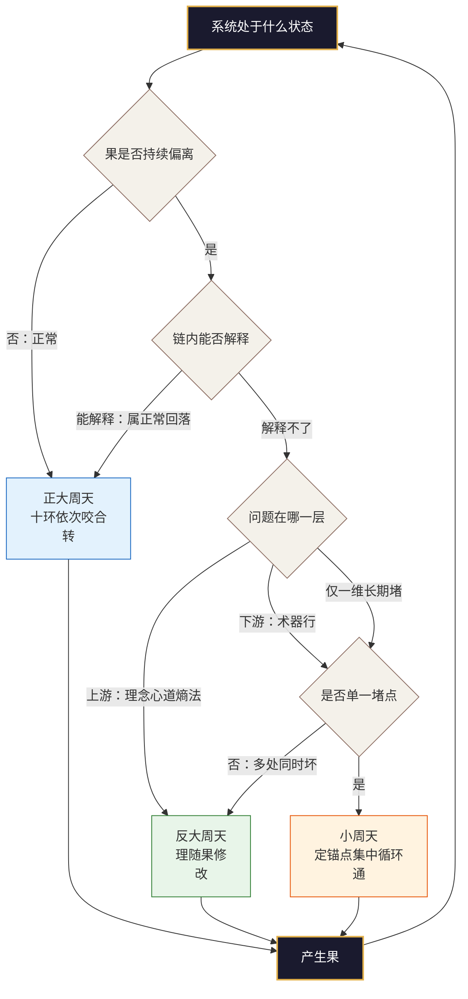
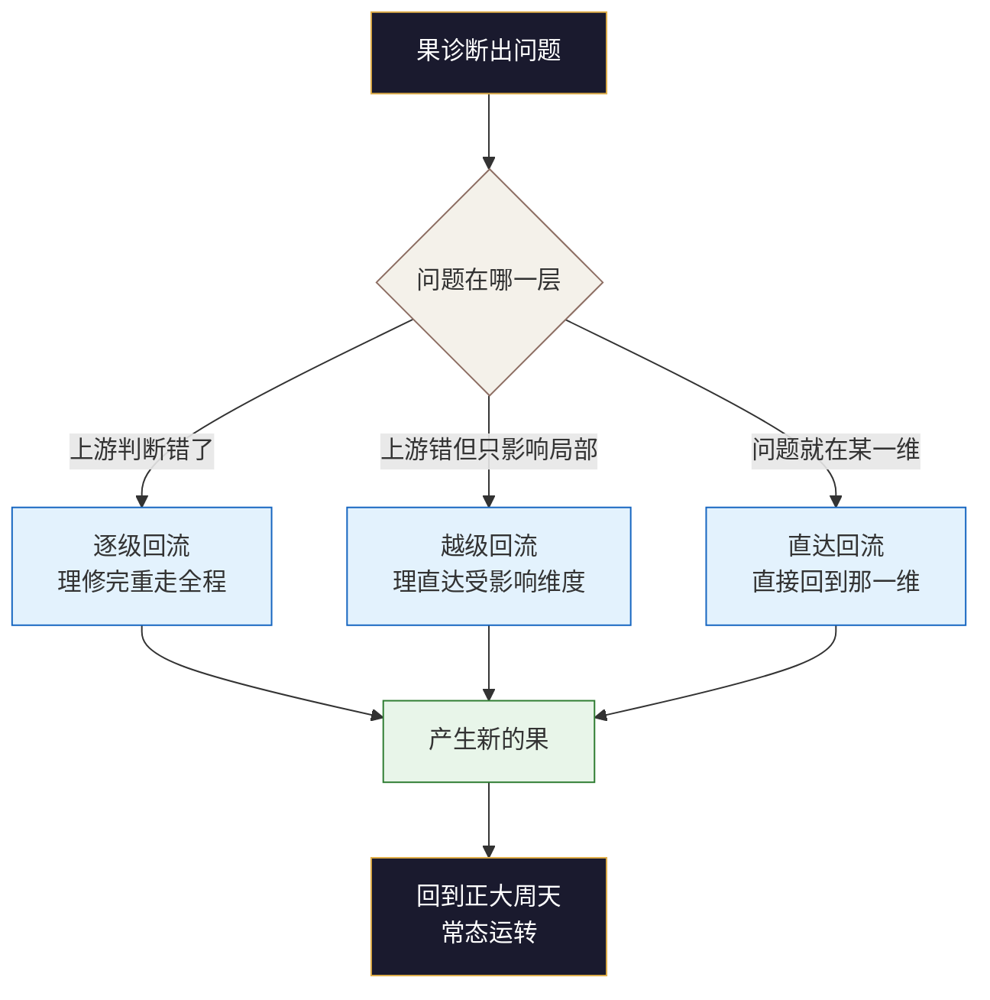

# 附录G：三循环速查图（三轴增补版）

> 本附录是第12章“三循环”的速查版，供诊断现场直接取用。
> 与正文冲突时，以正文为准。
>
> **本速查图与三轴的对应**：
> - **空间轴**：正大周天的十环传动，对应空间轴十维的依次咬合
> - **动力轴**：三循环是动力轴的核心运转形态——正大周天管“转”，反大周天管“改”，小周天管“通”
> - **时间轴**：三循环在不同七阶阶段有不同的侧重（构建期以正大周天为主，调适期以反大周天为主，诊断期以小周天为主）
> - **三把尺子**：三循环的运转效果，通过分维五境、宏观七阶、德之五级来衡量

## G.1 一图看懂三循环

**三句话总纲**：

> **正大周天管「转」，反大周天管「改」，小周天管「通」。**

| 形态 | 回答的问题 | 起点 | 终点 | 触发条件 |
|:---|:---|:---|:---|:---|
| **正大周天** | 系统平时怎么转 | 果 | 果 | 常态运行 |
| **反大周天** | 转不动时怎么改 | 理 | 果 | 果持续偏离 + 链内解释不了 + 源头指向上游 |
| **小周天** | 只有一处卡住怎么办 | 锚点 | 堵点 | 单一堵点长期不通 |

**三者共用同一个诊断器**：果的直达反馈。果不判断是谁错了，它只负责把异常信号发出来；判断哪一维出问题、该走哪条循环，是循环机制的事。

## G.2 正大周天：十环速查

### G.2.1 方向与口诀

**正向链**：果 → 理 → 念 → 心 → 道 → 熵 → 法 → 术 → 器 → 行 → 果

**口诀**：以果证理，以理定念，以念正心，以心合道，以道控熵，以熵缘法，以法构术，以术御器，以器载行，以行纳果。

**起点是果，不是理**——从“上一轮做出来什么结果”开始，接着上一轮往下走。

### G.2.2 十环传动表

| 环节 | 传的是什么 | 断在这里的样子 | 对应三轴 |
|---|---|---|---|
| 以果证理 | 用结果验证认知对不对 | 结果不好只说运气差，说不出哪条判断错了 | 时间轴→空间轴 |
| 以理定念 | 用认知定住方向 | 目标年年改，因为判断一直没定 | 空间轴 |
| 以念正心 | 用方向塑造心理 | 道理都懂，一遇到波动就慌 | 空间轴 |
| 以心合道 | 用心理支撑传动 | 制度写得很好，情绪一上来就绕开制度 | 空间轴 |
| 以道控熵 | 用结构约束并导引压力 | 压力到处乱窜，谁都在扛，谁都没被接住 | 动力轴 |
| 以熵缘法 | 用压力催生规则 | 吃过亏，却始终没沉淀出一条规则 | 动力轴 |
| 以法构术 | 用规则构建动作 | 规则说「分批」，手上只有「一把梭」 | 空间轴 |
| 以术御器 | 用动作驾驭工具 | 要做的事很多，全靠手动硬撑 | 空间轴 |
| 以器载行 | 用工具承载纪律 | 纪律靠意志，一忙就断 | 空间轴 |
| 以行纳果 | 用执行产生结果 | 动作很多，说不清哪一步带来了结果 | 空间轴→时间轴 |

### G.2.3 三个关键节点

| 关键节点 | 位置 | 断掉之后你会看到 | 三循环处置 |
|---|---|---|---|
| 以果证理 | 起点 | 每次复盘只改「下次要注意什么」，从不改判断本身 | 反大周天：改判断 |
| 以心合道 | 中段 | 制度执行率很高，但一遇压力就绕开制度 | 正大周天：补中间环 |
| 以行纳果 | 终点 | 动作很多，却说不清哪一步真的产生了结果 | 小周天：定位堵点 |

### G.2.4 两条纪律

- **不可跳跃**：不许跨维度。理不能直接到术，中间的念、心、道、熵、法一环都省不掉。
- **不可跨轮次**：本轮果未回，不改下一轮的理。

### G.2.5 与七阶的对应

| 七阶阶段 | 正大周天的形态 | 说明 |
|:---|:---|:---|
| **构建** | 搭链 | 把各维度从“无”补到“有”，让链条能转起来 |
| **稳固** | 固链 | 把已经转通的路径固化为规则和习惯 |
| **衍化** | 忘链 | 链条已内化为本能，不需要刻意维持 |

## G.3 反大周天：三模式 + 三条件

### G.3.1 方向与口诀

**反向链**：理随果修 → 念随理固 → 心随念安 → 道与心合 → 熵随道控 → 法随熵变 → 术随法转 → 器随术校 → 行随器易 → 果随行生。

**核心翻转**：果告诉你的不是“你的理对不对”，而是“你的理该怎么改”。验证解决不了修正——能发现问题是体检，能改对才是治病。

### G.3.2 三种修正模式

| 模式 | 路径 | 适用场景 | 速度 | 对应学习层次 |
|---|---|---|---|---|
| **逐级回流** | 理 → 念 → 心 → 道 → 熵 → 法 → 术 → 器 → 行 → 果 | 理的修正会牵动整个系统 | 慢，但最彻底 | 三环学习 |
| **越级回流** | 理 → 受影响的维度 → 果 | 理的修正只影响局部 | 中 | 双环学习 |
| **直达回流** | 果 → 问题维度 → 果 | 果能准确定位到问题维度 | 快 | 单环学习 |

**路径选择的判据只有一条**：这次修正会不会改变下游的前提。会，就逐级走；不会，就越级或直达。

### G.3.3 三个启动条件（须同时成立）

| # | 条件 | 泛化判据 | 诊断问题 |
|---|---|---|---|
| 1 | **果持续偏离** | 连续 **N 个复盘周期**同向偏离（N 由系统自定：日／周／月／季） | 偏离是偶发波动还是持续趋势？ |
| 2 | **链内解释不了** | 环境未变、结果持续变差；若能用既有认知解释，属正常回落 | 用现有的“理”能解释这个偏离吗？ |
| 3 | **源头指向上游** | 指向理、念、心、道、熵、法；若仅指向术、器、行，直接修，不启动 | 问题是出在“判断”还是“执行”？ |

**一句判据**：果反复喊 + 链内解释不了 + 问题在上游 = 启动。

### G.3.4 与七阶的对应

| 七阶阶段 | 反大周天的角色 | 说明 |
|:---|:---|:---|
| **调适** | 主要处置方式 | 果持续偏离，修正理或法 |
| **诊断** | 主要处置方式 | 定位堵点，决定是改判断还是打局部 |
| **进化** | 逐级回流 | 范式转变，理本身修正，重走全程 |

## G.4 小周天：锚点十模式

### G.4.1 四步流程

> **定锚点 → 循环下游 → 打通堵点 → 回到大周天**

| 步骤 | 核心任务 | 关键问题 |
|:---|:---|:---|
| **定锚点** | 选择当前最成熟、最稳定的维度 | 哪个维度最成熟？最稳定？不需再被调校？ |
| **循环下游** | 从锚点的下一个维度开始，沿正向链向下循环 | 从锚点到堵点跨了几维？ |
| **打通堵点** | 集中力量，让下游某一维从“无”到“有”、从“有”到“定” | 堵点的八维支撑中哪一维失效了？ |
| **回到大周天** | 目标达成后立刻拆坝，回到正大周天 | 什么现象出现，说明堵点通了？ |

### G.4.2 锚点三问

| 问题 | 含义 | 检查 |
|:---|:---|:---|
| **哪个维度当前最成熟？** | 不是“最重要”，是“做得最扎实” | ☐ |
| **哪个维度当前最稳定？** | 成熟 ≠ 稳定。最近刚被反大周天动过的，不能当锚点 | ☐ |
| **哪个维度不需要再被调校？** | 锚点的作用是提供参考，不是一个待办项 | ☐ |

> ⚠️ **无锚点退路**：十维多为「无」时不存在合格锚点，先跑一次最小正大周天，把各维补到「有」，再谈聚焦。

### G.4.3 锚点十模式速查

| 锚点 | 循环链 | 适用场景 |
|---|---|---|
| **理** | 念→心→道→熵→法→术→器→行→果 | 认知坚实，其余待突破 |
| **念** | 心→道→熵→法→术→器→行→果 | 方向坚定，其余待突破 |
| **心** | 道→熵→法→术→器→行→果 | 心理稳定，其余待突破 |
| **道** | 熵→法→术→器→行→果 | 结构稳定，其余待突破 |
| **熵** | 法→术→器→行→果 | 动力机制稳定，其余待突破 |
| **法** | 术→器→行→果 | 规则稳定，其余待突破 |
| **术** | 器→行→果 | 方法稳定，仅工具、执行待突破 |
| **器** | 行→果 | 工具稳定，仅执行待突破 |
| **行** | 果 | 执行稳定，仅反馈待突破 |
| **果** | 理 | 反馈稳定，仅认知待更新 |

**最常用的三种**：
- **术 → 器 → 行 → 果**：工具和执行出问题时
- **法 → 术 → 器 → 行 → 果**：规则需要更新时
- **道 → 熵 → 法 → 术 → 器 → 行 → 果**：结构需要调整时

### G.4.4 循环链长度经验规则

| 跨度 | 建议 | 说明 |
|:---|:---|:---|
| ≤ 3 维 | 可一次打通 | 链条短，中间环节少，风险可控 |
| 4–5 维 | 建议拆成两次，先打最近的一段 | 链条较长，中间环节可能走样 |
| ≥ 6 维 | 不建议用小周天，改走逐级回流或先补中间维度到“有” | 链条太长，局部循环可能失控 |

### G.4.5 四条纪律

1. **锚点不参与循环**：固定参考系，不接受下游反馈修正。
2. **一次只打一个堵点**：打通一个再打下一个，不要并行。
3. **循环只走下游**：不回溯上游，否则等于跑了一次缩水版的大周天。
4. **打通即回归**：目标达成后立刻拆坝，回到正大周天。长期停在局部循环里，系统会失去全局感。

### G.4.6 与七阶的对应

| 七阶阶段 | 小周天的角色 | 说明 |
|:---|:---|:---|
| **完善** | 配合正大周天使用 | 打通传动链上的断点，优化结构 |
| **诊断** | 配合反大周天使用 | 定位堵点后，用局部循环打通 |
| **稳固** | 用于补短板 | 某维度未到“定”时，用局部循环补 |

## G.5 三循环选择：if → then

| 观察到的现象 | 判断 | 走哪条循环 | 对应病态 |
|---|---|---|---|
| 各环节都在，但彼此不接 | 传动断裂 | **正大周天**：接链 | 传动断裂病 |
| 上层想通了，下面动不起来 | 跳跃了念／心／道 | **正大周天**：补中间环 | 传动断裂病 |
| 一直在改，越改越乱 | 上游未动，只改下游 | **反大周天**：改那句判断 | 目标偏离病 |
| 改了下游，三个月后又回到原样 | 病因在上游 | **反大周天**：逐级回流 | 目标偏离病 |
| 某一处反复修、反复坏 | 单一堵点 | **小周天**：定锚点打一段 | 经脉堵塞病 |
| 十个维度都弱，找不到抓手 | 系统尚未建立 | **先跑最小正大周天**（非小周天） | 维度缺失病 |
| 每次都在救火，从不校准 | 无常态循环 | **先建正大周天**，再谈校准 | 传动断裂病 |
| 某维过强，压制其他维 | 维度失衡 | **小周天**：定强项作锚点，只调弱项 | 维度失衡病 |
| 压力持续积聚，无处释放 | 熵增失控 | **正大周天+反大周天**：先补结构，再改判断 | 熵增失控病 |

## G.6 三循环 × 六病态：处置对照

| 病态 | 首选循环 | 处置要点 | 对应优化策略 |
|---|---|---|---|
| **维度缺失** | 小周天 | 以上游最成熟维为锚点，集中补该维 | 简化结构（补缺）+ 三循环策略 |
| **维度失衡** | 小周天 | 定住强项作锚点，只调弱项，解除压制 | 调整边界 + 三循环策略 |
| **传动断裂** | 正大周天 | 找出断点，接上，不加新维度 | 强化反馈 + 三循环策略 |
| **目标偏离** | 反大周天 | 追到“念”或“理”，改判断而非改动作 | 文化重塑 + 三循环策略 |
| **熵增失控** | 正大周天 + 反大周天 | 先补“以道控熵”结构，再改产生压力的上游判断 | 熵控策略 + 三循环策略 |
| **经脉堵塞** | 小周天 | 定位堵点，只循环该段，不重画全图 | 经脉重构 + 三循环策略 |

## G.7 三循环 × 三把尺子：联动速查

| 三把尺子 | 与三循环的联动 | 诊断问题 |
|:---|:---|:---|
| **分维五境** | 五境的每一次跃迁，都需要三循环的支撑。从“有”到“定”用正大周天固链；从“定”到“合”用反大周天+小周天；从“合”到“衍”用正大周天忘链 | 哪一维是瓶颈？该维需要哪种循环来推动跃迁？ |
| **宏观七阶** | 七阶的每一阶，对应三循环的不同侧重。构建期正大周天搭链，调适期反大周天修正，完善期正大周天+小周天，稳固期正大周天固链，诊断期反大周天+小周天，进化期反大周天逐级回流，衍化期正大周天忘链 | 系统在哪个阶段？该阶段应以哪条循环为主？ |
| **德之五级** | 德的循环（纳→蓄→养→成→归）与三循环直接对应。正大周天是德的“纳”与“蓄”，反大周天是德的“养”与“成”，小周天是德的“归” | 整体蓄养能力怎么样？德之循环的哪个动作需要加强？ |

## G.8 三循环 × 学习层次：联动速查

| 学习层次 | 核心问题 | 三循环对应 | 说明 |
|:---|:---|:---|:---|
| **单环学习**（改行为） | “做得对不对？” | 小周天（直达回流） | 果准确定位到问题维度，直接修 |
| **双环学习**（改规则） | “做的是否正确？” | 反大周天（越级回流） | 理修正影响局部，改规则和结构 |
| **三环学习**（改判断方式） | “如何学习？” | 反大周天（逐级回流） | 理本身修正，重走全程 |

**学习层次回答“改到多深”，三循环回答“改的路径怎么走”。** 两者互补，而非重复。

## G.9 常见误用对照

| 误用 | 表现 | 纠正 | 三轴关联 |
|---|---|---|---|
| 把正大周天当流程图 | 画得很圆，但没有信息在传 | 检查每两环之间「传的是什么」 | 动力轴：传得动才是转 |
| 把反大周天当倒放 | 以为要倒着走十维 | 同一条正向链，只换起点与主角 | 动力轴：反大周天不是倒放，是换主角 |
| 把反大周天当试错 | 盲改，改到行为止 | 先诊断到「哪一句判断错了」再动手 | 动力轴：反大周天改前提，不改行为 |
| 把反大周天当救火 | 烧起来才启动 | 果刚偏一点就修 | 时间轴：反大周天是“治本”机制 |
| 把锚点当成「最重要的维度」 | 选了正在修的维度 | 锚点须「最稳定」，不是「最重要」 | 动力轴：锚点不参与循环 |
| 无锚点硬做小周天 | 十维皆「无」还去聚焦 | 先补到「有」 | 时间轴：构建期先跑最小正大周天 |
| 长期停在小周天 | 一直打局部，失去全局感 | 打通即回归正大周天 | 动力轴：小周天是局部，正大周天是全局 |
| 把循环当「自动变好」 | 转了很多圈，水平没变 | 循环只管「能转」，升级靠五境 | 时间轴：五境是刻度，三循环是动力 |
| 三循环与三把尺子脱节 | 只看循环，不看时间定位 | 三循环要与七阶、五境、德之五级联动 | 三轴：三维一体 |
| 三循环与框架边界混淆 | 以为三循环能解决一切 | 三循环管“转”，管不了“不可道之道” | 框架边界：知止 |

## G.10 三循环的不器指向

三循环练到“衍”境时，不再需要刻意分辨走哪条循环——系统该转时转、该改时改、该通时通，三种形态自如切换，无需刻意选择。这就是三循环层面的“不器”。

| 三循环 | 不器状态 | 表现 |
|:---|:---|:---|
| **正大周天** | 忘链 | 链条已内化为本能，不需要刻意维持 |
| **反大周天** | 不执于改 | 修正不再需要刻意启动——果刚偏一点，理自动微调 |
| **小周天** | 不执于通 | 锚点不再需要刻意选择——系统自动识别最稳的维度作为参考系 |

## G.11 检查清单

使用三循环速查图后，请逐项确认：

**正大周天部分**
- [ ] 十环传动的起点和终点都是“果”，不是“理”
- [ ] 十环之间“传的是什么”已逐一检查
- [ ] 三个关键节点（以果证理、以心合道、以行纳果）已检查
- [ ] 不可跳跃、不可跨轮次已确认

**反大周天部分**
- [ ] 三个启动条件（果持续偏离、链内解释不了、源头指向上游）同时成立
- [ ] 修正模式（逐级/越级/直达）已选择
- [ ] 修正的是“一句判断”，不是“一套动作”

**小周天部分**
- [ ] 锚点三问已答“是”（最成熟、最稳定、不需再被调校）
- [ ] 无锚点时先跑了最小正大周天
- [ ] 循环链长度已评估（≤3/4-5/≥6维）
- [ ] 四条纪律已确认（锚点不参与循环、一次只打一个堵点、只走下游、打通即回归）

**三循环选择部分**
- [ ] 对照了“三循环×六病态”表
- [ ] 病态与循环的对应合理
- [ ] 与三把尺子（五境、七阶、德之五级）已联动

**框架边界部分**
- [ ] 知道三循环管“转”，管不了“不可道之道”

> *转、改、通——三种走法，一条骨架。*
> *骨架不改，走的姿势变了，系统就活了。*
> *正大周天像呼吸，反大周天像咳嗽，小周天像在河道某段筑坝——*
> *咳完了，呼吸要回来；坝拆了，河流要恢复流动。*

— **渊 云 不 器 · 循 环 无 端** —
