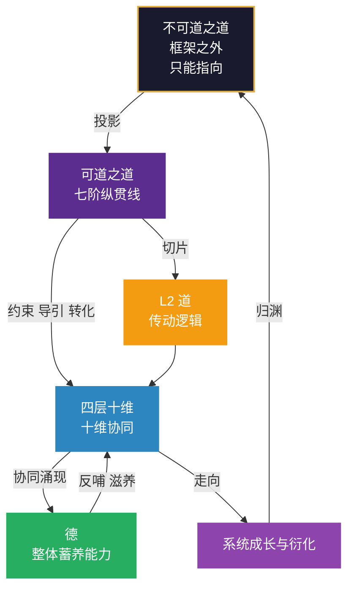

# 附录H：道德论速查图（三轴增补版）

> 本附录是第15章“整体德之五级”、第19章“道之三层”、第20章“道与德”的速查版，供讲评现场直接取用。
> 与正文冲突时，以正文为准。
>
> **本速查图与三轴的对应**：
> - **空间轴**：道之三层中的“L2道”是空间轴的一个维度；德不在空间轴的任何一个格子里，它在格子之间
> - **动力轴**：德之循环（纳→蓄→养→成→归）与三循环直接对应——正大周天是德的“纳”与“蓄”，反大周天是德的“养”与“成”，小周天是德的“归”
> - **时间轴**：德之五级是时间轴的“整体刻度”（第15章），道之三层是“框架的边界”（第19章），道与德是“框架的整体”（第20章）
> - **框架边界**：道之三层是框架的“封顶”——框架有边界，道无边界，知道框架的边界，才是真正的“知止”

## H.1 一图看懂：三层道与德的位置

**图里必须读出的三件事**：

1. **道在上，德在下——但这是一个循环，不是一条阶梯。** 图上有一条从 F 回到 A 的线（归渊）。系统成长到最后会回到源头——这是“不器”在整体层面的说法。
2. **德不在十维里面，也不在十维外面，它在“协同”这个动作上。** D → E 是“协同涌现”，E → D 是“反哺滋养”。德是十维自己长出来的，又回头养十维。
3. **道和德都只有一条边连到熵或十维，但那条边是全图最粗的。** 道对熵（约束、导引、转化），德对十维（反哺、滋养）。一条管动力能不能定向，一条管动力用完能不能补上。

## H.2 道之三层：一句话对照

| 层 | 一句话 | 能否被框架描述 | 位置 | 对应三轴 |
|---|---|---|---|---|
| **不可道之道** | 与德同层的终极之道，不可道、不可名 | 不能，只能指向 | 框架之外、之上 | 三轴之外 |
| **可道之道** | 贯穿系统全生命周期的路径与脉络（七阶） | 可指向，不可完全描述 | 贯穿 L1–L4 | 时间轴（宏观七阶） |
| **L2 道** | 系统结构层面的传动逻辑（以枢为核心） | 可以，已被完整描述 | L2 系统框架中的一维 | 空间轴（L2维度） |

**边界三条**：

1. **L2 道是可道之道的切片，不是替代。** 第6章不用改一个字。
2. **框架有边界，道无边界。** 知道框架的边界，才是真正的“知止”。
3. **遇到“为什么”的终极追问，停手。** 把问题往下拉一层，回到框架之内。

**三层与七阶的对应**：

| 道之三层 | 七阶对应 | 说明 |
|:---|:---|:---|
| **不可道之道** | 七阶之外 | 七阶是可道之道的展开，不可道之道不在七阶之内 |
| **可道之道** | 构建→调适→完善→稳固→诊断→进化→衍化 | 七阶是可道之道的“时间切片”——每一阶都是可道之道在系统生命周期上的一个截面 |
| **L2 道** | 每一阶中的“道在做什么” | 七阶表中“道在做什么”一列（生成路径/调整路径/精进路径/稳定路径/诊断路径/跃升路径/衍化路径），就是L2道在七阶中的七种角色 |

## H.3 可道之道：七阶速查

| 阶段 | 核心任务 | 道在做什么 | 退出条件 | 对应三循环 | 对应三轴 |
|---|---|---|---|---|---|
| **构建** | 从无到有 | 生成路径（道枢启动） | 能持续产出最小结构，不依赖外部输血 | 正大周天（搭链） | 时间轴+动力轴 |
| **调适** | 反馈校正 | 调整路径（果→道） | 偏离已归因到方向层面，且方向已修正 | 反大周天（修正） | 时间轴+动力轴 |
| **完善** | 结构优化 | 精进路径（道→术器行） | 结构在无人盯着的情况下连续三个月产出正常 | 正大周天+小周天 | 时间轴+动力轴 |
| **稳固** | 规则固化 | 稳定路径（道→法） | 规则被持续遵守，产出稳定可预期 | 正大周天（固链） | 时间轴+动力轴 |
| **诊断** | 堵塞识别 | 诊断路径（果→道） | 堵点已定位，结构性问题已诊断清楚 | 反大周天+小周天 | 时间轴+动力轴 |
| **进化** | 相变跃迁 | 跃升路径（道→理念心） | 新模式已稳定运行，不再需要刻意维持 | 反大周天（逐级回流） | 时间轴+动力轴 |
| **衍化** | 自组织涌现 | 衍化路径（道→不器） | 系统自己能长出新的业务线/能力 | 正大周天（忘链） | 时间轴+动力轴 |

**进退判据**：结构未理顺前不进「稳固」；某一段路的假设整体换了，退回「构建」重走。

**七阶与三循环的对应**：七阶告诉你“现在该做什么”，三循环告诉你“具体怎么做”。在错的阶段做对的事，等于做错事。

## H.4 德之五级：逐级速查

| 层次 | 刻度 | 一句话 | 怎么认 | 诊断问题 | 对应三循环 |
|---|---|---|---|---|---|
| **无德** | 无 | 靠外部输血 | 抽掉关键人物就停 | 有没有至少一条不依赖特定个人的产出路径？ | 正大周天（搭链）+小周天（补缺） |
| **下德** | 有 | 能蓄养但有执 | 要靠意志维持 | 蓄养是否依赖动员？换个人是否就做不了？ | 正大周天+小周天（从依赖人变成依赖结构） |
| **常德** | 定 | 蓄养成常规功能 | 不需动员，它自己就在做 | 换个人也能跑吗？压力来了散不散？ | 正大周天（固链） |
| **上德** | 合 | 内外贯通不需刻意 | 说不清怎么做到的，因为它不靠做法 | 新成员进来能否自然接上？ | 不做什么（减少动作） |
| **玄德** | 衍 | 自组织、自涌现 | “谁在做”已不重要 | 旧方法废了，新方法是否自己冒出来？ | 撤手（让系统自己长） |

**经典依据**：无德／下德／上德出《道德经》第38章，常德出第28章，玄德出第10、51、65章。

**关键限定**：**德不能拿来自评**——“上德不德，是以有德”，一旦把德当成可自评的指标，当场从“上德”掉回“下德”。

**德之五级的正确用法**：

| 用法 | 说明 | 对应三轴 |
|:---|:---|:---|
| **用它看系统，不用它看自己** | 最好的用法是诊断一个你身在其中、但你说不上话的系统 | 时间轴（整体刻度） |
| **用它找那一级的具体动作** | 无德→建最小结构；下德→把依赖人变成依赖结构；常德→打通内外；上德→不做什么；玄德→撤手 | 时间轴+动力轴 |
| **用它判断该不该“发力”** | 在上德时加考核，会打回常德甚至下德 | 时间轴 |

**德与叶的对应**：

| 叶的动作 | 德的层次 | 刻度位置 | 对应三循环 |
|:---|:---|:---|:---|
| 纳 | 下德 | 有 | 正大周天（果→理→念→心） |
| 蓄 | 常德 | 定 | 正大周天（道→熵→法→术→器→行） |
| 养 | 上德 | 合 | 正大周天（行→果→各维度反哺） |
| 成 | 玄德 | 衍 | 正大周天（完成一轮产出） |
| **归** | **不器（归渊）** | **不是一级，是“衍”的回环** | 反大周天（果→理→重走） |

## H.5 德之三境与不器

### H.5.1 德之三境

| 境界 | 区间 | 核心命题 | 《道德经》对应 | 对应三循环 |
|:---|:---|:---|:---|:---|
| **立基** | 有→定 | 让蓄养能力立得住 | 「早服谓之重积德；重积德则无不克」（第59章） | 正大周天（固链） |
| **贯通** | 定→合 | 让蓄养能力通内外 | 「含德之厚，比于赤子」（第55章） | 反大周天+小周天 |
| **自衍** | 合→衍 | 让蓄养能力自生长 | 「生而不有，为而不恃，长而不宰，是谓玄德」（第10章） | 正大周天（忘链） |

### H.5.2 德之不器

| 不器 | 表述 | 含义 |
|---|---|---|
| **消极自由** | **不执于德** | 不把「我有德」当身份，不把蓄养当交易——不因为「我对系统有贡献」就要求回报 |
| **积极自由** | **德即自然** | 玄德不是「有德」，是德与系统合一，不再有一个「拥有者」站在德的外面 |

**不进十维口诀**：十维不器口诀仍是十句，德不是维度，另立表述。

**不器与三境的逻辑**：不器不是第四境，而是第三境（自衍）的自然结晶。当德达到“玄德”，它的不器状态就自然显现——“生而不有，为而不恃，长而不宰”。

## H.6 叶五动作：纳·蓄·养·成·归

| 动作 | 叶在做什么 | 德的对应 | 系统意义 | 对应刻度 | 对应三循环 |
|---|---|---|---|---|---|
| **纳** | 光合作用——吸入阳光、二氧化碳 | 从外界吸入负熵、信息、能量、资源 | 系统的**输入** | 下德 · 有 | 正大周天（果→理→念→心） |
| **蓄** | 把光合产物储存于叶肉，输送到茎干 | 把吸纳的生机转化为系统可用的储备 | 系统的**积累** | 常德 · 定 | 正大周天（道→熵→法→术→器→行） |
| **养** | 滋养整棵树——根、干、枝、花、果 | 把蓄养的成果反哺系统各维度 | 系统的**反哺** | 上德 · 合 | 正大周天（行→果→各维度反哺） |
| **成** | 叶落归根，化为养分 | 完成一个周期，成果归入系统 | 系统的**成果** | 玄德 · 衍 | 正大周天（完成一轮产出） |
| **归** | 化为泥土，进入下一轮 | 回到源头，携带经验进入新一轮 | 系统的**归渊** | 不器（非一级，是回环） | 反大周天（果→理→重走） |

**层级**：叶属元意境（渊·心·叶·莲·云），不属元框架。意象负责让你看见，结构负责让你判断。

**只讲“纳”的代价**：只讲“纳”，等于只讲呼吸里的“吸”。吸收能力再强，蓄不住、养不出、成不了、归不回，德就停在“下德”。

## H.7 道与德：五重对照

| 维度 | 道 | 德 |
|---|---|---|
| **定位** | 源 | 流 |
| **功能** | 路径与脉络 | 蓄养的能力 |
| **与熵的关系** | 约束、导引、转化 | 反哺、滋养 |
| **在框架中的位置** | 贯穿全生命周期 | 十维协同后涌现 |
| **最高形态** | 不可道之道 | 玄德 |
| **体用** | 体 | 用 |
| **对应三轴** | 空间轴（L2道）+ 时间轴（可道之道） | 时间轴（整体刻度） |

**经典依据**：
- 「道生之，德畜之」（第51章）——道负责“生”，德负责“畜”。
- 「孔德之容，惟道是从」（第21章）——德不自己定方向，德跟着道走。方向反复变，能力一定长不厚。
- 「失道而后德，失德而后仁，失仁而后义，失义而后礼」（第38章）——降级序列：你越强调什么，往往说明上一级已经丢了什么。

**体用**：道是体（脉络），德是用（生命力）。脉络断了，生命就死了；生命力没了，脉络就空了。

## H.8 降级序列：目标偏离病的分级诊断

| 当前在强调什么 | 可能说明上一级已丢 | 诊断动作 | 对应病态 | 对应三循环 |
|:---|:---|:---|:---|:---|
| 价值观/文化 | 道（方向） | 检查战略方向是否清晰、是否被相信 | 目标偏离病 | 反大周天（改判断） |
| 制度/流程 | 德（蓄养能力） | 检查价值观是否被内化、是否被践行 | 目标偏离病 | 反大周天（改判断） |
| 奖惩/考核 | 仁/义（信任与公正） | 检查制度是否被遵守、是否公正 | 目标偏离病 | 反大周天（改判断） |
| 口号/形式 | 礼（规则） | 检查规则是否有效、是否被绕过 | 目标偏离病 | 反大周天（改判断） |

**你越强调什么，往往说明上一级已经丢了什么。** 这是道与德关系最深层的一个诊断信号。

## H.9 德之循环与三循环的联动

### H.9.1 德的五步循环

| 德的循环 | 三循环对应 | 说明 | 对应七阶阶段 |
|:---|:---|:---|:---|
| **纳（下德·有）** | 正大周天（果→理→念→心） | 系统从外界吸入负熵，更新认知根基 | 构建→调适 |
| **蓄（常德·定）** | 正大周天（道→熵→法→术→器→行） | 系统把吸纳的生机转化为可用的储备 | 完善→稳固 |
| **养（上德·合）** | 正大周天（行→果→各维度反哺） | 系统把蓄养的成果反哺各维度 | 稳固→诊断 |
| **成（玄德·衍）** | 正大周天（完成一轮产出） | 系统完成一个周期，拿出成果 | 进化→衍化 |
| **归（不器·归渊）** | 反大周天（果→理→重走） | 系统回到源头，携带经验进入新一轮 | 衍化→新循环 |

**一句话总结**：德之循环是“整体代谢”，三循环是“维度运转”。德之循环告诉你“系统整体在怎么更新”，三循环告诉你“具体怎么转、怎么改、怎么通”。

### H.9.2 德之循环与新陈代谢的对应

| 德的循环 | 新陈代谢对应 | 说明 |
|:---|:---|:---|
| **纳** | 纳入生机（过滤生机以吸纳） | 从外界识别有价值的负熵，吸入系统 |
| **蓄** | 转化（把吸纳的生机转化为储备） | 把吸纳的负熵转化为系统可用的储备 |
| **养** | 反哺（把蓄养的成果反哺各维度） | 把蓄养的成果反哺系统各维度 |
| **成** | 产出（完成一轮产出） | 完成一个周期，拿出成果 |
| **归** | 排除废熵（识别废熵以排除） | 把废物排出，携带经验进入新一轮 |

## H.10 道之三层与三把尺子的联动

| 三把尺子 | 与道之三层的关联 | 诊断问题 |
|:---|:---|:---|
| **分维五境** | L2道是空间轴的一个维度，有其五境刻度（控道→合道→忘道） | L2道到了哪一级？ |
| **宏观七阶** | 可道之道贯穿七阶——七阶是可道之道的“时间切片” | 系统在七阶的哪个阶段？该阶段道在做什么？ |
| **德之五级** | 德是十维协同后涌现的整体蓄养能力，与道之三层不在同一层面 | 整体蓄养能力怎么样？ |

**关键区分**：道之三层是“框架的边界”，三把尺子是“系统内部的刻度”。框架边界告诉你“框架能说到哪一级”，三把尺子告诉你“系统到了哪一级”。**知道框架的边界，才知道三把尺子的“有效范围”。**

## H.11 常见误用对照

| 误用 | 症状 | 纠正 | 三轴关联 |
|---|---|---|---|
| 把德当第十一维 | 想给德排刻度、排口诀 | 德不是维度，它在格子之间 | 空间轴：德不在格子里 |
| 把整体五境当第二套标准 | 分维一套、整体一套，互不相通 | 同一把尺子（无有定合衍），只换刻度上的字 | 时间轴：同一根尺子量两种对象 |
| 用道之三层否定 L2 道 | 说「有了可道之道，L2 道就过时了」 | 投影与切片关系，L2 道不必改 | 空间轴：L2道仍是空间轴的一维 |
| 把「归」当成第五级 | 德之五级变六级 | 归是「衍」的回环，对应不器 | 时间轴：不器不是第四境 |
| 拿德自评自宣 | 越强调越掉级 | 德只能用来看系统，不能用来评自己 | 时间轴：德不能自评 |
| 只讲「纳」 | 学了很多，能力不长 | 补齐蓄、养、成、归 | 动力轴：新陈代谢要完整 |
| 在「上德」时加考核 | 一加管理就退级 | 后两级的动作是减，不是加 | 时间轴：上德→玄德靠减 |
| 混淆道之三层与七阶 | 把L2道当成全部道，或把可道之道当成L2道 | 分清层：L2道是横截面，可道之道是纵贯线，不可道之道是源头 | 框架边界：知止 |
| 把德之循环与三循环混为一谈 | 以为德之循环就是三循环 | 德之循环是“整体代谢”，三循环是“维度运转” | 动力轴：两者视角不同 |
| 道之三层与三把尺子脱节 | 只看三把尺子，不看框架边界 | 三把尺子量的是系统内部，框架边界告诉你“有效范围” | 框架边界：知止 |

## H.12 检查清单

使用道德论速查图后，请逐项确认：

**道之三层部分**
- [ ] L2道是可道之道的切片，不是替代——第6章不用改
- [ ] 可道之道贯穿七阶——七阶是可道之道的“时间切片”
- [ ] 不可道之道在框架之外——框架只能指向，不能描述
- [ ] 框架有边界，道无边界——知道框架的边界，才是真正的“知止”

**德之五级部分**
- [ ] 德不是品德，是蓄养能力——十维协同后涌现的整体状态
- [ ] 德有五级（无德→下德→常德→上德→玄德），对应五境的五个刻度
- [ ] 德有三境（立基→贯通→自衍），对应五级的质变节点
- [ ] 德有不器（不执于德→德即自然），不进口诀
- [ ] 德不能拿来自评——“上德不德，是以有德”

**叶五动作部分**
- [ ] 纳→蓄→养→成→归，对应德的四级加一个回环
- [ ] 归不是第五级，是“衍”的回环（不器·归渊）
- [ ] 只讲“纳”，等于只讲呼吸里的“吸”

**道与德部分**
- [ ] 道是源，德是流；道是体，德是用
- [ ] “道生之，德畜之”（第51章）定了分工
- [ ] “孔德之容，惟道是从”（第21章）定了从属
- [ ] “失道而后德”（第38章）给出降级序列

**三轴关联部分**
- [ ] 道之三层与三把尺子已联动——框架边界告诉你“有效范围”
- [ ] 德之循环与三循环已联动——德之循环是“整体代谢”，三循环是“维度运转”
- [ ] 降级序列与第17章目标偏离病已联动——降级序列是目标偏离病的分级诊断工具
- [ ] 德之五级与第16章三把尺子已联动——德之五级是时间轴的“整体刻度”

**框架边界部分**
- [ ] 知道框架有边界，道无边界
- [ ] 遇到“为什么”的终极追问，停手
- [ ] 知道框架的边界，才是真正的“知止”

> *框架有边界，道无边界。*
> *知道框架的边界，才是真正的「知止」。*
> *道是源，德是流；道是体，德是用。*
> *脉络断了，生命就死了；生命力没了，脉络就空了。*
> *两者合一，才是完整的系统。*

— **渊 云 不 器 · 循 环 无 端** —
