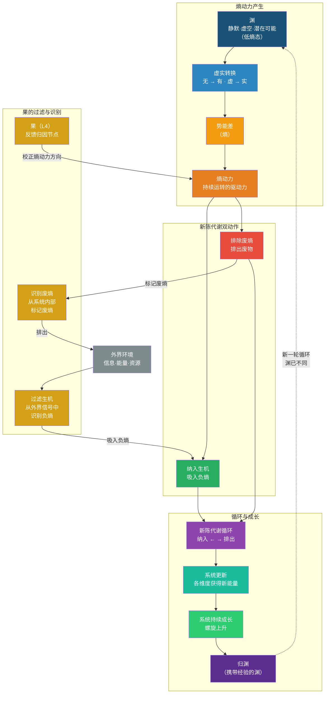

# 第10章 熵为源：系统动力与新陈代谢

> *“系统的动力，不在外部输入的能源本身，而在系统对能量释放过程中所产生的无序性的管理方式。”*
> ——作者手记

在第9章中，我们建立了维度间的相互作用矩阵，从静态视角分析了十个维度之间的增强、抑制、依赖关系。关系矩阵回答了“维度之间如何相互影响”的问题，但它尚未回答一个更深层的问题：**系统为什么会动？是什么力量驱动着维度之间的相互作用持续发生？**

如果说关系矩阵是系统的“解剖图”——展示各维度如何连接，那么本章要探讨的则是系统的“生理学”——展示系统如何获得并维持运转的动力。**系统动力与新陈代谢**，正是连接静态结构与动态行为的关键环节。

第6章已从维度层面阐述了“熵为源”的理论内涵——熵是系统内部无序度、压力差、失衡状态的总和，是系统演化的内在动力；熵的三境是识熵→控熵→熵控。本章在此基础上，进一步展开三个层面的分析：第一，熵作为系统动力的深层机制（10.1）；第二，熵控的结构框架——约束为基，疏导、转化、应用为用（10.2）；第三，**新陈代谢循环——纳入生机与排除废熵**（10.3）；第四，三种内部能量疏导方案（10.4）；第五，熵控机制的跨领域应用（10.5）；第六，能量循环与耗散结构（10.6）。六节逐层递进，从“为什么动”到“如何构架”再到“如何更新”，构成系统动力分析的完整路径。

> **【本章与三轴的关联】** 本章是动力轴的核心章节——它回答“动力从哪里来”。
>
> - **与空间轴的关联**：熵是L2系统框架中的一个维度（第6章已定位），但它的动力作用贯穿全轴。第9章的关系矩阵中，“熵→法（+S）”和“理→熵（+S）”等关系，本质上都是熵作为动力源在维度间的作用。
> - **与时间轴的关联**：熵的三境（识熵→控熵→熵控）是时间轴分维五境在熵这一维上的具体化。第14章将说明：熵的成熟度从“识熵”到“熵控”，正是从“有”到“衍”的跃迁。
> - **与第12章三循环的关联**：正大周天的“以道控熵”环节依赖于熵控结构；反大周天的“熵随道控”环节依赖于熵控结构的更新；小周天的堵点可能出现在熵控结构的任何环节。**三循环是熵控结构的运转形态，熵控结构是三循环的动力基础。**

## 10.1 能源≠动力：一个根本性的区分

### 10.1.1 能源≠动力

在理解系统动力之前，必须首先厘清一个经常被混淆的根本区分：**能源（energy source）与动力（driving force）不是同一回事。**

“能源”是系统从外部获取的、用于做功的原始输入——煤是发电厂的能源，食物是人体代谢的能源，资金是交易系统的能源。没有能源，系统无法启动。

“动力”则是系统能够**持续运转**的驱动力来源——它不来自外部输入本身，而来自系统对能源释放过程中所产生的**无序性（熵）的管理方式**。

这一区分的核心在于：能源可以被消耗完，但动力的来源在于系统如何持续地管理熵增。一吨煤如果只是在空气中燃烧，它会产生一次性的能量释放（爆炸），但不会驱动一个发电系统持续运转。要让煤“驱动”一个发电系统，需要有磁场的约束将等离子体控制在反应区域内，有管道将高温高压的气体疏导至汽轮机，有热交换系统将热能转化为机械能，有冷却循环将余热排出——这一整套“熵控结构”，才是系统持续运转的动力来源。

**能源提供“可能的功”，熵控结构决定“实际的功”。**

> **【与第6章的衔接】** 第6章已从维度层面对“熵为源”进行了理论阐述——熵是系统内部无序度、压力差、失衡状态的总和，是系统演化的内在动力。本章在此基础上，进一步展开熵控机制的具体结构和跨领域应用。如果说第6章回答了“熵是什么、为什么是动力源”，本章回答的是“熵控机制如何建构、如何在各类系统中发挥作用”。第6章的熵之三境——识熵、控熵、熵控——构成本章论述的框架基础：识熵是感知与识别（10.1、10.6），控熵是熵控结构的建立与运行（10.2），熵控是系统层面的能量循环与涌现（10.3、10.4、10.5、10.6）。

### 10.1.2 熵增作为“压力差”

系统的动力来源于**压力差**——正如电流源于电压差，水流源于水位差，系统的运转源于系统内部的压力差。

熵增正是这种压力差的直接来源。当系统内部出现无序度的增加、能量的耗散、结构的失衡时，就产生了“有序”与“无序”之间的压力差。系统为了维持自身的有序状态，必须做功——这种做功的过程，就是系统运转的动力来源。

这一机制在三个层面同时发挥作用：

在**物理层面**，熵增表现为能量从集中走向分散、从有序走向无序。系统通过熵控结构，将这种能量释放过程从“无序爆炸”转化为“有序做功”。

在**信息层面**，熵增表现为信息的混乱和不确定性增加。系统通过反馈和校正，将不确定性转化为可识别的信号，从而驱动决策和行动。

在**组织层面**，熵增表现为流程的冗余、资源的闲置、目标的偏离。系统通过规则和纪律，将这些混乱转化为改进的压力和变革的动力。

### 10.1.3 动力与熵控的关系

动力与熵控的关系可以用一个简单的类比来理解：

**能源是“燃料”，熵控是“发动机”。** 燃料提供了能量，但发动机的结构决定了燃料的能量能否被持续、有序地转化为有用的功。没有发动机的燃料只能产生一次爆炸；有了发动机，燃料的能量才能被持续地转化为运动。

同样，系统中的能源输入提供了“可能的功”，但系统能否持续运转，取决于它是否拥有有效的熵控结构——以**约束**为始终在场的结构基底，以**疏导**、**转化**、**应用**为在约束框架内发生的三重操作。熵控结构越完善，系统从能源中提取“持续动力”的能力就越强。

从熵之三境的视角来看：**识熵**是识别燃料燃烧过程中产生了多少无序能量（熵增）；**控熵**是通过发动机的结构设计——约束、疏导、转化、应用——将无序能量有序化为持续的做功；**熵控**则是发动机的结构已经内化为系统的一部分，能量转化与应用成为系统的本能运转。

> **【动力与三循环的关联】** 正大周天的第五环是“以道控熵”——道（传动结构）决定了熵（压力）在系统中的通道宽窄与去处。这正是本章熵控结构在链条上的表述：约束为基，疏导、转化、应用为用。**没有熵控结构，正大周天的“以道控熵”环节就是空的——压力无处可去，传动无法持续。**

## 10.2 熵控的结构框架：约束为基，三重操作为用

### 10.2.1 约束：始终在场的结构基底

约束是熵控的**结构基底**——它不是四步流程中的“第一步”，而是在疏导、转化、应用的全过程中始终在场的结构性力量。如果把熵控比作一座水电站，约束就是大坝本身——大坝从蓄水到发电到泄洪的整个过程中始终在场，而非只在最初发挥作用。

约束在系统中同时发挥三重功能，这三重功能在同一时刻并行存在：

| 约束功能 | 作用时刻 | 操作表现 | 可控核聚变类比 |
|:---|:---|:---|:---|
| **边界约束** | 起始 | 设定阈值、划定范围，将熵增纳入可控边界，防止无序扩散 | 约束磁场使等离子体成形，不散逸 |
| **通道约束** | 全流程 | 限宽、限速、限流，使能量在经脉中有序流动 | 约束磁场控制等离子体的流动路径与形态 |
| **底线约束** | 风险管理 | 作为系统的最后一道防线，防止熵增超出系统承受极限导致崩溃 | 约束磁场边界一旦破损即自动停机 |

**这三个功能同时存在，而非先后发生。** 这就是为什么“约束”不能被视为一个“步骤”。

边界约束使熵的转化成为可能——没有约束，能量只会无序释放，无法做功；通道约束使能量的流动受到控制——没有持续的限宽限速，能量会在释放过程中失控；底线约束使系统的安全得以保障——即使前两道防线失效，系统仍有最后一道屏障防止崩溃。

**约束的三个功能并行存在，贯穿熵控的始终。**

在四层十维框架中，约束的实现依赖于多个维度的协同：法维度提供规则的约束，器维度提供物理或技术的约束，行维度提供纪律的约束，心维度提供文化的约束。约束从来不是一个孤立的机制，而是多个维度共同作用的结构性条件。

### 10.2.2 在约束框架下的三重操作

在约束作为结构基底的前提下，熵控的三重操作——疏导、转化、应用——在约束的框架内有序运行。

**第一重：疏导（Channeling）**

疏导是在约束边界内，对熵增进行分门别类和有序导引的过程。它的核心功能是“变堵为疏”——让熵的能量有路可走，有方向可去。

疏导包含两个相互关联的环节：

- **分门别类**：识别熵增的类型（技术债、流程熵、沟通熵、市场压力等），将不同类型的熵源分别归入各自的处理通道。削解（对熵的消减处理）是分流中的备用手法，而非主流操作——仅在熵增强度超出系统疏导能力时，才作为局部应急措施使用。正如大禹治水，以疏导为主，削解只是在极极端情况下的备用手段。
- **有序导引**：为每一类熵增设计最合适的释放路径，引导其流向能够做功的方向。导引的核心原则是“因势利导”——利用熵增本身的压力差，将其引向系统需要做功的方向。逆势而为的引导，不仅不能解决问题，还会消耗额外的能量。

在技术系统中，疏导体现为错误处理机制、异常流程、降级方案、技术债务的分类管理通道；在组织系统中，疏导体现为投诉渠道、建议机制、冲突调解流程、员工压力的分层释放机制；在社会系统中，疏导体现为民意表达渠道、司法救济途径、社会对话机制。

**第二重：转化（Conversion）**

转化是在约束边界内，将熵增的压力从“无序破坏力”转变为“有序推动力”的过程。它的核心功能是“化废为宝”——将压力的能量转化为推动系统前进的动力。

转化的关键机制是“重新定义”：将“问题”重新定义为“机会”，将“故障”重新定义为“反馈”，将“危机”重新定义为“转折点”。当系统能够重新定义熵增的意义时，熵就不再是负担，而是资源。

在技术系统中，技术债务的压力可以被转化为重构的动力，系统复杂度的熵增可以倒逼架构升级；在组织系统中，客户投诉可以被转化为产品改进的输入，员工流失的压力可以倒逼管理优化；在社会系统中，社会矛盾可以推动制度改革，环境压力可以催生技术创新。

转化是熵控从“被动应对”走向“主动驾驭”的关键跃迁——它要求系统具备双环学习的能力（第8章），即不仅调整行为，还重新审视行为的规则和意义。

**第三重：应用（Application）**

应用是在约束边界内，将转化后的熵能持续地注入系统的运转之中，利用其绵绵不绝、用之不勤的特性，推动系统的持续运行、进化、涌现与衍化。

应用是熵控的“输出端”——它使熵能不再是“被处理掉的废物”，而是“被利用的资源”。应用的关键在于建立持续的能量循环：熵增不断产生，系统不断转化，能量不断注入，系统不断运行。

在技术系统中，应用体现为将系统故障压力转化为持续改进的驱动力，每次事故都成为系统健壮性提升的契机；在组织系统中，应用体现为将市场竞争压力转化为持续创新的动力，危机成为组织进化的催化剂；在社会系统中，应用体现为将社会矛盾压力转化为制度演进的长效动力，使社会在变革中不断自我更新。

**【约束与三重操作的协同】**

约束与疏导、转化、应用的关系，不是先后的序列，而是**框架与内容、基底与操作的关系**：

- 没有约束，疏导就没有通道可依——能量会在无序中散逸
- 没有约束，转化就没有边界可凭——压力无法被集中利用
- 没有约束，应用就没有节奏可控——能量释放会时快时慢，系统无法稳定运行

反过来，疏导为转化提供有序的能量流，转化为应用提供可用的动力源，应用为约束提供反馈——能量释放的效果会反馈回来，提示约束的边界是否合理、通道的容量是否适当、底线的位置是否准确。

**四者形成一个动态协同的整体：约束设框架，疏导分类导引，转化变废为宝，应用永续驱动。**

### 10.2.3 熵控结构的经脉支撑

熵控的三重操作（疏导、转化、应用）在实际运行中，依赖于第11章所阐述的**经脉**系统作为能量流动的载体：

- **疏导**依赖经脉提供具体的能量释放通道——不同的熵增类型需要被导入不同的经脉路径
- **转化**依赖经脉将转化后的能量输送到需要做功的节点——转化发生在经脉的特定节点上
- **应用**依赖经脉将熵能持续注入系统的运转之中——经脉是能量循环的实际路径

经脉是熵控结构得以落地的“物质载体”。没有经脉，熵控只是理论框架；有了经脉，熵控才能在实际系统中运行。

> **【熵控结构与第11章经脉的关联】** 第11章将说明：经脉是维度关系被反复激活后形成的“习惯性通道”（实然轨迹）。而熵控结构中的疏导、转化、应用，本质上就是能量在这些经脉通道中的有序流动。**熵控结构是“设计”，经脉是“实况”——设计再好，如果经脉堵塞，熵控结构也无法运转。** 第11章将专门讨论经脉堵塞的诊断与疏通——那是熵控结构失效的“物理表现”。

### 10.2.4 熵控的三境界

熵控的成熟度可以划分为三个递进的境界，与第6章中熵的三境界（识熵→控熵→熵控）一一对应：

| **熵的境界** | **熵控的重点** | **核心状态** |
|--------------|----------------|--------------|
| **识熵** | 识别熵增信号 | 监测、感知、预警——知道熵在哪里 |
| **控熵** | 建立并运行熵控结构 | 约束为基，疏导、转化、应用三重操作有序运行——主动驾驭熵 |
| **熵控** | 熵成为系统的永续引擎 | 能量自循环、自组织、涌现、衍化——熵与系统共舞 |

识熵是熵控的前提——不知道熵在哪里，就无法建立熵控结构。控熵是熵控的核心——通过约束、疏导、转化、应用的结构化运作，将熵的压力从“无序破坏力”逐步升维为“有序推动力”再升维为“永续驱动力”。熵控是熵控的升华——系统已经建立起以熵为引擎的自循环生态，熵从“需要管理的对象”变为“系统生命力的自然表达”，推动系统进入涌现与衍化之境。

> **【熵控三境与第14章五境的关联】** 第14章将说明分维五境的“无→有→定→合→衍”。熵的三境与五境的对应关系是：**识熵**对应从“有”向“定”过渡的阶段——系统能感知熵增信号，但尚未建立系统性管理；**控熵**对应“定”境——熵控结构可量化、可验证、可复现；**熵控**对应“合”境向“衍”境的跃迁——熵不再需要刻意“控”，它自己就在运转。

## 10.3 新陈代谢：纳入生机与排除废熵

### 10.3.1 核心翻转：动力不是让系统“空转”

熵控结构回答了“动力如何被管理”的问题，但还有一个更根本的问题没有被充分回答：**熵产生的动力，究竟被用来做什么？**

如果熵只是“让系统动起来”，那么系统可能在原地空转。一个持续空转的系统，即使一直在动，也会在循环中逐渐耗散：没有新信息输入，认知停滞（理退化）；没有新能量输入，执行疲软（行松散）；没有排出废物，内部堵塞（经脉堵）；没有淘汰过时规则，制度僵化（法固化）。

真正的系统不应该只是“动”，而应该“动得有方向、动得有意义”——即通过运动实现**自我更新**。

这个“自我更新”的机制，就是**新陈代谢循环**：**纳入生机**（从外界吸入负熵）与**排除废熵**（将内部废物排出）。两者合在一起，构成系统的新陈代谢——如同人体的呼吸、消化与排泄，旧的排出，新的纳入，系统在循环中不断更新，获得持续成长的源泉。

> **【增补一的核心贡献】** 增补一将“熵为源”从“让系统动起来”升级为“让系统动起来并且动得有方向、有意义”。原定义正确，但存在一个未被充分阐述的环节：熵产生的动力用于做什么？增补一补上了这个环节——**熵动力驱动系统完成“纳入生机”与“排除废熵”两个关键动作，形成新陈代谢循环。** 这不是对原定义的修改，而是对其的深化与精确定位。

### 10.3.2 新陈代谢循环的完整流程

这个循环的关键节点是**果**。果不仅是验证和驱动改进的枢纽，更是新陈代谢的“质检站”：它从外界信号中**过滤生机**（识别什么是有价值的负熵，值得吸纳），从系统内部**识别废熵**（标记什么已经变成了废物，需要排除）。没有果的过滤与识别，新陈代谢循环就会“盲进盲出”——该进的进不来，该出的出不去。

### 10.3.3 纳入生机：吸入负熵

| 维度 | 吸入的“负熵”类型 | 作用 |
|:---|:---|:---|
| 理 | 新知识、新模型、新认知 | 更新判断依据 |
| 念 | 新愿景、新意义、新方向 | 校准价值导向 |
| 心 | 新信任、新关系、新安全感 | 增强心理资本 |
| 道 | 新流程、新路径、新连接 | 优化传动结构 |
| 法 | 新规则、新制度、新标准 | 更新运行规则 |
| 术 | 新方法、新技能、新操作 | 提升执行效率 |
| 器 | 新工具、新技术、新平台 | 增强承载能力 |
| 行 | 新习惯、新节奏、新纪律 | 强化执行保障 |

**纳入生机不是“什么都吸”。** 它需要果的过滤功能——从外界信号中识别什么是有序的、有价值的负熵。一个没有过滤功能的系统，会不加区分地吸纳一切（信息过载、资源浪费、方向分散）；一个过滤功能过强的系统，会拒绝一切外部输入（封闭、僵化、失去活力）。**健康的纳入，是“有选择的开放”。**

### 10.3.4 排除废熵：排出废物

| 维度 | 排出的“废熵”类型 | 作用 |
|:---|:---|:---|
| 理 | 过时知识、错误假设 | 腾出认知空间 |
| 念 | 过时目标、冲突价值观 | 凝聚方向共识 |
| 心 | 不信任、恐惧、焦虑 | 释放心理负担 |
| 道 | 堵塞路径、冗余环节 | 畅通传动网络 |
| 法 | 僵化规则、冲突制度 | 简化规则体系 |
| 术 | 过时方法、低效操作 | 精简操作流程 |
| 器 | 过时工具、故障设备 | 升级工具平台 |
| 行 | 坏习惯、无效节奏 | 重塑执行纪律 |

**排除废熵不是“什么都扔”。** 它需要果的识别功能——从系统内部标记什么已经变成了废物。一个没有识别功能的系统，会让废物持续堆积（规则臃肿、流程僵化、资源闲置）；一个识别功能过强的系统，会频繁“清仓”（过度精简、失去冗余、缺乏缓冲）。**健康的排除，是“有节奏的清理”。**

### 10.3.5 果作为新陈代谢的枢纽

第8章已说明果的四个功用：验证、驱动改进、过滤生机以吸纳、识别废熵以排除。在新陈代谢循环中，果的角色尤为关键：

| 新陈代谢环节 | 果的功能 | 对应维度 |
|:---|:---|:---|
| **纳入生机** | 过滤生机以吸纳——从外界识别负熵，吸入系统 | 果→理、果→念、果→心 |
| **排除废熵** | 识别废熵以排除——从内部标记废物，驱动排出 | 果→法、果→术、果→器、果→行 |
| **循环本身** | 果是循环的“质检站”和“枢纽节点” | 果→果（自反馈） |

**没有果的过滤与识别，新陈代谢循环就无法精准运行——该进的进不来，该出的出不去。** 系统就会从“持续更新”退化为“静态堆积”。这就是为什么第8章要将果的功用从“验证+驱动改进”扩展为“验证+驱动改进+过滤生机+识别废熵”——果不仅是系统的“质检站”，更是新陈代谢的“枢纽”。

### 10.3.6 新陈代谢循环与三循环的关联

新陈代谢循环与第12章的三循环有着直接的对应关系：

| 三循环 | 与新陈代谢的关系 |
|:---|:---|
| **正大周天（转）** | 正大周天的每一圈，都是一次新陈代谢——果回流到理（纳入生机），旧规则被淘汰（排除废熵），系统在循环中更新。**正大周天不是原地打转，而是螺旋上升的新陈代谢。** |
| **反大周天（改）** | 反大周天的启动条件之一是“果持续偏离且链内解释不了”——这正是新陈代谢循环中“废熵识别”的信号：系统内部已经积累了废物（过时的理），但尚未被排除。反大周天就是主动识别并排除这些废熵的过程。 |
| **小周天（通）** | 小周天打通的“堵点”，往往是新陈代谢循环中的“局部堵塞”——某个维度的废熵没有被及时排除，导致能量流动受阻。小周天集中力量打通这一段，让新陈代谢重新畅通。 |

**一句话总结**：新陈代谢循环是“熵为源”的深层机制，三循环是这一机制在十维框架中的运转形态。

### 10.3.7 新陈代谢循环与三把尺子的关联

| 三把尺子 | 与新陈代谢的关联 | 诊断问题 |
|:---|:---|:---|
| **分维五境** | 新陈代谢循环的运转，推动各维度从“有”到“定”到“合”到“衍” | 哪些维度的代谢最慢？ |
| **宏观七阶** | 不同阶段的新陈代谢重点不同（构建期重“纳”，稳固期重“蓄”，衍化期重“归”） | 系统的代谢节奏是否与阶段匹配？ |
| **德之五级** | 新陈代谢的完整运转，是德之五级从“下德”到“常德”到“上德”的基础 | 整体代谢能力处于哪一级？ |

## 10.4 内生为序——三种能量疏导方案

系统内部如何疏导熵增的能量？根据系统的结构特点和管理哲学，存在三种典型的疏导方案。它们并非互斥，可以在不同层次或不同模块中混合使用。无论采用哪种方案，约束作为结构基底都始终在场——区别在于约束的形态和分布方式。

### 10.4.1 方案一：分布式自疏导

**设计思想**：每个维度内部独立处理自身的熵增，同时维度之间通过“经脉”通道传递多余能量，形成分布式协同网络。

**约束形态**：各维度自设约束边界，约束是分散的、本地化的。

**适用场景**：松耦合系统、分布式团队、模块化架构。

**优点**：无中心瓶颈，鲁棒性强；各维度自主权高；符合“无为而治”思想。

**缺点**：需预先设计维度间的能量传导协议；可能出现“抢占”或“闲置”不均。

**典型案例**：开源社区中，各模块维护者独立处理本模块的技术债务，同时通过跨模块的API变更通知和协同重构来传递能量。没有中心调度者，但整体系统仍能保持有序演化。

### 10.4.2 方案二：统一调度中心

**设计思想**：设立一个全局“能量池”，所有维度产生的熵增统一转化为同一种能量类型，集中存储，再由调度中心按需分配。

**约束形态**：约束集中在调度中心层面，由中心统一设定全局边界和通道规则。

**适用场景**：强管控系统、资源有限场景、需要高可见性的系统。

**优点**：控制集中，易于管理；能量利用率高；便于监控和审计。

**缺点**：中心成为瓶颈，若瘫痪则系统失控；可能抑制维度自主性。

**典型案例**：企业资金池管理——各部门盈余统一归集到财务中心，再根据战略优先级统一分配。既保证了资金利用率，也便于高层掌握全局。

### 10.4.3 方案三：玄牝之门（源头能量池）

**设计思想**：在系统最底层构建一个“源泉”——一个持续产生负熵的“元能量池”（如组织的使命愿景、技术的核心基座）。能量从源头流出，沿经脉分配给各维度，消耗后产生的熵增再回流到源头进行再生。

**约束形态**：约束内化于源头的设计之中——源头的结构和规则本身就构成了对所有分支的约束框架。

**适用场景**：高可靠性系统、长期进化的系统、需要高度自洽的系统。

**优点**：接近自然生态系统，高度可持续；能量自循环，对外依赖低；适应性强。

**缺点**：设计复杂，需深刻理解系统本质；源头若被污染则全系统崩溃。

**典型案例**：一个组织的使命愿景——它不直接产生业务成果，但为所有部门提供方向感和凝聚力。各部门在执行中产生的反馈（熵增）回流到愿景层面，经过“转化”再生成新的战略方向，形成能量的自循环。

> **【三种疏导方案与新陈代谢的关联】** 三种疏导方案本质上都是新陈代谢循环的不同实现形态：分布式自疏导是“各细胞各自进行代谢”，统一调度中心是“集中代谢”，玄牝之门是“以源头为核心的循环代谢”。无论哪种方案，核心机制都是相同的——**纳入生机、排除废熵、系统更新**。

### 10.4.4 三种方案的对比与选择

| 对比维度 | 分布式自疏导 | 统一调度中心 | 玄牝之门 |
|:---|:---|:---|:---|
| **约束位置** | 分散在各维度 | 集中在调度中心 | 内化于源头 |
| **能量流向** | 多维互动 | 中心汇聚→中心分配 | 源头流出→各维度→回流源头 |
| **适用系统** | 松耦合、模块化 | 强管控、资源有限 | 高可靠性、长期进化 |
| **优点** | 鲁棒性强、自主权高 | 控制集中、利用率高 | 可持续、自循环 |
| **缺点** | 需协议、可能不均 | 中心瓶颈、抑制自主 | 设计复杂、源头风险 |
| **三循环关联** | 小周天（局部自主） | 反大周天（中心修正） | 正大周天（源头驱动） |

## 10.5 跨域为证——熵控的跨领域应用

熵控结构（约束为基，疏导、转化、应用为用）在新陈代谢循环的框架下，在不同类型的系统中表现出统一的逻辑。以下从三个领域简要展示这一统一性。

### 10.5.1 技术系统：软件架构中的熵控

在软件系统中，熵表现为技术债务的累积、代码腐化的加速、系统复杂度的失控。软件架构的熵控结构包括：

- **约束（基底）**：编码规范、架构边界、API契约、测试覆盖率要求——始终在场的结构条件，从项目启动到系统退役全程有效
- **疏导**：技术债务的分类管理通道（架构债进入重构通道、代码债进入优化通道、测试债进入补充通道），将不同类型的债务导入不同的处理流程
- **转化**：将技术债务的压力转化为重构的动力，将系统复杂度的熵增倒逼为架构升级的契机
- **应用**：将每次故障、每次债务处理的经验转化为系统健壮性提升的持续驱动力，推动系统架构的持续进化

**新陈代谢循环**：果（监控数据、故障报告）过滤出值得吸纳的新技术（纳入生机），识别出需要重构的旧模块（识别废熵），推动系统在“重构—升级—再重构”中持续更新。

### 10.5.2 组织系统：企业管理中的熵控

在组织系统中，熵表现为流程混乱、沟通不畅、资源闲置、目标偏离。组织管理的熵控结构包括：

- **约束（基底）**：预算限制、职责边界、合规要求、绩效考核标准——始终在场的制度框架，为所有管理活动提供结构条件
- **疏导**：沟通渠道、建议机制、冲突调解流程、资源再分配——将不同类型的组织熵导入不同的处理通道
- **转化**：将客户投诉转化为产品改进的输入，将员工流失压力倒逼管理优化，将危机转化为变革的动力
- **应用**：将市场竞争压力转化为持续创新的驱动力，使每次危机都成为组织进化的催化剂

**新陈代谢循环**：果（绩效数据、员工反馈）过滤出值得吸纳的新人才、新方法（纳入生机），识别出需要淘汰的旧流程、旧规则（识别废熵），推动组织在“招聘—培养—淘汰”中持续更新。

### 10.5.3 生物系统：人体代谢中的熵控

在人体系统中，熵表现为代谢紊乱、能量失衡、细胞老化。人体代谢的熵控结构包括：

- **约束（基底）**：胰岛素控制血糖、肝脏解毒、胃黏膜保护——始终在场的生化边界，维持内环境稳定
- **疏导**：血液循环、淋巴系统、不同代谢通路——将不同类型的营养物质和能量导入各自的代谢通道
- **转化**：新陈代谢——将食物能量转化为生命活动所需的化学能，将老化的细胞降解并生成新细胞
- **应用**：将代谢产生的能量持续用于维持体温、运动、思考、免疫等生命活动，推动生命的持续运转

**新陈代谢循环**：人体本身就是新陈代谢循环的典型——纳入氧气和食物（纳入生机），排出二氧化碳和废物（排除废熵），细胞在循环中不断更新。

### 10.5.4 三个领域的统一逻辑

这三个领域的熵控结构，虽然在具体形式上差异巨大，但其逻辑高度一致：**约束始终在场设定框架，在框架内疏导有序释放、转化变废为宝、应用永续驱动。** 这正是“识熵→控熵→熵控”三境在操作层面的完整映射。

| 熵控环节 | 技术系统 | 组织系统 | 生物系统 |
|:---|:---|:---|:---|
| **约束** | 编码规范、架构边界 | 预算、职责、合规 | 胰岛素、肝脏、胃黏膜 |
| **疏导** | 技术债务分类管理 | 沟通渠道、冲突调解 | 血液循环、淋巴系统 |
| **转化** | 债务压力→重构动力 | 客户投诉→改进输入 | 食物→化学能 |
| **应用** | 故障经验→架构进化 | 竞争压力→持续创新 | 代谢能量→生命活动 |
| **纳入生机** | 新技术吸纳 | 新人才、新方法 | 氧气、食物 |
| **排除废熵** | 旧模块重构 | 旧流程淘汰 | 二氧化碳、废物 |

## 10.6 耗散为源——开放系统的能量循环

### 10.6.1 耗散结构的启示

普里高津的耗散结构理论揭示了一个深刻的洞见：**开放系统通过持续与外界交换能量，可以在远离平衡的状态下维持有序结构。**

这一洞见对系统动力分析的意义在于：系统不需要“消灭”熵增来维持有序，而是可以通过“管理”熵增来获得动力。系统通过与外界交换能量，将内部的熵增“输出”到外界（排出废物、释放热量），同时从外界“输入”负熵（能量、信息、资源），从而维持自身的低熵状态。

这正是熵之第三境“熵控”的深层机制——当系统建立起以约束为基底、以经脉为传动、以果为证为反馈路径的熵控结构时，熵增不再是需要被反复应对的“麻烦”，而是成为系统持续运转的永续引擎——约束将其纳入框架，疏导将其有序释放，转化将其变为动力，应用将其持续注入系统运转之中，推动系统的进化、涌现与衍化。

### 10.6.2 能量循环的三个环节

系统的能量循环包括三个相互连接的环节——它们与新陈代谢循环的“纳入生机—转化—排除废熵”直接对应：

| 能量循环环节 | 新陈代谢对应 | 说明 |
|:---|:---|:---|
| **输入** | 纳入生机 | 系统从外部环境获取能源（物质、能量、信息） |
| **转化** | 转化 | 系统通过熵控结构，将输入的能源转化为有用的功，同时产生熵增 |
| **输出** | 排除废熵 | 系统将熵增（废物、废热、无用信息）排出到外部环境 |

**没有输入，系统就是封闭系统，必然走向热寂；没有输出，系统内部的混乱度就会持续上升；没有转化，能源就只是能源，无法变成动力。**

### 10.6.3 能量循环与十维框架

能量循环的三个环节与四层十维框架有着清晰的对应关系：

| **能量循环环节** | **对应维度** | **说明** |
|-------------------|--------------|----------|
| 输入 | 器（工具平台）、术（操作方法） | 获取外部能源的手段 |
| 转化 | 道（传动枢纽）、熵（动力源）、法（运行规则） | 熵控结构的核心——以道为枢，以熵为源，以法为则 |
| 输出 | 果（结果度量） | 排出熵增、输出成果、提供反馈 |

这一对应关系表明：系统的能量循环不是孤立的“技术问题”，而是嵌入在整个框架结构中的系统性过程。任何一个环节的失效——输入不足、转化低效、输出堵塞——都会影响系统整体的动力表现。

从熵之三境的视角来看：**识熵**对应能量循环中的“输出环节”——识别熵增信号，感知系统正在排出什么、积压什么；**控熵**对应“转化环节”——通过约束、疏导、转化和应用的熵控结构，将输入能源在转化过程中产生的熵有序管理并转化为动力；**熵控**则对应整个能量循环的完整运行——输入→转化→输出形成自洽的循环，熵能持续做功，系统无需外部干预即可持续进化与涌现。

> **【能量循环与第12章三循环的关联】** 正大周天（果→理→念→心→道→熵→法→术→器→行→果）本质上就是能量循环在十维框架中的完整展开：果（输出）→理（认知输入）→念（方向输入）→心（心理输入）→道（传动转化）→熵（动力转化）→法（规则转化）→术（操作转化）→器（工具转化）→行（执行输出）→果（输出）。**正大周天不是一条线，是一个循环——和能量循环一样，首尾相连，循环无端。**

### 10.6.4 耗散结构视角下的三循环

| 三循环 | 耗散结构视角 | 说明 |
|:---|:---|:---|
| **正大周天（转）** | 能量循环的常态运转 | 输入（纳入生机）→转化→输出（排除废熵）→再输入，循环无端 |
| **反大周天（改）** | 能量循环的校准 | 当输入或转化环节出现偏差，系统通过修正认知来校准能量循环 |
| **小周天（通）** | 能量循环的局部疏通 | 当某一环节堵塞，系统集中力量打通，恢复能量循环的畅通 |

## 10.7 本章小结

本章从“系统动力与新陈代谢”的角度，深化了对四层十维框架中“熵为源”维度的理解。

**能源≠动力**。能源是外部输入，动力来自系统对能源释放过程中所产生的熵增的管理方式。熵增产生压力差，压力差驱动系统做功，做功的过程就是系统运转的动力来源。

**熵控的结构框架：约束为基，三重操作为用**。约束不是四步流程中的“第一步”，而是始终在场的结构基底——同时发挥边界约束（起始）、通道约束（全流程）、底线约束（风险管理）三重功能。在约束的框架内，疏导（分类导引）、转化（压力→动力）、应用（永续驱动）三重操作有序运行。四者形成动态协同的整体：约束设框架，疏导分类导引，转化变废为宝，应用永续驱动。

**新陈代谢循环：纳入生机与排除废熵**。熵产生的动力不是让系统“空转”，而是驱动系统完成两个关键动作——**纳入生机**（从外界吸入负熵）与**排除废熵**（将内部废物排出）。两者合在一起，构成系统的新陈代谢循环。**果**是新陈代谢的枢纽——它过滤生机以吸纳，识别废熵以排除。没有果的过滤与识别，新陈代谢循环就无法精准运行。

**三种内部疏导方案**——分布式自疏导（去中心化）、统一调度中心（中心化）、玄牝之门（源头驱动）——展示了约束作为结构基底在不同系统架构中的具体形态。

**熵控结构在技术系统、组织系统、生物系统中**表现出统一的结构逻辑——约束始终在场设定框架，在框架内疏导有序释放、转化变废为宝、应用永续驱动——这验证了熵控作为系统动力分析的通用框架的有效性，也体现了从“识熵”到“控熵”再到“熵控”的完整演进路径。

**耗散结构视角**揭示了开放系统通过能量循环维持低熵状态的机制：输入能源→内部转化→输出熵增。这一循环与四层十维框架中的多个维度形成清晰的对应关系，也是“熵控”第三境（以熵为永续引擎）得以实现的结构基础。

在下一章中，我们将进一步探讨熵控结构的具体实现路径——**经脉**。经脉是系统内部能量流动的“虚无通道”，是熵控结构（特别是疏导与应用）得以落地的物质载体。理解经脉的结构和功能，是将熵控从“理论框架”转化为“实际运行”的关键一步。

## 思考与练习

1. **能源与动力的区分**：选择一个你熟悉的系统（如一个企业、一个项目团队、一台机器），找出它的“能源”和“动力”分别是什么，并说明它们之间的区别。你能找到能源充足但系统动力不足的例子吗？原因是什么？

2. **约束的识别**：在你选择的系统中，约束的三种功能（边界约束、通道约束、底线约束）分别体现在哪里？是否存在某一重约束缺失的情况？

3. **熵控操作识别**：在你选择的系统中，分别找出“疏导”、“转化”和“应用”的具体例子。这三重操作是否在约束的框架下运行？系统的熵控目前处于识熵、控熵还是熵控的境界？

4. **新陈代谢诊断**：在你选择的系统中，果的“过滤生机”和“识别废熵”功能是否在运行？系统是否能够从外界识别有价值的负熵并吸纳？系统是否能够从内部识别废物并驱动排出？如果这两个功能缺失，系统的新陈代谢循环会怎样？

5. **疏导方案分析**：在你选择的系统中，目前采用的是三种疏导方案中的哪一种（或混合方案）？这种方案适合该系统吗？是否有切换方案的必要？

6. **能量循环诊断**：画出你选择的系统的能量循环图（纳入生机→转化→排除废熵），分析哪个环节目前最薄弱。这个薄弱环节对应四层十维框架中的哪个维度？如何改进？

7. **三循环预判**：回顾本章“新陈代谢循环与三循环的关联”。如果你选择的系统需要启动反大周天，它的“废熵识别”信号是什么？如果你选择的系统需要用小周天打通某个堵点，这个堵点最可能出现在新陈代谢循环的哪个环节？

8. **三把尺子预判**：回顾本章“新陈代谢循环与三把尺子的关联”。你选择的系统，当前处于分维五境的哪一级？宏观七阶的哪个阶段？德之五级的哪一级？这些时间定位如何影响你对新陈代谢循环的设计？

— **渊 云 不 器 · 循 环 无 端** —

