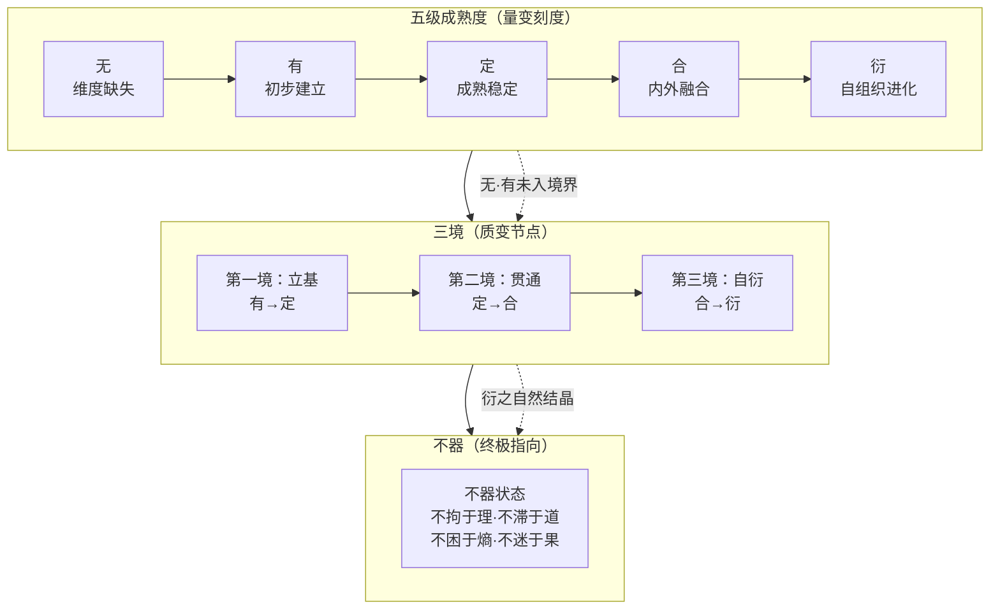

# 第12章 系统的演化与成熟度

**章首语：**

  ------------------------------------------------------------------------------------------------
  *系统不是静态的结构，而是动态的演化过程。理解系统当前所处的演化阶段，是预测其未来行为的前提。*
  ------作者手记
  ------------------------------------------------------------------------------------------------

  ------------------------------------------------------------------------------------------------

在第9章中，我们建立了维度间关系的静态分析工具——十维关系矩阵。在第10章中，我们揭示了系统动力的来源与熵控结构——约束为基，疏导、转化、应用为用。在第11章中，我们探讨了能量流动的通道——经脉的形成、功能与疏通。这三章共同构成了对系统运作机制的深入理解。

然而，理解系统如何“运作”还不够。系统不是静止不变的——它随着时间演化，从一个状态过渡到另一个状态，从一种成熟度发展到更高的成熟度。**系统的演化与成熟度**，是系统分析的另一个关键维度：它帮助分析者判断系统当前所处的发展阶段、识别系统进化的方向和路径、预测系统可能面临的转折点。

本章将完成三方面的分析：第一，系统演化的典型阶段（12.1）；第二，五级成熟度·三境·不器三位一体框架（12.2）；第三，境界跃迁的条件与机制（12.3-12.4）。这三个层次从“宏观阶段”到“评估标尺”再到“跃迁机制”，构成系统演化分析的完整框架。

## 12.1 系统演化阶段——从混沌到再分化的辩证螺旋

### 12.1.1 演化的基本路径

系统的演化遵循一个基本的辩证螺旋：**混沌→分化→整合→简化→再分化**。这一路径不是线性的，而是螺旋上升的——每一次循环都在更高的层次上重复，每一次“简化”都不是回到原点，而是对前一阶段复杂性的超越。

| **阶段** | **特征** | **核心任务** | **典型表现** |
|----------|----------|--------------|--------------|
| **混沌** | 无结构、无秩序、无明确边界 | 自发的秩序萌芽 | 新系统诞生初期的无序状态 |
| **分化** | 要素开始分工、功能开始专业化 | 建立初步的结构和规则 | 系统发展出子系统和专门化功能 |
| **整合** | 分化的要素重新协调、形成协同 | 建立维度间的有效关系 | 子系统之间的协调和整合 |
| **简化** | 去除冗余、精简结构、提升效率 | 删除不必要的复杂性和冗余 | 流程优化、架构精简、文化沉淀 |
| **再分化** | 在新的层次上再次分化 | 在更高成熟度上开启新一轮演化 | 系统升级后的新一轮专业化 |

### 12.1.2 混沌阶段：无序中的秩序萌芽

混沌不是“没有系统”，而是“系统的结构尚未显现”的状态。在这一阶段，要素之间存在相互作用，但作用的方式是随机的、不稳定的、不可预测的。

混沌阶段的核心特征是“涌现的潜力”——新的秩序可能从混沌中自发产生。正如普里高津所揭示的，远离平衡的开放系统可以通过微小的涨落跃迁到新的有序结构。混沌不是系统的终点，而是新秩序的起点。

在混沌阶段，分析者的任务不是“强加秩序”，而是“识别秩序萌芽”——发现那些可能发展成为有效结构的互动模式，并为其提供生长空间。

### 12.1.3 分化与整合：结构的建立与协调

分化是系统从混沌走向有序的第一步。在分化阶段，系统的要素开始承担不同的功能、发展出不同的特性、形成不同的子系统。分化是系统适应复杂环境的必要条件——没有分化，系统就无法处理多样化的任务和挑战。

但分化也带来了新的问题——分化的子系统可能发展出各自的利益、逻辑和节奏，导致系统的整体协调成本上升。这就是整合阶段的任务：在分化之后，建立子系统之间的协调机制，使它们在保持各自功能的同时，能够协同服务于系统的整体目标。

整合不是消除分化，而是在分化的基础上建立有效的连接。整合的成功标志是：子系统能够在保持自主性的同时，与整体系统保持一致的方向和节奏。

### 12.1.4 简化与再分化：超越复杂性

整合阶段往往伴随着系统复杂度的显著增加——更多的规则、更多的流程、更多的协调机制。这种复杂度的增加在短期内是必要的，但长期来看，它会成为系统进一步发展的障碍。

简化阶段的任务就是去除这种冗余的复杂性。简化不是“回到混沌”，而是“在理解的基础上做减法”——保留必要的结构，删除多余的部分。简化使系统重新获得灵活性和适应性，为下一轮分化创造条件。

再分化是在简化的基础上，在更高的层次上开启新一轮的分化。这是一个螺旋上升的过程——每一次循环都在更高的成熟度上重复，每一次“再分化”都产生比上一轮更精细、更有效的结构。

**【与“五级-三境-不器”框架的呼应】** 这一演化路径与本章后续展开的五级成熟度·三境·不器框架形成清晰的对应关系：混沌对应“无”，分化对应“有”，整合对应“定”，简化对应“合”，再分化对应“衍”。

## 12.2 五级成熟度·三境·不器：三位一体框架

### 12.2.1 框架的设计逻辑

四层十维中的任何一个维度，都可以从“未建立”到“自进化”划分为五个成熟度级别，并在这五个级别的基础上，聚合成三重境界，最终以“不器”作为该维度进化的终极指向。

五级成熟度提供**精细的刻度**——它回答“该维度现在处于什么水平”。

三境提供**质变节点**——它回答“该维度完成了哪些关键跃迁”。

不器提供**终极指向**——它回答“该维度进化的最终方向是什么”。

三者之间的关系是：**五级是量变的刻度，三境是质变的节点，不器是质变完成后自然结晶的终极状态。**

### 12.2.2 五级成熟度（量变刻度）

| 级别 | 名称 | 核心特征 | 状态描述 |
|------|------|----------|----------|
| Lv.1 | **无** | 维度缺失或完全混沌 | 尚未建立，没有考虑，没有做，没有融合。系统对该维度毫无意识。 |
| Lv.2 | **有** | 初步建立，但粗糙、不稳定、不理解 | 已经做了，已经建立了，但不理解其本质，不清楚其运作规律，不稳定，常常失效。只是“有了”而已。 |
| Lv.3 | **定** | 成熟稳定，可量化、可验证、可复现 | 已经构建出确定的框架、模式、方法、内容、制度，能够正常稳定地运行。有章可循，有据可依。 |
| Lv.4 | **合** | 归一统一，内外融合 | 该维度内部实现了合一、归一、统一（**内合**）；与其他维度实现了配合、整合、合一（**外合**）。内外贯通，运行无碍。 |
| Lv.5 | **衍** | 自组织、自涌现、自进化、自衍化 | 该维度已具备生命力，能够自我更新、自我迭代、自我涌现出新结构与新功能。无需外部干预。 |

**五级演进的核心逻辑**：

- **无 → 有**：从“什么都没有”到“有了”，是“从0到1”的质变
- **有 → 定**：从“有了但不稳定”到“稳定可控”，是“从1到100”的量变积累
- **定 → 合**：从“稳定但孤立”到“内外融合”，是“从局部到整体”的系统性跃升
- **合 → 衍**：从“融合贯通”到“自发生长”，是“从他组织到自组织”的生命力涌现

### 12.2.3 三境（质变节点）

五级成熟度进一步聚合成三重境界。**三境不是与五级并列的另一个维度，而是对五级演化路径的质变节点概括。**

**划分规则**：

| 境界 | 涵盖区间 | 划分理由 | 本质 | 核心命题 |
|------|----------|----------|------|----------|
| **第一境** | **有 → 定** | 从“初步建立”到“成熟稳定”——这是 **“建立与巩固”** 的阶段。系统对该维度从“有”走到了“定”，掌握了它的规律，能够稳定运行。 | 建立与巩固 | 让该维度“**立基**” |
| **第二境** | **定 → 合** | 从“成熟稳定”到“内外融合”——这是 **“贯通与整合”** 的阶段。系统将该维度与自身其他维度融合贯通，从孤立运作走向系统协同。 | 贯通与整合 | 让该维度“**贯通**” |
| **第三境** | **合 → 衍** | 从“内外融合”到“自生自衍”——这是 **“超越与进化”** 的阶段。系统不再需要刻意维持该维度，它已具备了自我进化的生命力。 | 超越与进化 | 让该维度“**自衍**” |

**关键原则**：当一个维度处于“无”或“有”阶段时，它**尚未进入任何境界**。三境只在“定→合→衍”的跃迁区间内凝聚而成。三境是质变节点，而非固定档位。

### 12.2.4 不器（终极指向）

三境的最终指向，是该维度的“**不器**”表述。

**从三境到不器的逻辑**：

| 境界 | 状态 | 不器的萌发 |
|------|------|----------|
| 第一境 | 建立与巩固 | 维度刚立住，需要“有”与“定”——此时**不器尚未显现**。 |
| 第二境 | 贯通与整合 | 维度内外融合，开始“合”——**不器的种子已萌发**。 |
| 第三境 | 超越与进化 | 维度进入“衍”——**不器自然显现**。 |

> **不器不是第四境，而是第三境的自然结晶。** 当一个维度已经达到了“衍”的级别，它的不器状态就成了该维度的本质特征。

**不器的两层含义**（以“熵”为例）：

| 层次 | 含义 | 表述 |
|------|------|------|
| **浅层（消极自由）** | 不被该维度所困 | **不困于熵**——不被混乱和压力淹没。 |
| **深层（积极自由）** | 该维度的终极自由 | **以熵为控**——让熵成为系统进化的永续动力。 |

不器既是“不被束缚”的解脱状态（消极自由），也是“终极自由”的达成状态（积极自由）。

## 12.3 十维完整对应表

以下为十个维度在五级成熟度、三境与不器三个层面的完整对应关系：

| 维度 | 五级成熟度 | **第一境** | **第二境** | **第三境** | **不器（终极指向）** |
|------|-----------|-------------------|-------------------|-------------------|-------------------|
| **理** | 无·有·定·合·衍 | 奠基 | 穷究 | 知不知 | **不拘于理** |
| **念** | 无·有·定·合·衍 | 正念 | 凝念 | 化念 | **不束于念** |
| **心** | 无·有·定·合·衍 | 正心 | 修心 | 心外无物 | **不住于心** |
| **道** | 无·有·定·合·衍 | **控道** | **合道** | **忘道** | **不滞于道** |
| **熵** | 无·有·定·合·衍 | **识熵** | **控熵** | **熵控** | **不困于熵** |
| **法** | 无·有·定·合·衍 | **定法** | **依法** | **破法** | **不囿于法** |
| **术** | 无·有·定·合·衍 | **构术** | **活术** | **无术** | **不碍于术** |
| **器** | 无·有·定·合·衍 | **用器** | **御器** | **不器** | **不器于器** |
| **行** | 无·有·定·合·衍 | **执行** | **习惯** | **不行而行** | **不违于行** |
| **果** | 无·有·定·合·衍 | **结果** | **归因** | **涌果** | **不迷于果** |

> **不器完整口诀**：
> “不拘于理，不束于念，不住于心，不滞于道，不困于熵，不囿于法，不碍于术，不器于器，不违于行，不迷于果。”

## 12.4 境迁为跃——境界跃迁的条件与触发机制

### 12.4.1 跃迁的一般条件

从低境界向高境界的跃迁，不是自动发生的。每一阶跃迁都需要特定的条件和触发机制。

| **跃迁** | **触发条件** | **所需资源** | **典型障碍** |
|----------|--------------|--------------|--------------|
| **无→有** | 外部压力、主动学习、引入规则 | 基础知识、基本工具 | 资源不足、认知盲区 |
| **有→定** | 反复实践、建立量化指标、验证有效性 | 时间、数据、反馈机制 | 缺乏耐心、急于求成 |
| **定→合** | 突破思维定势、拥抱变化、学会裁剪 | 经验积累、试错空间 | 路径依赖、僵化思维 |
| **合→衍** | 建立自反馈机制、鼓励涌现、容忍试错 | 制度保障、文化支持 | 恐惧失败、控制过度 |

### 12.4.2 跨维度跃迁的相互促进

一个维度的境界提升，会通过十维关系矩阵中的增强关系，促进其他维度的提升。以下是几个关键的跨维度跃迁路径：

| **维度提升** | **主要促进的维度** | **促进机制** |
|--------------|-------------------|--------------|
| 理 ↑ | 念、道、熵 | 认知深化支撑信念坚定和结构优化 |
| 念 ↑ | 心、行、果 | 信念坚定稳定心理状态，驱动持续行动 |
| 心 ↑ | 行、术 | 心理安全促进执行力和创新力 |
| 道 ↑ | 法、术、器 | 结构清晰使规则有效、方法有据 |
| 熵 ↑ | 道、法 | 熵控能力增强驱动结构和规则进化 |
| 法 ↑ | 术、行、果 | 规则有效支撑方法执行和结果可靠 |
| 术 ↑ | 行、果 | 方法熟练提升执行效率和结果质量 |
| 器 ↑ | 术、行 | 工具升级放大能力、降低执行难度 |
| 行 ↑ | 果、心 | 执行持续产生可靠结果、强化心理信任 |
| 果 ↑ | 所有维度 | 反馈驱动全系统迭代 |

从“熵”维度来看：当熵从“识熵”跃迁至“控熵”（即系统建立起完整的熵控结构——约束为基，疏导、转化、应用为用），它将为道的“控道→合道”（建立并完善传动网络）提供持续的动力输入；当熵进一步跃迁至“熵控”（熵成为系统的永续引擎），它将为道的“忘道”（传动自进化）和法的“破法”（规则自更新）创造结构条件。三者形成框架层的协同进化螺旋。

### 12.4.3 跃迁的时机识别

识别跃迁的合适时机，是系统管理的关键能力。过早推动跃迁（条件未成熟）会导致失败，过晚推动跃迁（错过窗口）会导致系统僵化。

以下信号表明系统可能已经准备好跃迁：

- **信号一**：系统在当前的境界中已经稳定运行了足够长的时间，表现出高度的可预测性和一致性
- **信号二**：系统开始反复遇到“当前方法无法解决”的新问题
- **信号三**：系统的内外部环境发生了显著变化，原有的规则和结构已不再适配
- **信号四**：系统成员开始自发地探索新的方法和路径——这是“涌现”的前兆

识别这些信号后，系统可以有意识地推动跃迁——但推动的方式不是“强推”，而是“创造条件”：提供资源、减少障碍、鼓励尝试、容忍失败。

## 12.5 独立演进与系统共进——双表示法思想

### 12.5.1 双表示法的基本思想

双表示法思想允许系统在不同维度上呈现不同的成熟度，同时要求系统整体的健康状况取决于维度间的协调程度。

双表示法的两个维度是：

**维度独立能力度**：每个维度可以独立评定境界。一个系统的“理”可能已达到“定”境，而“心”可能仍处于“有”境——这不仅是允许的，也是常见的。不同维度的发展速度天然不同，非均衡发展是系统的常态而非异常。

**系统共进要求**：系统整体的健康运行，需要各维度之间的协调。如果某个维度的境界显著低于其他维度，它就会成为系统的“瓶颈”——限制其他维度的充分发挥。因此，系统需要关注“最弱环节”的提升。

### 12.5.2 独立演进的必要性

允许独立演进的核心理由在于：**不同维度的发展节奏不同，强行同步会扭曲系统的自然演化**。

理的提升需要知识和经验的积累，这是一个渐进的过程；心的提升可能通过一次深刻的体验实现突破；器的提升可能依赖外部技术的成熟，需要等待外部条件——这些不同的发展节奏决定了同步推进既不可行也不可取。

强行同步的代价往往是：为了“对齐”而牺牲深度，为了“平衡”而牺牲效率。允许独立演进，系统的各部分就能按其自身的节奏发展，在各自的最佳时机实现跃迁。

### 12.5.3 系统共进的协调机制

尽管允许独立演进，系统仍然需要确保各维度之间的协调。协调机制包括：

**周期性审视**：定期评估各维度的境界，识别“最弱环节”和“最强环节”，判断是否存在威胁系统整体健康的瓶颈。

**跨维度促进**：利用一个维度的提升来促进其他维度的提升。例如，当“理”提升时，主动将其应用于“念”和“道”的优化；当“器”提升时，主动将其应用于“术”和“行”的改进。

**阈值管理**：当某个维度的境界与其他维度的差距过大时，需要识别这是“合理的差异化”还是“危险的失衡”。当差异开始影响系统的整体功能时，就需要优先提升弱项维度。

### 12.5.4 双表示法的实践应用

在实践中，双表示法可以通过以下方式应用：

**第一步：评估**。使用五级成熟度模型对系统的十个维度分别进行评定，绘制“成熟度雷达图”。

**第二步：分析**。识别图中的“高峰”（高境界维度）和“低谷”（低境界维度），分析差异的原因和影响。

**第三步：决策**。根据分析结果决定干预策略——是优先提升低谷，还是继续强化高峰，抑或等待低谷自然发展。

**第四步：执行**。实施干预，并在下一轮审视中评估效果。

## 12.6 本章小结

本章从动态演化的视角，完成了对系统演化与成熟度的完整分析。

**系统演化的典型阶段**遵循“混沌→分化→整合→简化→再分化”的辩证螺旋。这一路径不是线性的，而是螺旋上升的——每一次循环都在更高的层次上重复。混沌是新秩序的起点，分化是适应复杂环境的需要，整合是协调分化的后果，简化是超越冗余的必然，再分化是更高层次上的新一轮演化。

**五级成熟度·三境·不器三位一体框架**为每个维度提供了“无·有·定·合·衍”五级刻度、“立基→贯通→自衍”三境节点、以及“不器”作为终极指向的完整评估体系。“无”是维度完全缺失，“有”是初步建立但机械，“定”是成熟稳定可量化，“合”是内外融合贯通，“衍”是自组织自进化——五级刻度精准，三境节点清晰，不器指向明确。

**境界跃迁**需要特定的条件和触发机制。从无到有需要学习，从有到定需要实践，从定到合需要突破，从合到衍需要自反馈。一个维度的提升会通过促进关系带动其他维度的提升，形成正向循环。在框架层，熵的跃迁（识熵→控熵→熵控）与道的跃迁（控道→合道→忘道）、法的跃迁（定法→依法→破法）形成协同进化螺旋。

**双表示法思想**允许各维度独立演进，同时要求系统整体协调。独立演进尊重了不同维度的不同发展节奏，系统共进则通过周期性审视、跨维度促进和阈值管理来确保系统的整体健康。

系统的演化不是一条直线，而是一条螺旋——每一次循环都在更高的层次上重复。理解这一规律，是系统分析者从“描述现状”走向“预测未来”的关键能力。

## 思考与练习

1. **演化阶段诊断**：选择你熟悉的一个系统，判断它当前处于“混沌→分化→整合→简化→再分化”演化路径中的哪个阶段？有哪些证据支持你的判断？它可能即将进入下一个阶段吗？

2. **五级评估**：对你选择的系统的十个维度分别进行五级评定，绘制“成熟度雷达图”。哪些维度是“高峰”？哪些是“低谷”？这种分布反映了什么？

3. **三境诊断**：根据五级评估结果，判断各维度分别处于三境中的哪一境（立基/贯通/自衍）？是否存在维度长期停留在“有”境无法进入第一境的情况？

4. **跃迁条件分析**：在你选择的系统中，是否有某个维度正处于境界跃迁的临界点？如果是，它满足跃迁的条件吗？需要做什么来促进跃迁？

5. **跨维度促进路径**：在你选择的系统中，哪个维度的提升可能对其他维度产生最大的促进效应？为什么？你会优先推动哪个维度的跃迁？

6. **双表示法应用**：在你选择的系统中，是否出现了“维度间境界差距过大”的情况？这是合理的差异化还是危险的失衡？如果是失衡，你会如何干预？如果不是，如何维持这种健康的差异化？