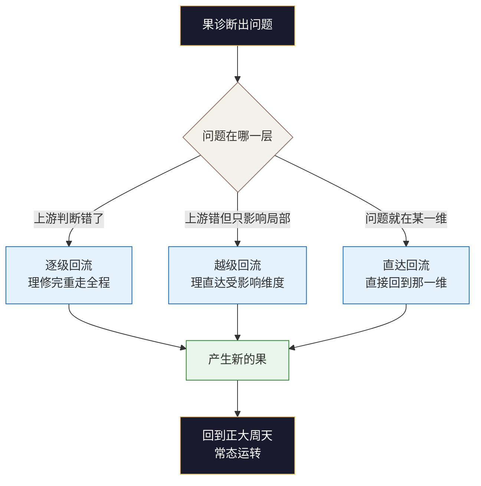

# 第12章 三循环：系统的运转、校准与突破

> *果告诉你的，不是「你的理对不对」，而是「你的理该怎么改」。*
> *一个只会验证不会修正的系统，像一具只能体检、不会治病的身体。*

---

一家做工业设备的公司，年底做了一次内部审计。审计报告里有一句话，让总经理看了很久：

「公司有三份文件：三年战略、年度预算、部门考核表。三份文件都很完整，但**彼此不认识**。」

战略里写「未来三年从卖设备转向卖服务」，预算里 80% 的钱仍然投在产能扩张上，考核表里 70% 的权重仍然是出货量。三份文件分三次、由三个部门、在不同月份写成，写的时候谁也没看谁。

它们不是一条链，是三根并排放着的木棍。

这就是正大周天要解决的问题：**让已有的环节咬合起来，转成一条链。**

但转起来之后，新的问题又来了：转着转着，果持续偏离预期，系统需要修正——这就是反大周天要解决的问题。修正之后，可能还有某一处反复堵、反复坏，需要集中力量打通——这就是小周天要解决的问题。

**转、改、通——三种形态，合起来才是一个会自己走的系统。**

## 核心观点

三循环不是三个并列的模型，而是**同一个系统的三种工作状态**：

| 形态 | 回答的问题 | 一句话 |
|:---|:---|:---|
| **正大周天** | 系统平时怎么转 | 十环依次咬合，转完一圈再转下一圈 |
| **反大周天** | 转不动时怎么改 | 果判定理该改，理改完重走一遍下游 |
| **小周天** | 只有一处卡住怎么办 | 定住最稳的一维，只循环下游那一段 |

三者共用同一个诊断器：**果的直达反馈**。果不判断是谁错了，它只负责把异常信号发出来；判断哪一维出问题、该走哪条循环，是循环机制的事。

> **【本章与三轴的关联】** 本章是动力轴的“运转形态”——它回答“系统怎么转、怎么改、怎么通”。
>
> - **与第9章（关系矩阵）的关联**：三循环是关系矩阵的“动态化”——关系矩阵中的增强关系（+S）和依赖关系（→）构成了正大周天的传动链；抑制关系（-）和断裂的连接构成了反大周天的修正对象；依赖关系的断裂位置构成了小周天的堵点候选。
> - **与第10章（熵为源）的关联**：三循环是熵控结构的“运转形态”——正大周天是熵动力沿经脉的正常做功，反大周天是熵增压力触发的修正，小周天是熵增在局部积聚后的集中释放。
> - **与第11章（经脉）的关联**：经脉是“路”，三循环是“怎么走”——正大周天是沿经脉正常流动，反大周天是校准经脉方向，小周天是疏通经脉堵点。
> - **与第13章（七阶）的关联**：三循环在不同的七阶阶段有不同的侧重——构建期以正大周天为主（建立传动链），调适期以反大周天为主（修正认知），诊断期以反大周天和小周天并重（定位堵点），稳固期以正大周天为主（固化运转）。
> - **与第8章（果）的关联**：果是三循环的共用诊断器——正大周天的起点和终点都是果，反大周天的启动条件是果持续偏离，小周天的诊断器是果定位堵点。

## 12.1 三循环总览：转、改、通

### 12.1.1 为什么是三循环

四层十维框架的主书稿写到传动链时，只有一句话：

> 理 → 念 → 心 → 道 → 熵 → 法 → 术 → 器 → 行 → 果，不可跳跃，果可直达任意维度。

这句话里其实藏着三种完全不同的运转形态，但主书稿没有展开：

| 形态 | 它在回答什么 | 一句话 |
|:---|:---|:---|
| **正大周天** | 系统平时怎么转 | 十环依次咬合，转完一圈再转下一圈 |
| **反大周天** | 转不动时怎么改 | 果判定理该改，理改完重走一遍下游 |
| **小周天** | 只有一处卡住怎么办 | 定住最稳的一维，只循环下游那一段 |

三者的关系不是并列，而是**同一个系统的三种工作状态**：常态运转、自我校准、局部突破。

### 12.1.2 三句话总纲

> **正大周天管「转」，反大周天管「改」，小周天管「通」。**

- **转**：系统平时靠什么维持运转——十环依次传动，一圈接一圈。
- **改**：验证出「认知错了」之后靠什么修正——理随果修，重走下游。
- **通**：只有某一段堵住时靠什么打通——定锚点，集中循环那一小段。

三者共用同一个诊断器：**果的直达反馈**。果不判断是谁错了，它只负责把异常信号发出来；判断哪一维出问题、该走哪条循环，是循环机制的事。

### 12.1.3 三循环速览

| | 正大周天 | 反大周天 | 小周天 |
|---|---|---|---|
| **解决** | 验证 | 修正 | 打通 |
| **起点** | 果 | 理 | 锚点 |
| **终点** | 果 | 果 | 堵点 |
| **范围** | 全链 | 从理到果 | 锚点下游一段 |
| **触发** | 常态运行 | 果持续偏离 + 链内解释不了 + 源头指向上游 | 单一堵点长期不通 |
| **比喻** | 呼吸 | 咳嗽 | 在河道某段筑坝冲刷 |
| **频率** | 持续 | 偶发 | 专项 |

### 12.1.4 三循环与学习层次的分工

第8章已说明单环学习、双环学习与三环学习。三循环与它们不是重复，而是**互补**：

- **学习层次**回答「改到多深」：单环改行为，双环改规则，三环改判断方式。
- **三循环**回答「改的路径怎么走」：从理出发，沿哪条线传到果。

| 学习层次 | 三循环对应 | 说明 |
|:---|:---|:---|
| 单环学习（改行为） | 小周天（直达回流） | 果准确定位到问题维度，直接修 |
| 双环学习（改规则） | 反大周天（越级回流） | 理修正影响局部，改规则和结构 |
| 三环学习（改判断方式） | 反大周天（逐级回流） | 理本身修正，重走全程 |

一个系统可能已经具备双环学习的能力（会改规则），但依然不会修正——因为它不知道该从哪一环开始改、改完要传到哪里。三循环补的正是这段路。

## 12.2 正大周天：常态传动

### 12.2.1 核心观点

**十个维度不是并排的十根木棍，是一条一环咬一环的链——链一转，系统才算自己走起来。**

正大周天循环，是以果为起点、又以果为终点的完整一圈，中间依次经过理、念、心、道、熵、法、术、器、行九个维度。十个环节一个咬一个，前一个是后一个的前提。

一句话说完：

> **以果证理，以理定念，以念正心，以心合道，以道控熵，以熵缘法，以法构术，以术御器，以器载行，以行纳果。**

请注意首尾：开头是果，结尾也是果。可结尾的果，已经不是开头那个果了——它经过整整一圈的淬炼，带着新的信息，去驱动下一圈。

**为什么起点是果，不是理？** 很多人做系统，是从「我想怎么做」开始的；正大周天是从「上一轮做出来什么结果」开始的。起点一变，整套动作的性质就变了——它不是从零设计，而是接着上一轮往下走。

> **【正大周天与第13章七阶的关联】** 正大周天在不同的七阶阶段有不同的侧重：**构建期**的正大周天是“搭链”——把各维度从“无”补到“有”，让链条能转起来；**稳固期**的正大周天是“固链”——把已经转通的路径固化为规则和习惯，让链条转得稳定；**衍化期**的正大周天是“忘链”——链条已经内化为系统的本能，不需要刻意维持。**正大周天不是一成不变的，它在系统的不同生命周期阶段有不同的形态。**

### 12.2.2 十环传动

判断一个系统有没有真的「转起来」，最简单的办法：看它有没有这些箭头。

| 环节 | 传的是什么 | 断在这里的样子 |
|---|---|---|
| 以果证理 | 用结果验证认知对不对 | 结果不好只知道「运气差」，说不出哪条判断错了 |
| 以理定念 | 用认知定住方向 | 目标年年改，因为底下的判断一直没定 |
| 以念正心 | 用方向塑造心理 | 道理都懂，一遇到波动就慌 |
| 以心合道 | 用心理支撑传动 | 制度写得很好，情绪一上来就绕开制度 |
| 以道控熵 | 用结构约束并导引压力 | 压力到处乱窜，谁都在扛，谁都没被接住 |
| 以熵缘法 | 用压力催生规则 | 吃过亏，却始终没沉淀出一条规则 |
| 以法构术 | 用规则构建动作 | 规则说「分批」，手上却只有「一把梭」 |
| 以术御器 | 用动作驾驭工具 | 要做的事很多，却全靠手动硬撑 |
| 以器载行 | 用工具承载纪律 | 纪律靠意志，一忙就断 |
| 以行纳果 | 用执行产生结果 | 做了很多动作，说不清哪一步带来了结果 |

**「以道控熵」这一环要特别说明。** 「控」不是压制，而是**约束边界 + 导引流向**：传动结构（道）决定了压力（熵）在系统里的通道宽窄与去处。这正是第10章「约束为基，疏导、转化、应用为用」在链条上的表述——只不过第10章讲的是「怎么建结构」，这里讲的是「结构在第几环起作用」。

**「以熵缘法」也一样。** 熵提供「为什么必须有这条规则」的必要性，法提供「规则长什么样」的形态。没有压力差，规则就只是纸面装饰；反过来，只有压力没有规则，压力就只会变成内耗。

### 12.2.3 不可跳跃与不可跨轮次

十个环节依次传动，**不能跳**。这是正大周天的第一原则。

道理很朴素：每一环都是下一环的前提。没有以果证理，理就没有依据；没有以理定念，念就没有根基；没有以念正心，心就没有方向；没有以心合道，道就没有支撑；没有以道控熵，熵就没有通道；没有以熵缘法，法就没有来源；没有以法构术，术就没有框架；没有以术御器，器就没有用途；没有以器载行，行就没有保障；没有以行纳果，果就没有来源。

**跳过任何一个，传动都会在那里断。**

最常被跳的例子是：**理不能直接到术。**

你有了「市场不可预测」这个认知，不能直接变成「仓位怎么分」的操作。中间必须过念（确立「不预测只应对」的方向）、过心（建立「不因波动而焦虑」的心理）、过道（设计传动结构）、过熵（识别压力从哪来、能承受到什么程度）、过法（选定一套模式）。少一环，理到术就是断的。

组织里同样如此：老板想通了「要从卖产品转卖服务」（理），不能直接下命令改流程（术）。中间要过念（三年内接受利润率下降）、过心（团队相信这不是又一次口号）、过道（服务响应的传动链）、过熵（现金流压力怎么承接）、过法（服务考核怎么定）。

**还有一条容易被忽略的：不可跨轮次。** 这一轮的果还没回来验证，就急着去改下一轮的理，等于第一环就空转了。

> **【不可跨轮次与第14章五境的关联】** “不可跨轮次”要求系统在果回归之前，不改下一轮的理。但“果什么时候回归”取决于系统的反馈周期——交易系统可能以“日”为单位，组织系统可能以“季”为单位，家庭健康系统可能以“年”为单位。第14章的“宏观七阶”为不同系统提供了“轮次时长”的参考：**轮次时长 ≥ 果的反馈周期**，否则果还没回来就改理，等于第一环空转。

### 12.2.4 三个关键节点

十环里有三个节点最要命：

| 关键节点 | 位置 | 断掉之后你会看到 |
|---|---|---|
| 以果证理 | 起点 | 每次复盘只改「下次要注意什么」，从不改判断本身 |
| 以心合道 | 中段 | 制度执行率很高，但一遇压力就绕开制度 |
| 以行纳果 | 终点 | 动作很多，却说不清哪一步真的产生了结果 |

要让这一圈转起来，还需同时满足三个条件：

1. **每一维至少先到「有」。** 某一维还是「无」，传动到它那里就过不去——心没建起来，念就正不了心；器没建起来，术就御不了器。
2. **链上没有严重堵点。** 只要有一环堵着，上游再顺也白搭；堵点会让整圈流速慢下来。
3. **正向传动不可跳跃。** 前两条讲状态，第三条讲纪律——状态可以慢慢补，纪律一旦松了，圈当场就断。

### 12.2.5 三个最常见的误读

- **误读一：把它当成一张流程图。** 把十维画成一个圈、标上箭头，就以为系统转起来了。可圈画得再圆，只要链上没有信息在传，它还是十根木棍。**画出来的是图，不是传动。**
- **误读二：把它当成「按顺序做完十件事」。** 以为从理一路做到行，做完一遍就算走完。可循环不是一次性任务，它是常态运转；做完一遍不等于转起来，转起来是每一轮都比上一轮更顺一点。
- **误读三：把它当成单行道，只朝前不回头。** 于是把果只当终点，忘了果更是起点。**一旦果不再回流去证理，第一环就断了，后面九环转得再勤，也是空转。**

三者指向同一件事：正大周天的价值不在「画得像」，在「传得动」。

### 12.2.6 跨域示例

同一根链，在四个领域里长成完全不同的样子——这正是它作为「结构语言」的证据。

| 环节 | 组织 / 项目 | 个人成长 | 家庭健康 | 交易系统 |
|---|---|---|---|---|
| 以果证理 | 项目复盘检验市场判断 | 阶段结果检验自我认知 | 体检指标检验养生假设 | 净值偏离检验策略假设 |
| 以理定念 | 认知决定战略方向 | 认知决定成长目标 | 认知决定健康目标 | 认知决定策略目标 |
| 以念正心 | 方向明确则团队不散 | 目标清晰则不焦虑 | 目标明确则坚持得住 | 目标稳则回撤不慌 |
| 以心合道 | 信任足够则流程跑通 | 心态稳定则习惯不断 | 关系和睦则规则可行 | 情绪稳则制度落地 |
| **以道控熵** | 流程约束冲突压力 | 日程结构约束惰性 | 作息结构约束疲劳 | 风控结构约束回撤压力 |
| **以熵缘法** | 冲突逼出协作规则 | 挫败逼出学习规则 | 病痛逼出饮食规则 | 回撤逼出止损规则 |
| 以法构术 | 制度决定协作动作 | 规则决定练习动作 | 规则决定饮食动作 | 规则决定下单动作 |
| 以术御器 | 方法决定用什么系统 | 方法决定用什么工具 | 方法决定买什么设备 | 手法决定用什么工具 |
| 以器载行 | 系统让协作可重复 | 工具让坚持可重复 | 设备让执行可重复 | 工具让纪律可重复 |
| 以行纳果 | 执行累积成交付 | 执行累积成能力 | 执行累积成指标 | 执行累积成净值 |

**组织那个例子走一遍**：审计发现三份文件互不认识 → 以果证理（年底没达成，证明「靠产能扩张能带来服务收入」这个判断错了）→ 以理定念（把方向改成「服务收入占比」）→ 以念正心（让中层相信这次不是口号）→ 以心合道（把服务响应写进流程）→ 以道控熵（用预算硬约束住扩张冲动）→ 以熵缘法（现金流压力逼出「服务合同回款周期」规则）→ 以法构术（把规则拆成销售动作）→ 以术御器（上服务工单系统）→ 以器载行（工单闭环让响应可考核）→ 以行纳果（服务收入占比成为新的果）。

**关键不在十步都做了，而在每一环之间都有人把「输出」接住。**

## 12.3 反大周天：自我校准

### 12.3.1 核心观点

**正大周天解决「验证」，反大周天解决「修正」——果告诉你的不是「你的理对不对」，而是「你的理该怎么改」。**

反大周天最容易的误解，是把它当成「把正大周天倒着跑一遍」。它其实不是。

它走的**还是那条正向链路**，只是换了起点，也换了主角：正向里果是主动方，理接受验证；反向里理是主动方，理主动修正。

| 这件事 | 正大周天怎么做 | 反大周天怎么做 |
|---|---|---|
| 果出了偏离 | 以果证理：判定果与理是否一致 | 理随果修：判定理该怎么改 |
| 谁在动 | 果是主动方 | 理是主动方 |
| 往哪走 | 从果出发，回到果 | 从理出发，走到果 |
| 解决什么 | 验证——对不对 | 修正——怎么改 |

### 12.3.2 为什么验证解决不了修正

正大周天跑完一圈，能给出的最强结论只有一句：**「果和理不一致。」**

至于理该怎么改，链路里没有这一环。于是你就算跑一百遍正大周天，得到的还是同一句话，只是重复了一百次。

这就是「体检」与「治病」的区别：体检能告诉你指标异常，却不能告诉你该吃什么药。**能发现问题，不等于能解决问题。**

所以反大周天的起点，恰恰是正大周天的尽头——正因为果把「这条判断不成立」验证了出来，修正才有明确的对象。**没有验证，修正就是乱改。**

> **【反大周天与第8章学习层次的关联】** 第8章已说明：单环学习是“改行为”，双环学习是“改规则”，三环学习是“改判断方式”。反大周天为这三种学习提供了**具体的操作路径**——单环学习对应小周天的直达回流，双环学习对应反大周天的越级回流，三环学习对应反大周天的逐级回流。**学习层次回答“改到多深”，反大周天回答“改的路径怎么走”。**

### 12.3.3 反向传动的十个环节

反大周天要传动的也是十环，只是每一环的语法变了：

正向说的是「A 对 B 做了什么」（**作用**），反向说的是「B 跟随 A 做了什么」（**跟随**）。

| 环节 | 反向传动的含义 |
|---|---|
| 理随果修 | 认知跟随结果修正 |
| 念随理固 | 方向跟随认知稳固 |
| 心随念安 | 心理跟随方向安定 |
| 道与心合 | 传动跟随心理契合 |
| **熵随道控** | 压力跟随结构被约束与导引 |
| **法随熵变** | 规则跟随压力变化 |
| 术随法转 | 动作跟随规则转动 |
| 器随术校 | 工具跟随动作校准 |
| 行随器易 | 执行跟随工具改变 |
| 果随行生 | 结果跟随执行产生 |

十个「随」字不是修辞，是**从属关系的精确标记**：它标明了在修正过程中，谁是主动的、谁是跟随的。

**这里有一个极其重要的观察：** 十环里真正需要「动手」的往往只有最上游那一环。上游一改，下游自动重算；上游不改，下游只能陪着错。

这也是为什么很多组织「年年改进、年年不动」——它们改的都是下游（换工具、加考核、提要求），而上游那句判断从来没被碰过。

### 12.3.4 三种修正模式

果的诊断越准，修正的路径越短。据此有三种走法：

| 模式 | 路径 | 适用场景 | 速度 |
|---|---|---|---|
| **逐级回流** | 理 → 念 → 心 → 道 → 熵 → 法 → 术 → 器 → 行 → 果 | 理的修正会牵动整个系统 | 慢，但最彻底 |
| **越级回流** | 理 → 受影响的维度 → 果 | 理的修正只影响局部 | 中 |
| **直达回流** | 果 → 问题维度 → 果 | 果能准确定位到问题维度 | 快 |

「直达回流」之所以成立，是因为**果可以直达任意维度**（第8章）。果是「行之果」，是所有维度共同作用的最终输出——输出的异常，可能来自任何一维。果不需要知道是哪一维错了，它只负责发信号。

**路径选择的判据只有一条：这次修正会不会改变下游的前提。** 会，就逐级走；不会，就越级或直达。

> **【三种修正模式与第11章经脉的关联】** 逐级回流是沿经脉的逐级修正——每一环都是经脉上的节点，修正沿着经脉向下游传导；越级回流是跨经脉的局部修正——理直接到达受影响的维度，跳过中间节点；直达回流是经脉上的点对点修正——果直接定位到问题维度，不经过其他节点。**反大周天的三种模式，本质上是经脉的三种“修正走法”。**

### 12.3.5 什么时候启动

反大周天不是随时启动的。乱启动，系统会一直在「改」，永远没有稳定的参照系。它需要三个条件同时成立：

1. **果持续偏离预期。** 偶发偏离可能是正常波动，不必启动。「持续」必须给可操作判据——建议用**连续两个复盘周期**同向偏离（周期由系统自定：日／周／月／季，因域而异）。
2. **果的偏离无法用正大周天解释。** 如果偏离能用既有认知解释（环境变了，结果自然变），那属于正常回落，不必启动；只有**市场没变、结果却持续变差**，才说明认知本身不成立。
3. **偏离的源头指向上游。** 若问题在下游（术、器、行），直接修，不必走反大周天；只有指向上游（理、念、心、道、熵、法），才启动。

三条合起来一句话：**反大周天是「治本」的机制，只在果反复喊、正大周天又解释不了、问题还留在上游的时候才出手。**

### 12.3.6 跨域示例

| 领域 | 果说了什么 | 理怎么修 | 走哪种模式 | 结果 |
|---|---|---|---|---|
| **个人成长** | 学了两小时，第二天仍不会处理 | 把「按章节学」改成「按问题学」 | 越级回流：理 → 法（学习规则） | 学习单元从「章节」变成「一个真实问题」 |
| **组织** | 服务收入连续两季不达标 | 把「卖设备附赠服务」改成「服务单独定价」 | 逐级回流：牵动考核、流程、预算 | 定价、考核、工单三处同步改 |
| **家庭健康** | 体检三项指标连续两次异常 | 把「少吃油」改成「换掉精制碳水」 | 越级回流：理 → 法（饮食规则） | 只改餐单结构，不动运动计划 |
| **交易系统** | 一条选股标准在牛市持续失效 | 从「单看股息率」改成「股息率＋估值分位」 | 越级回流：理 → 法（筛选规则） | 筛选与条件单一并跟着改 |

四个例子的共同点是：**改的都是「一句判断」，不是「一套动作」。** 这正是反大周天与普通优化的区别——普通优化改行为，反大周天改前提。

### 12.3.7 三个常见误读

- **误读一：当成「重跑一遍」。** 以为启动反大周天就是把正大周天从头再来一次。可重跑一万遍也不会冒出「该怎么改」，那只是把同一个问题验证一万遍。
- **误读二：当成「试错」。** 以为修正就是不停地改、改到行为止。可盲改没有参照系，改对了不知道为何对，改错了不知道错在哪。
- **误读三：当成「救火」。** 只在系统烧起来时才启动。可反大周天的价值在于果刚偏一点就修，不是等亏完了才救。

## 12.4 小周天：局部突破

### 12.4.1 核心观点

**小周天循环 = 定住一个成熟且稳定的维度作为锚点，只循环它下游的维度，直到堵点被打通。**

它不是大周天的替代，而是大周天在特定阶段的**聚焦模式**。堵点打通之后，系统回到大周天的常态运转。

四步：

> **定锚点 → 循环下游 → 打通堵点 → 回到大周天**

一个家庭的年度体检，连续两年都是同一个结果：父亲血压偏高、体重上升、睡眠质量下降。家人商量后决定「全面改善生活方式」——早睡、运动、控盐、减重，四件事一起上。

三个月后，四件事一件都没坚持下来。

复盘时发现问题不在决心，而在**四件事互相打架**：晚上八点去健身房，回家已十点，洗漱完十一点，早睡落空；睡得晚，第二天起不来，晨跑取消；晨跑取消后体重没降，控盐也失去动力。

四件事不是四个独立任务，它们在同一个时间盘上互相挤。**这时候不需要重跑整个「生活方式」，只需要定住一件最稳的事，把它下游那一段打通。**

这就是小周天循环。

老陈的比喻很准：大周天像一条河持续流动，小周天像在河某一段筑坝——把上游的水拦住，集中力量冲刷下游的堵塞段，通了就拆坝，河流恢复流动。

> **【小周天与第14章五境的关联】** 小周天的目标，就是让某一维跃迁一级（无→有、有→定、定→合）。它是一次**定向的成熟度推进**——不是让整个系统升级，而是让某一个堵住的维度突破瓶颈。第14章将说明：五境的每一次跃迁都需要特定的触发条件，而小周天就是为某一维的跃迁创造条件的“定向操作”。

### 12.4.2 为什么需要小周天

**原因一：系统成熟度天然不均衡。**
一个系统不可能所有维度同时到「定」。有些已经「定」，有些还在「有」里挣扎。如果每次都跑完整大周天，成熟维度被反复空转，真正要突破的堵点反而被稀释了注意力。

**原因二：堵点需要集中发力才能打通。**
有些堵点不是「整体循环」能解决的，它需要你聚焦在局部，集中资源与注意力反复调校。就像水管堵了，不需要把整个管网拆开，只需要找到那一段集中处理。

**原因三：它是「一次只改一个东西」在系统层的应用。**
同时改十处，等于哪一处都没改——因为你无法归因，下一轮不知道该保留什么。

### 12.4.3 三个要素

| 要素 | 含义 |
|---|---|
| **锚点** | 当前最成熟、最稳定的那一维。它不再被调校，只提供固定参考系 |
| **循环链** | 从锚点的下一个维度开始，沿正向链向下循环，直到果 |
| **目标** | 打通堵点：让下游某一维从「无」到「有」、从「有」到「定」，甚至从「定」到「合」 |

**锚点不参与循环**，这是小周天最容易被违反、也最要紧的一条。锚点一旦被下游反馈牵着改，参考系就动了，整个局部循环失去校准对象。

### 12.4.4 锚点怎么选

三个问题，必须同时答「是」：

1. **哪个维度当前最成熟？** 不是「最重要」，是「做得最扎实」。
2. **哪个维度当前最稳定？** 成熟 ≠ 稳定。一个维度可能很成熟，但最近正在修正（刚被反大周天动过），此时不能当锚点。
3. **哪个维度不需要再被调校？** 锚点的作用是提供参考，不是一个待办项。

> ⚠️ **无锚点时的退路**
> 如果十维大多为「无」，说明系统还没有建立起来——此时**不存在**合格的锚点，小周天不适用。
> 正确做法是先跑一次**最小正大周天**，把各维补齐到「有」，再谈聚焦。
> 不补这条，会把「系统还没建起来」误当成「堵点打不通」，于是反复做无用功。

### 12.4.5 循环链与十种模式

**循环链 = 从锚点的下一个维度开始，沿正向链向下循环，直到果。**

正向链（元框架版）：

> 以果证理，以理定念，以念正心，以心合道，以道控熵，以熵缘法，以法构术，以术御器，以器载行，以行纳果。

按锚点不同，共有十种模式：

| 锚点 | 循环链 | 适用场景 |
|---|---|---|
| **理** | 念→心→道→熵→法→术→器→行→果 | 认知坚实，但方向、心理、执行待突破 |
| **念** | 心→道→熵→法→术→器→行→果 | 方向坚定，但心理、结构、执行待突破 |
| **心** | 道→熵→法→术→器→行→果 | 心理稳定，但结构、规则、执行待突破 |
| **道** | 熵→法→术→器→行→果 | 结构稳定，但规则、工具、执行待突破 |
| **熵** | 法→术→器→行→果 | 动力机制稳定，但规则、工具、执行待突破 |
| **法** | 术→器→行→果 | 规则稳定，但操作、工具、执行待突破 |
| **术** | 器→行→果 | 方法稳定，但工具、执行待突破 |
| **器** | 行→果 | 工具稳定，但执行待突破 |
| **行** | 果 | 执行稳定，但反馈待突破 |
| **果** | 理 | 反馈稳定，但认知待更新 |

十种不是每种都常用。最常用的是三种：

- **术 → 器 → 行 → 果**：工具和执行出问题时
- **法 → 术 → 器 → 行 → 果**：规则需要更新时
- **道 → 熵 → 法 → 术 → 器 → 行 → 果**：结构需要调整时

**循环链的长度，取决于锚点与堵点之间的跨度。** 跨度越小，打得越快；跨度越大，越要谨慎——链条一长，中间每一环都可能再次走样。

**循环链长度的经验规则**：

> 循环链跨度 ≤ 3 维：可一次打通。
> 循环链跨度 4–5 维：建议拆成两次，先打最近的一段。
> 循环链跨度 ≥ 6 维：不建议用小周天，改走逐级回流或先补中间维度到「有」。

### 12.4.6 四个运行原则

1. **锚点不参与循环。** 固定参考系，不接受下游反馈修正。
2. **一次只打一个堵点。** 打通一个再打下一个，不要并行。
3. **循环只走下游。** 不回溯上游，否则等于跑了一次缩水版的大周天。
4. **打通即回归。** 目标达成后立刻拆坝，回到正大周天。长期停在局部循环里，系统会失去全局感。

### 12.4.7 跨域示例

| 领域 | 堵点 | 锚点（最成熟稳定） | 循环链 | 结果 |
|---|---|---|---|---|
| **家庭健康** | 运动与作息互相挤 | 作息（已稳定三年） | 运动→饮食→指标 | 固定晚九点后不安排运动，晨跑与控盐随之稳定 |
| **组织** | 流程要求协作，但工具只支持单人 | 制度（已运行稳定） | 术→器→行→果 | 换协作工具，动作与执行随之对齐 |
| **个人成长** | 想学的太多，时间不够 | 理（认知已成形） | 念→心→道→…→果 | 先定方向、再做取舍，日程结构随之收紧 |
| **交易系统** | 方法与工具不匹配 | 术（方法已固定） | 器→行→果 | 换掉不支持分批的工具，执行随之稳定 |

**回到开头那个家庭**：他们选定「作息」作锚点（三年来起居时间稳定，是全家最不容易动摇的一维），循环链是「运动→饮食→指标」。只做一个动作：晚九点后不安排运动。三周后早睡稳定，晨跑自动恢复，控盐也有了动力——一个堵点打通，整段就顺了。

### 12.4.8 与既有工具的接口

- **与双表示法（第16章）**：双表示法负责**找出最弱环节**；小周天负责**用什么去打通它**——用它上游最成熟的那一维当锚点。这是两套工具最自然的接口。
- **与六病态（第17章）**：小周天专治「维度缺失」与「维度失衡」——前者靠下游循环补短板，后者靠定住强项、只调弱项来解除压制。
- **与五境（第14章）**：小周天的目标就是让某一维跃迁一级（无→有、有→定、定→合）。它是一次**定向的成熟度推进**。

### 12.4.9 两个常见误读

- **误读一：把锚点当成「最重要的维度」。** 锚点不是「最重要」，是「最稳定」。一个很重要的维度，如果最近正在修正（刚被反大周天动过），就不能当锚点——参考系动了，循环就失去了校准对象。
- **误读二：无锚点硬做小周天。** 十维皆「无」时，不存在合格锚点。此时应该先跑最小正大周天补到「有」，再谈聚焦。把「系统还没建起来」误当成「堵点打不通」，会反复做无用功。

## 12.5 三循环 × 六病态：处置对照

三循环是“处置”工具，六病态是“诊断”工具。先诊断出病态类型，再决定走哪条循环。下表给出对照：

| 病态 | 首选循环 | 处置要点 |
|---|---|---|
| 维度缺失 | 小周天 | 以上游最成熟维为锚点，集中补该维 |
| 维度失衡 | 小周天 | 定住强项作锚点，只调弱项，解除压制 |
| 传动断裂 | 正大周天 | 找出断点，接上，不加新维度 |
| 目标偏离 | 反大周天 | 追到「念」或「理」，改判断而非改动作 |
| 熵增失控 | 正大周天 + 反大周天 | 先补「以道控熵」结构，再改产生压力的上游判断 |
| 经脉堵塞 | 小周天 | 定位堵点，只循环该段，不重画全图 |

> **【三循环与第17章病态诊断的关联】** 第17章将详细展开六种病态的识别和诊断方法。本章的“三循环×六病态”对照表，是第17章诊断结论的“处置出口”——诊断出病态后，从这里选择对应的循环。**没有诊断的优化是盲目的，没有优化的诊断是徒劳的。**

## 12.6 三循环的边界与常见误用

### 12.6.1 三条边界

三循环不是万能的。有三条边界必须记住，否则会被用错：

1. **三循环管「转不转」，五境管「到没到」。** 它们是一横一纵，不能互相替代。一个维度可以在「有」这一级长期稳定地参与循环，也可以在「衍」这一级却从未真正接入循环。
2. **三循环是「处置」，六病态是「诊断」。** 先诊断出是传动断裂、熵增失控还是维度缺失，再决定走哪条循环。
3. **循环只保证「能转」，不保证「越转越好」。** 变好取决于每一维是否在升级。循环只管“能转”，升级靠五境——每次循环后应检查是否有维度从“有”到“定”、从“定”到“合”。

### 12.6.2 常见误用对照

| 误用 | 表现 | 纠正 |
|---|---|---|
| 把正大周天当流程图 | 画得很圆，但没有信息在传 | 检查每两环之间「传的是什么」 |
| 把反大周天当倒放 | 以为要倒着走十维 | 同一条正向链，只换起点与主角 |
| 把反大周天当试错 | 盲改，改到行为止 | 先诊断到「哪一句判断错了」再动手 |
| 把反大周天当救火 | 烧起来才启动 | 果刚偏一点就修 |
| 把锚点当成「最重要的维度」 | 选了正在修的维度 | 锚点须「最稳定」，不是「最重要」 |
| 无锚点硬做小周天 | 十维皆「无」还去聚焦 | 先补到「有」 |
| 长期停在小周天 | 一直打局部，失去全局感 | 打通即回归正大周天 |
| 把循环当「自动变好」 | 转了很多圈，水平没变 | 循环只管「能转」，升级靠五境 |

### 12.6.3 三循环的选择：if → then

| 观察到的现象 | 判断 | 走哪条循环 |
|---|---|---|
| 各环节都在，但彼此不接 | 传动断裂 | 正大周天：接链 |
| 上层想通了，下面动不起来 | 跳跃了念／心／道 | 正大周天：补中间环 |
| 一直在改，越改越乱 | 上游未动，只改下游 | 反大周天：改那句判断 |
| 改了下游，三个月后又回到原样 | 病因在上游 | 反大周天：逐级回流 |
| 某一处反复修、反复坏 | 单一堵点 | 小周天：定锚点打一段 |
| 十个维度都弱，找不到抓手 | 系统尚未建立 | 先跑最小正大周天（**非**小周天） |
| 每次都在救火，从不校准 | 无常态循环 | 先建正大周天，再谈校准 |

## 12.7 本章小结

三循环是系统的三种工作状态：**正大周天管“转”，反大周天管“改”，小周天管“通”**。三者共用同一个诊断器：果的直达反馈。

**正大周天（转）** 是常态传动：以果为起点、以果为终点，十环依次传动，不可跳跃，不可跨轮次。它的价值不在“画出一个漂亮的圈”，而在让已有的环节之间产生传递。

**反大周天（改）** 是自我校准：果发现理不成立，理随果修，修正后的理重走一遍下游，产出新的果。它有三种模式——逐级、越级、直达；它有三个启动条件——持续偏离、正大周天解释不了、源头指向上游。

**小周天（通）** 是局部突破：定住一个成熟且稳定的锚点，只循环下游那一段，打通一个堵点，然后回到常态。它成立的前提是“有锚点”。十维多为“无”时，先跑最小正大周天，不要急着聚焦。

三循环与六病态的关系是“处置”与“诊断”的关系——先诊断出病态类型，再决定走哪条循环。三循环与五境的关系是“横”与“纵”的关系——循环管“转不转”，五境管“到没到”，两者不能互相替代。

它的目的从来不是“让系统一直改”，而是“让系统改完能回到常态”。每一次反大周天走完，正大周天都该更顺一分。

> 正大周天像呼吸，反大周天像咳嗽，小周天像在河道某段筑坝——咳完了，呼吸要回来；坝拆了，河流要恢复流动。

在下一章中，我们将进入第五部分“时间轴”，从第13章“宏观七阶”开始，探讨系统一生的七个阶段——构建、调适、完善、稳固、诊断、进化、衍化。**三循环回答“系统怎么转”，七阶回答“系统一生走到了哪一段”。**

## 思考与练习

1. **翻旧账**：翻出你最近三个周期的「果」，问它三个问题——是否持续偏离？正大周天能不能解释？源头在上游还是下游？

2. **找那句判断**：如果该修，写下你要改的那**一句判断**（不是一套动作）。写不出来，说明你还没诊断到上游。

3. **选模式**：这次修正会不会改变下游的前提？会就逐级，不会就越级或直达。

4. **设回归**：改完给自己设一个「回到常态」的时点。没有回归时点的修正，会变成长期折腾。

5. **找一个堵点**：你系统里有没有一处「反复调、反复坏」的地方？

6. **选锚点**：它的上游，哪一维最成熟且最稳定？答不出「最稳定」，就不要选它。

7. **算链长**：从锚点到堵点跨了几维？跨得越多，越要拆成两次打。

8. **写回归条件**：什么现象出现，就说明这个堵点通了、可以拆坝了？写不出来，这个循环会变成长期占用。

9. **三循环预判**：回顾本章“三循环×六病态”对照表。如果你选择的系统被诊断出“目标偏离病”，你会走哪条循环？为什么？如果你选择的系统被诊断出“维度缺失病”，你会走哪条循环？锚点怎么选？

10. **与学习层次的关联**：回顾本章“三循环与学习层次的分工”。你选择的系统目前以哪种学习层次为主（单环/双环/三环）？它对应三循环中的哪种模式？系统是否需要从单环升级到双环或三环？如何升级？

— **渊 云 不 器 · 循 环 无 端** —

