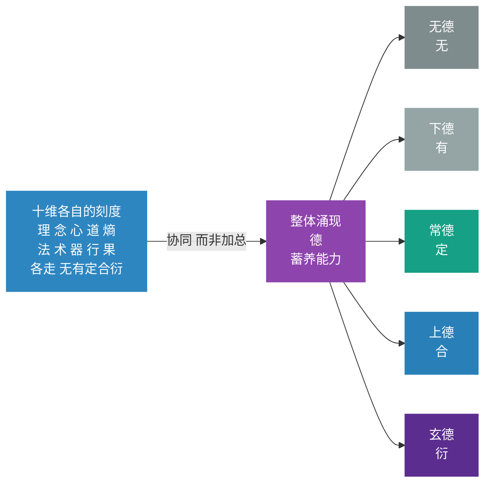

# 第15章 整体德之五级：协同涌现的蓄养能力

> *“十个人都强，合起来不一定强。”*
> *“十个人都有短板，合起来不一定弱。”*
> *“加起来那个数，从来不是整体。”*

---

在第14章中，我们完成了分维五级成熟度的阐述——每一维从“无”到“衍”的五级刻度，以及三境（立基、贯通、自衍）和不器口诀。五境回答的是“某一维到了哪一级”的问题。

但五境只给了“每一维”的刻度，还没有给“整体”的刻度。一个八人团队，单看简历挑不出毛病：两个资深产品、三个后端、两个前端、一个设计。分开评价，每个人都在自己的维度上“到了定甚至到了合”。但这一年他们做了三个半成品——每一个都做到七八成，然后卡住、换方向、再起一个新项目。年底复盘，大家的结论是“资源不够”。

一个旁观者问了一句：这一年里，有没有哪一次，某个人的产出被另一个人**接住并且往前推了一步**？

沉默了。

问题不在八个人各自的水平。问题在于：**这八个人之间，没有一条能传递东西的通道。** 每个人都在自己的格子里做得很认真，格子之间是空的。

这就是本章要说的事：**十维的水平加起来，不等于系统的水平。** 中间差的那一块，有名字，叫德。

本章聚焦于时间轴的第三个刻度——**整体德之五级**。它量的是“十维协同后整体到了哪一级”，是时间轴的“整体刻度”。第16章将说明三把尺子（分维五境、宏观七阶、德之五级）的关系。

> **【本章与三轴的关联】** 本章是时间轴的“整体刻度”——它回答“十维协同后整体到了哪一级”。
>
> - **与空间轴的关联**：德不是第十一维，它是十维协同后涌现的整体状态。它不在任何一个格子里，它在格子之间。第14章的分维五境量的是“每一维”，本章的德之五级量的是“整体”——两者是同一把尺子量两种对象。
> - **与动力轴的关联**：德的循环（纳→蓄→养→成→归）与三循环直接对应——正大周天是德的“纳”与“蓄”（吸入负熵、蓄住能力），反大周天是德的“养”与“成”（反哺系统、完成产出），小周天是德的“归”（回到源头、进入下一轮）。**三循环是德的运转形态，德是三循环的整体刻度。**
> - **与第13章七阶的关联**：七阶量“系统一生走到了哪一段”，德之五级量“十维协同后整体到了哪一级”。两者不是同一把尺子——一个系统可能在“衍化”阶段但整体德性只有“常德”，也可能在“稳固”阶段但整体德性已达“上德”。

## 15.1 分维刻度不等于整体状态

### 15.1.1 核心观点

**德不是品德，是蓄养能力——十维协同运作之后涌现出来的整体状态，又反过来滋养十维。**

它有五级：无德、下德、常德、上德、玄德。这五级用的是**同一把尺子**（无→有→定→合→衍），只是量的对象从“某一维”换成了“整体”。

### 15.1.2 分维刻度不等于整体状态

先把最容易错的直觉拆掉。

第14章的五级成熟度，量的是**某一个维度**：理到了“定”，心到了“合”，器还在“有”。它是一排刻度尺，一维一把。

那么把十把尺子的读数加起来，是不是就是系统的整体水平？

**不是。** 两个反例就够了：

**反例一：十维都不错，整体不协调。**
上面那个八人团队就是。每个人的专业维度都在“定”以上，但系统整体运转得像一台齿轮没有咬合的机器。反过来也成立：有些团队每个人都平平，但配合极顺，产出高得离谱。

**反例二：某一维明显薄弱，整体反而顺。**
有些家庭，收入不高（果弱）、工具很少（器弱），但日子过得很有秩序，遇事不慌。它的整体状态，比很多“什么都有”的家庭要好。

原因很简单：**整体状态是「协同」的产物，不是「加总」的结果。**

一个类比：

- 分维五境是**器官的健康度**——心脏怎么样、肝怎么样、肺怎么样。
- 整体五境是**生命力的旺盛度**——这个人整体有没有劲。

器官都健康，人可能长期疲惫（不协调）；某个器官不完美，人可能精力充沛（代偿能力强）。**整体不是器官的平均值，是器官协同后的状态。**

### 15.1.3 分维与整体的关系图

注意图上那条箭头写的是「协同 而非加总」。整张图最要紧的就是这一个词：从左边到右边，不是求和，是**协同**。十个刻度加起来得不到右边，十个人配合起来才能得到右边。

## 15.2 德是什么：蓄养能力

### 15.2.1 德的本义：蓄养

德这个字在现代汉语里几乎只剩「品德」一义，这是理解它的最大障碍。

在《道德经》里，德的本义近于「**得**」——从道那里得到、并把它蓄住的那个能力。《道德经》第51章说得最清楚：

> 道生之，德畜之，物形之，势成之。是以万物莫不尊道而贵德。

四个动词，一条链：**道生**（生出）、**德畜**（蓄养）、**物形**（成形）、**势成**（成势）。

「畜」就是蓄养。德在这里不是道德判断，是**一种蓄住并使之前长的能力**。

### 15.2.2 德的定义

> **德 = 十维协同运作之后，涌现出来的整体蓄养能力。**

拆开三句：

1. **它是涌现的。** 不是某一维的属性，是十维协同之后才出现的东西。八个人各自的水平里，都找不到「配合得顺」这一项。
2. **它是能力，不是品格。** 它说的是「这个系统能不能把外部的东西纳进来、蓄住、再长出去」，与好坏无关。一个黑帮可以有很高的德，一个慈善组织可以有很低的德。
3. **它是双向的。** 德由系统显化，又反哺系统（15.7展开这个循环）。

这个定义有一个立竿见影的好处：**它把「德」从评价词变成了诊断词。** 你不再问「这个团队的人品好不好」，你问「这个团队能不能把外面的东西变成自己的、再长出去」。

### 15.2.3 德与道的关系

道与德不是两个并列的东西，是同一件事的两面：**道是路径（源），德是蓄养（流）。**

| 维度 | 道 | 德 |
|:---|:---|:---|
| **定位** | 源 | 流 |
| **功能** | 路径与脉络 | 蓄养的能力 |
| **与熵的关系** | 约束熵、导引熵、转化熵 | 反哺系统、滋养系统 |
| **在框架中的位置** | 贯穿全生命周期 | 十维协同后涌现 |
| **最高形态** | 不可道之道 | 玄德（不执的蓄养） |
| **体用** | 体 | 用 |

**经典依据**：
- “道生之，德畜之”（第51章）——道负责“生”，德负责“畜”。没有生，无从畜；没有畜，生下来也活不成。
- “孔德之容，惟道是从”（第21章）——德不自己定方向，德跟着道走。方向反复变，能力一定长不厚。
- “失道而后德，失德而后仁，失仁而后义，失义而后礼”（第38章）——**降级序列**：你越强调什么，往往说明上一级已经丢了什么。

> **【德与第19-20章的分工】** 第15章讲德之五级的**刻度与识别**（时间轴的整体刻度），第19-20章讲道与德的**关系与边界**（框架的边界与整体）。第19章将说明“道之三层”（不可道之道、可道之道、L2道），第20章将说明“道与德：源与流，体与用”。本章是“德是什么、德有几级、怎么认”，第19-20章是“道与德在整个框架中的位置”。

## 15.3 德之五级：无德→下德→常德→上德→玄德

### 15.3.1 五级速览

五级借用《道德经》的五个字，正好对应五境的五个刻度：

| 德之层次 | 对应刻度 | 德的状态 | 蓄养能力的表现 |
|:---|:---|:---|:---|
| **无德** | 无 | 系统尚未形成蓄养能力 | 蓄养能力缺失，系统靠外部输血维持；断了供给就停 |
| **下德** | 有 | 蓄养能力初步建立，但「执」于蓄养 | 能蓄养，但蓄养是刻意的、有条件的、害怕失去的 |
| **常德** | 定 | 蓄养能力稳定、可复现 | 蓄养成为系统的常规功能，不依赖偶然条件 |
| **上德** | 合 | 蓄养能力内外贯通 | 蓄养不再需要刻意，已成为系统的自然运作 |
| **玄德** | 衍 | 蓄养能力自组织、自涌现 | 蓄养本身不再有「蓄养者」的执念 |

五个字都不是自创的，全在《道德经》里有出处，而且出处的语境高度一致：

| 层次 | 《道德经》原文 | 章 | 原文在说什么 |
|:---|:---|:---|:---|
| 无德 | 「下德不失德，是以无德」 | 38 | 拼命抓住德的人，反而没有德 |
| 下德 | 「下德不失德，是以无德」「下德无为而有以为」 | 38 | 有所执、有所为、有所图的德 |
| 常德 | 「常德不离，复归于婴儿」「常德不忒，复归于无极」「常德乃足，复归于朴」 | 28 | 不离、不忒、乃足——稳定不失常 |
| 上德 | 「上德不德，是以有德」「上德无为而无以为」 | 38 | 不刻意表现为有德，才是真有德 |
| 玄德 | 「生而不有，为而不恃，长而不宰，是谓玄德」 | 10、51、65 | 生养而不占有，成就而不自恃 |

第38章那两句是全章枢纽：

> 上德不德，是以有德；下德不失德，是以无德。

一句话读法：**上德的人不觉得自己在行德，所以有德；下德的人一刻不敢丢掉德的样子，所以没有德。**

注意这里的关键差异不是「做得多不多」，是**「有没有一个『我在行德』的自我意识」**。下德与上德的分别，全在这一点上。

### 15.3.2 逐级怎么认

**无德（无）**：系统靠外部输血。项目靠老板盯着，学习靠外部培训，情绪靠某一个人撑着。供给一断，系统就停。特征是：**说不出「我们自己能持续产出什么」。**

**下德（有）**：能蓄养了，但蓄养是刻意的、有条件的、怕失去的。典型表现是：方法有效，但只有某个人在的时候有效；经验有积累，但每次都要重新动员一遍。特征是：**要靠意志维持。**

**常德（定）**：蓄养成了常规功能。换个人也能跑，压力来了也不散，一年和三年差别不大。特征是：**不需要动员，它自己就在做。** 这是多数成熟组织停留的位置，也是极难再往上走的一层。

**上德（合）**：蓄养内外贯通，不再需要刻意。组织里出现了「不用说也这么做」的默契，外部的人一进来就感到「这里有一种说不清但很稳的东西」。特征是：**你问它怎么做到的，它说不出来——因为它已经不靠「做法」了。**

**玄德（衍）**：系统自己能长出新的蓄养方式。旧的方法废了，新的方法自己冒出来。特征是：**「谁在做」已经不重要了。**

### 15.3.3 逐级诊断问题

| 层次 | 诊断问题 |
|:---|:---|
| 无德 | 有没有至少一条不依赖特定个人的产出路径？ |
| 下德 | 蓄养是否依赖动员？换个人是否就做不了？ |
| 常德 | 换个人也能跑吗？压力来了散不散？ |
| 上德 | 新成员进来能否自然接上？ |
| 玄德 | 旧方法废了，新方法是否自己冒出来？ |

### 15.3.4 五级的两个陷阱

**陷阱一：把「无德」误判成「下德」。**
一个系统如果所有产出都依赖某一个关键人物，它看起来很有能力，其实是无德——因为能力没长在系统上，长在那个人身上。判断方法：**把那个人抽掉，还剩什么？**

**陷阱二：把「下德」当成目标。**
下德是很舒服的一层——它确实有效。但它有一个死穴：**需要持续的意志输入**。意志是会耗尽的。很多组织在这一层待了十年，然后随着创始人老化，一夜回到无德。

## 15.4 德之三境与不器

### 15.4.1 三境速览

五级是量变刻度，三境是质变节点。德的三境沿用第14章的三个通用名：

| 境界 | 区间 | 核心命题 | 《道德经》对应 |
|:---|:---|:---|:---|
| **第一境：立基** | 有 → 定 | 让蓄养能力「立得住」 | 「早服谓之重积德；重积德则无不克」（第59章）——持续积累，使德深厚 |
| **第二境：贯通** | 定 → 合 | 让蓄养能力「通内外」 | 「含德之厚，比于赤子」（第55章）——德厚到内外无碍 |
| **第三境：自衍** | 合 → 衍 | 让蓄养能力「自生长」 | 「生而不有，为而不恃，长而不宰，是谓玄德」（第10章） |

第59章那句值得多说一句。「早服谓之重积德」——「早服」是尽早顺从、及早准备；「重积德」是不断累积的德。老子在这里给的是一个**时间条件**：德不是顿悟出来的，是积出来的。

这一句对实践的意义很直接：**德之五级里，从下德到常德那一段，没有捷径，只能靠时间。** 想跳过积累直接到「合」，做不到——因为「合」要求内外贯通，而贯通的前提是内部先有东西可通。

### 15.4.2 德之不器

第14章给每一维都有一句「不器」，十句成一套封闭口诀。德不是维度，所以不进口诀，但整体层面同样有不器：

| 层次 | 表述 | 含义 |
|:---|:---|:---|
| **浅层（消极自由）** | **不执于德** | 不把「我有德」当作身份，不把「蓄养」当作交易——不因为「我对系统有贡献」就要求回报 |
| **深层（积极自由）** | **德即自然** | 蓄养不再是「能力」，而是系统存在的自然方式 |

深层的这句话需要拆一下：**玄德不是「有德」，是「德」与「系统」合一。**

「有德」意味着德是系统拥有的一样东西——可以多一点、少一点，可以拿出来说。而「合一」意味着不再有一个「拥有者」站在德的外面。

《道德经》第38章那句话，在这里才真正落地：为什么「上德不德，是以有德」？因为**当德和系统合一的时候，就没有一个「我在行德」的位置了。** 没有那个位置，才叫真有。

## 15.5 为什么德不能拿来自评

### 15.5.1 核心边界

这一节是实践边界，也是本章最容易被违背的一条。

德一旦被当成可以自评、可以考核、可以对外宣称的指标，它就当场降级——从「上德」掉回「下德」。

原因在15.3节已经说了：**「我有德」这个念头本身，就是「执于蓄养」。** 而「执于蓄养」正是下德的定义。

所以德之五级有一个奇特的性质：**它越被当成目标，越达不到。**

这不是玄学，是很实的东西。你去看那些真正「蓄养能力很强」的组织，它们几乎从不谈自己的文化多好；反过来，天天把文化挂在嘴上的组织，往往正是「下德不失德」——怕丢掉那个样子。

### 15.5.2 德之五级的正确用法

那么德之五级该怎么用？三条：

**用法一：用它看系统，不用它看自己。**
最好的用法是：拿它诊断一个你身在其中、但你说不上话的系统。一旦用来评价自己，它就不准了——因为评价这个动作本身会污染结果。

**用法二：用它找那一级的具体动作。**
不要问「我们怎么才能有德」，要问「我们现在在第几级，这一级该做什么」。
- 无德 → 先建一条能持续产出的最小结构（这是第13章的「构建」阶段）。
- 下德 → 把依赖人的部分变成依赖结构的部分。
- 常德 → 打通内部与外部，让外人进来也能接上。
- 上德 → 不做什么。这一级的动作是「减少动作」。
- 玄德 → 撤手。让系统自己长。

注意上德和玄德的动作是「不做」——这是五级里最反直觉的地方。前三级靠加，后两级靠减。

**用法三：用它判断该不该「发力」。**
一个系统如果已经在上德，你再加一套考核，会把它打回常德甚至下德。**在德的层面，多管一次，往往退一级。**

### 15.5.3 德与降级序列的关联

《道德经》第38章的降级序列——“失道而后德，失德而后仁，失仁而后义，失义而后礼”——可以操作化为一个诊断工具：

| 当前在强调什么 | 可能说明上一级已丢 | 诊断动作 |
|:---|:---|:---|
| 价值观/文化 | 道（方向） | 检查战略方向是否清晰、是否被相信 |
| 制度/流程 | 德（蓄养能力） | 检查价值观是否被内化、是否被践行 |
| 奖惩/考核 | 仁/义（信任与公正） | 检查制度是否被遵守、是否公正 |
| 口号/形式 | 礼（规则） | 检查规则是否有效、是否被绕过 |

**你越强调什么，往往说明上一级已经丢了什么。** 这是德之五级最深层的一个诊断信号。

## 15.6 德与叶：纳→蓄→养→成→归

### 15.6.1 叶的五动作

德与「叶」的对应，来自「渊云不器」的**元意境**层。「渊·心·叶·莲·云」是与元框架、元梦想并列的另一条线，专管意象，不管结构。本节借用它，是因为它把德那个抽象的循环，讲成了五个看得见的动作。

| 动作 | 叶在做什么 | 德的对应 | 系统意义 | 对应刻度 |
|:---|:---|:---|:---|:---|
| **纳** | 光合作用——吸入阳光、二氧化碳 | 从外界吸入负熵、信息、能量、资源 | 系统的**输入** | 下德 · 有 |
| **蓄** | 把光合产物储存于叶肉，输送到茎干 | 把吸纳的生机转化为系统可用的储备 | 系统的**积累** | 常德 · 定 |
| **养** | 滋养整棵树——根、干、枝、花、果 | 把蓄养的成果反哺系统各维度 | 系统的**反哺** | 上德 · 合 |
| **成** | 叶落归根，化为养分 | 完成一个周期，成果归入系统 | 系统的**成果** | 玄德 · 衍 |
| **归** | 化为泥土，进入下一轮 | 回到源头，携带经验进入新一轮 | 系统的**归渊** | 不器（非一级，是回环） |

### 15.6.2 为什么「归」不是第五级

这里必须做一处修正，否则整个结构会和第14章打架。

按五级的说法，德有五级：无德（无）、下德（有）、常德（定）、上德（合）、玄德（衍）。叶有五个动作：纳、蓄、养、成、归。看起来正好一一对应：

- 纳 → 下德（有）
- 蓄 → 常德（定）
- 养 → 上德（合）
- 成 → 玄德（衍）
- 归 → ？

如果「归」也算一级，那德的五级就变成了六级，与第14章的刻度冲突。

**所以「归」不是第五级。**

第14章有一句关键的话：**不器不是第四境，而是第三境的自然结晶。** 同一个道理用在这里——**归不是「衍」之后的一级，是「衍」自然产生的回环。**

理由很硬：五级（无有定合衍）是一个**单向升级**的刻度，从「没有」到「自组织」。而「归」在方向上不是升级，是**折返**。《道德经》第16章把这个折返说得很准：

> 万物并作，吾以观复。夫物芸芸，各复归其根。归根曰静，静曰复命。复命曰**常**，知常曰明。

「归根曰静，静曰复命，复命曰**常**」——归到最后落在「常」上，不是落在更高的一个级别上。

这就对上了：**归是回到「常」的那个动作，不是「常」之上的新一级。**

正确的对应是：

| 叶的动作 | 德的层次 | 刻度的位置 |
|:---|:---|:---|
| 纳 | 下德 | 有 |
| 蓄 | 常德 | 定 |
| 养 | 上德 | 合 |
| 成 | 玄德 | 衍 |
| **归** | **不器（归渊）** | **不是一级，是「衍」的回环** |

一句话记住：**四个动作对应四级，第五个动作是把整圈接回起点。**

### 15.6.3 只讲「纳」的代价

此前讲「叶」的时候，只讲了「纳」——叶从外界吸入无序能量，转化为内部有序能量，是「纳入生机」的入口。

这个说法不算错，但只说了五分之一。

**只讲纳，会带来三个具体的误判：**

**误判一：把「学了很多」当成「长出了能力」。**
纳是输入，输入可以造假——书读了、课上了、方法记住了，都是纳。但蓄、养、成、归一步没走。结果是一年读五十本书，遇事还是那套反应。

**误判二：把「吸收能力」当成「德的全部」。**
一个组织如果特别擅长引进外部经验（纳很强），但从不把经验转成自己的东西（蓄弱），也不拿它滋养别的部门（养弱），那它在德上是**下德**，不是上德。它看起来一直在进步，实际上一直在原地换姿势。

**误判三：看不到「归」的价值。**
归是最容易被忽略的一步，因为它发生在「成」之后——成果已经拿到了，为什么还要回头？但恰恰是这一步，决定了下一轮从哪儿开始。

一个不归的系统，每一轮都从零开始。它可能每一轮都做得很好，但它永远在同一个水平上做「很好」。

## 15.7 德的循环：从静态能力到代谢

### 15.7.1 德的五步循环

把五个动作连起来看，德就不再是一个「状态」，而是一个**循环**：

~~~mermaid
graph TD
  A[纳 吸入外部能量 对应下德 · 有] -->|纳入后| B[蓄 转为可用储备 对应常德 · 定]
  B -->|蓄住后| C[养 反哺各维度 对应上德 · 合]
  C -->|养出后| D[成 完成一轮产出 对应玄德 · 衍]
  D -->|成而后| E[归 携经验回起点 对应不器 · 归渊]
  E -->|新一轮| A
  style A fill:#27ae60,color:#ffffff,stroke:#27ae60
  style B fill:#16a085,color:#ffffff,stroke:#16a085
  style C fill:#1abc9c,color:#ffffff,stroke:#1abc9c
  style D fill:#f39c12,color:#ffffff,stroke:#f39c12
  style E fill:#5b2d8e,color:#ffffff,stroke:#5b2d8e
~~~

### 15.7.2 德与十维之间的双向循环

这个循环有一个必须说清的方向：**它是双向的。**

德由系统显化，又反哺系统。

~~~mermaid
graph TD
  A[十维协同运作] -->|涌现| B[德 整体蓄养能力]
  B -->|反哺| C[各维度获得滋养]
  C -->|成长| D[更高的协同水平]
  D -->|新一轮| A
  style A fill:#2e86c1,color:#ffffff,stroke:#2e86c1
  style B fill:#27ae60,color:#ffffff,stroke:#27ae60
  style C fill:#1abc9c,color:#ffffff,stroke:#1abc9c
  style D fill:#8e44ad,color:#ffffff,stroke:#8e44ad
~~~

这两张图要合起来读：

- 第一张讲**德内部**怎么转（纳蓄养成归）；
- 第二张讲**德与十维之间**怎么转（涌现与反哺）。

合起来才是完整的：德不是一个「结果」，是一个「代谢循环」。它是系统与自身之间的物质交换——系统长出德，德回头养系统，养出更高的系统，再长出更高的德。

这也解释了为什么德不能靠「一次建成」。凡是代谢，都是循环的；凡循环，都需要转起来；凡要转起来，就不能只走一步。

### 15.7.3 德的循环与三循环的关联

| 德之循环 | 三循环对应 | 说明 |
|:---|:---|:---|
| **纳（下德·有）** | 正大周天（果→理→念→心） | 系统从外界吸入负熵，更新认知根基 |
| **蓄（常德·定）** | 正大周天（道→熵→法→术→器→行） | 系统把吸纳的生机转化为可用的储备 |
| **养（上德·合）** | 正大周天（行→果→各维度反哺） | 系统把蓄养的成果反哺各维度 |
| **成（玄德·衍）** | 正大周天（完成一轮产出） | 系统完成一个周期，拿出成果 |
| **归（不器·归渊）** | 反大周天（果→理→重走） | 系统回到源头，携带经验进入新一轮 |

**一句话总结**：德之循环是“整体代谢”，三循环是“维度运转”——德之循环告诉你“系统整体在怎么更新”，三循环告诉你“具体怎么转、怎么改、怎么通”。**两者是同一件事的两个视角：德是代谢的整体刻度，三循环是代谢的运转形态。**

### 15.7.4 意象与结构：两个层的关系

最后说明一处层级关系，避免误读。

「叶」不是四层十维框架里的概念。它不属于元框架（《系统之析》），属于**元意境**（渊·心·叶·莲·云）。二者是「渊云不器」体系里并列的两条线：

| | 管什么 | 表达方式 |
|---|---|---|
| **元框架** | 结构、传动、成熟度 | 维度、层级、刻度、循环 |
| **元意境** | 意象、感受、指向 | 渊、心、叶、莲、云 |

所以本章做的事，不是「把叶纳入框架」，而是**让两个层互相照亮**：

- 结构（德之五级）给了意象一个可验证的骨架——「纳」到底是哪一级，能对上；
- 意象（叶的五动作）给了结构一个可感知的形状——「蓄养」这个词，一片叶子就说清了。

这种互照是有边界的：**不能拿意象去做诊断。** 「这个系统像不像一片健康的叶子」不是一个可操作的判据。判据还是要回到五级的具体表现（15.3节）。

意象负责让你**看见**，结构负责让你**判断**。混用会两头都失效。

## 15.8 本章小结

本章聚焦于时间轴的第三个刻度——**整体德之五级**。

**德不是品德，是蓄养能力**——十维协同运作之后涌现出来的整体状态，又反过来滋养十维。它不在任何一个格子里，它在格子之间。**整体是协同的产物，不是加总的产物。**

**德有五级**——无德、下德、常德、上德、玄德，对应五境的五个刻度。这是**同一把尺子量第二种对象**，不是第二套标准。

**德有三境**——立基（有→定）、贯通（定→合）、自衍（合→衍）。三境是五级的质变节点，不是五级的简化版。

**德有不器**——不执于德（浅层，消极自由）、德即自然（深层，积极自由）。德不进口诀，十维不器口诀仍是十句。

**德不能拿来自评**——「上德不德，是以有德」，一旦把德当成可自评的指标，当场从「上德」掉回「下德」。德只能用来看系统，不能用来评自己。

**德与叶**——纳→蓄→养→成→归，对应德的四级加一个回环。归不是第五级，是「衍」的回环（不器·归渊）。只讲「纳」，等于只讲呼吸里的「吸」。

**德的循环**——从静态能力到代谢。德由系统显化，又反哺系统。凡是代谢，都是循环的；凡循环，都需要转起来。

在下一章中，我们将说明**三把尺子的关系**——分维五境、宏观七阶、德之五级如何协同使用？双表示法如何运作？时间轴的诊断用法是什么？三把尺子合拢，时间轴的坐标系才算完整。

## 思考与练习

1. **做抽人测试**：挑一个你认为「能力很强」的系统，把最关键的那个人抽掉，看还剩什么。如果什么都不剩，它在德上是「无德」。

2. **找意志依赖**：你的系统里，有哪件事是「必须靠某个人动员才能做成」的？那一项就是下德的位置。

3. **分辨加与减**：回顾你最近一次「加强管理」的动作。当时系统在德的第几级？如果已经在上德，那次加强是不是反而退了级？

4. **判断能不能自评**：试着给自己所在的团队打一个德之五级的分数，然后立刻问：这个打分的动作，有没有让分数本身失真？

5. **找断点**：拿一件你「学了很久但没长出来」的事，逐个检查五个动作——你是卡在蓄、养、成，还是归？

6. **查「纳而不蓄」**：过去一年你吸收的东西里，有多少变成了「下次能直接用」的储备？比例低于三成，问题在蓄。

7. **找「养」的证据**：德的判定标准是「有没有往外流」。你做过的哪件事，让别人的某一维变强了？说不出，就是只有纳，没有养。

8. **试一次「归」**：找一个已经完成的项目，专门花半天做「归」——不是写总结，是把这一轮的经验改成下一轮的起点条件。

9. **德之循环与三循环**：回顾本章15.7.3节的“德的循环与三循环的关联”。你选择的系统，当前处于德之循环的哪个动作？对应的三循环是哪条？两者是否一致？如果不一致，会有什么后果？

10. **降级序列诊断**：你的组织最近半年在反复强调什么？如果强调的是价值观，是不是说明方向已经不清楚了（失道而后德）？如果强调制度，是不是说明价值观已经不管用了（失德而后仁）？

— **渊 云 不 器 · 循 环 无 端** —

