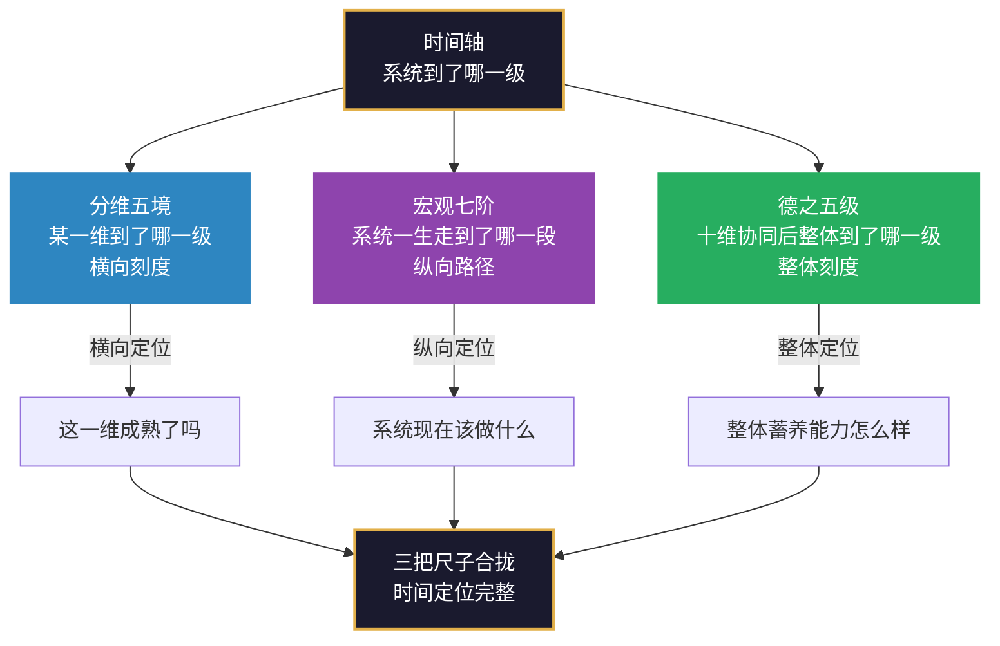

# 第16章 三把尺子的关系：分维、七阶、整体

> *“一把尺子量一种对象。三把尺子合拢，系统的时间定位才算完整。”*
> *“分维五境量‘这一维到了哪一级’，宏观七阶量‘系统一生走到了哪一段’，德之五级量‘十维协同后整体到了哪一级’。”*

---

在第13章中，我们完成了宏观七阶的阐述——系统一生走过的七个阶段：构建、调适、完善、稳固、诊断、进化、衍化。七阶回答的是“系统一生走到了哪一段”。

在第14章中，我们完成了分维五级成熟度的阐述——每一维从“无”到“衍”的五级刻度，以及三境（立基、贯通、自衍）和不器口诀。五境回答的是“某一维到了哪一级”。

在第15章中，我们完成了整体德之五级的阐述——十维协同后涌现的整体蓄养能力：无德、下德、常德、上德、玄德。德之五级回答的是“十维协同后整体到了哪一级”。

三章分别展开了时间轴的三个刻度。但三把尺子不是三个独立的工具——它们共同构成时间轴的完整坐标系。本章的任务，就是把三把尺子合拢，说明它们的关系、协同用法和诊断逻辑。

> **【本章与三轴的关联】** 本章是时间轴的“收束章”——它回答“三把尺子如何协同使用”。
>
> - **与空间轴的关联**：三把尺子量的是空间轴十维在时间轴上的“投影”。分维五境量每一维的成熟度（空间轴的单维投影），宏观七阶量系统一生的路径（空间轴的整体投影），德之五级量十维协同后的整体状态（空间轴的协同投影）。
> - **与动力轴的关联**：三把尺子的每一次跃迁，都需要动力轴的支撑。七阶的推进靠三循环的运转，五境的跃迁靠正大周天/反大周天/小周天的组合，德之五级的提升靠新陈代谢循环的持续运转。**时间轴是“刻度”，动力轴是“动力”——没有动力，刻度不会自己往上走。**
> - **与第19-20章的关联**：第19章（道之三层）和第20章（道与德）是“框架的边界与整体”，本章是“时间轴的刻度与关系”。两者一内一外，共同构成框架的完整收束。

## 16.1 三把尺子：分维五境、宏观七阶、德之五级

### 16.1.1 三把尺子速览

| 尺子 | 量什么 | 刻度 | 回答的问题 | 对应章节 |
|:---|:---|:---|:---|:---|
| **分维五境** | 某一维到了哪一级 | 无→有→定→合→衍 | 这一维成熟了吗？ | 第14章 |
| **宏观七阶** | 系统一生走到了哪一段 | 构建→调适→完善→稳固→诊断→进化→衍化 | 系统现在该做什么？ | 第13章 |
| **德之五级** | 十维协同后整体到了哪一级 | 无德→下德→常德→上德→玄德 | 整体蓄养能力怎么样？ | 第15章 |

### 16.1.2 三把尺子的共同逻辑

三把尺子共用同一套刻度语言（无→有→定→合→衍），但量的是三种不同的对象：

| 尺子 | 量什么 | 刻度语言 | 说明 |
|:---|:---|:---|:---|
| **分维五境** | 某一维 | 无→有→定→合→衍 | 直接使用五级名称 |
| **宏观七阶** | 系统一生 | 构建→调适→完善→稳固→诊断→进化→衍化 | 七阶是五境在“系统生命周期”上的展开 |
| **德之五级** | 整体协同 | 无德→下德→常德→上德→玄德 | 借用《道德经》五个字，对应五级刻度 |

**三把尺子不是三套标准，是同一根尺子换了刻度上的字。** 分维五境量“某一维”，宏观七阶量“系统一生”，德之五级量“十维协同后的整体”——对象不同，刻度逻辑相同。

### 16.1.3 三把尺子的关系图

## 16.2 三者的关系：一横一纵一整体

### 16.2.1 一横：分维五境

分维五境是“横向刻度”——它量的是系统在某一时刻，每一维的成熟度。

**横向刻度的特征**：
- **量的是“点”**：某一维在某一时刻的成熟度。
- **可以比较**：不同维度之间的成熟度可以横向比较（哪一维高、哪一维低）。
- **可以诊断**：通过五境评分，可以快速识别系统的“高峰”和“低谷”。
- **不能替代整体**：十维五境的加总，不等于整体状态（第15章已说明）。

**横向刻度的用法**：用雷达图绘制十维五境评分，识别“低谷”维度（≤2分）作为优先改进点。

### 16.2.2 一纵：宏观七阶

宏观七阶是“纵向路径”——它量的是系统一生走过的七个阶段。

**纵向路径的特征**：
- **量的是“段”**：系统当前处于生命周期的哪一段。
- **有先后顺序**：七阶有先后顺序（构建→调适→完善→稳固→诊断→进化→衍化），但可以回退、并行、跳过。
- **有退出条件**：每一阶都有退出条件（第13章13.6节），达不到就不该进入下一阶。
- **不能替代横向**：七阶告诉你“现在该做什么”，但不告诉你“每一维到了哪一级”。

**纵向路径的用法**：定位系统当前所处的阶段，检查“它做的事对不对这个阶段”。

### 16.2.3 一整体：德之五级

德之五级是“整体刻度”——它量的是十维协同后涌现的整体蓄养能力。

**整体刻度的特征**：
- **量的是“整体”**：十维协同后的整体状态，不是十维刻度的加总。
- **是涌现的**：德不是某一维的属性，是十维协同后才出现的东西。
- **不能自评**：德一旦被当成可自评的指标，当场从“上德”掉回“下德”（第15章15.5节）。
- **需要多视角验证**：德之五级的判断，应该由系统外部的观察者来做，而非系统自己。

**整体刻度的用法**：用“抽人测试”“意志依赖测试”等方法，诊断系统的整体蓄养能力。

### 16.2.4 三者的关系总表

| 关系 | 分维五境 | 宏观七阶 | 德之五级 |
|:---|:---|:---|:---|
| **与分维五境的关系** | — | 七阶的每一阶，对应各维度的最低成熟度要求 | 德之五级是分维五境的“协同涌现”，不是加总 |
| **与宏观七阶的关系** | 五境是七阶的“横截面高度” | — | 德之五级是七阶的“整体状态刻度” |
| **与德之五级的关系** | 五境是德的“分维基础” | 七阶是德的“纵向路径” | — |

**一句话总结**：分维五境是“横截面”，宏观七阶是“纵贯线”，德之五级是“整体状态”。三者不是三个独立工具，是同一个系统的三个侧面——**横向看每一维，纵向看一生，整体看协同。**

### 16.2.5 三者可能出现的“错位”

三把尺子经常出现“错位”——这不是矛盾，是常态：

| 错位类型 | 表现 | 说明 |
|:---|:---|:---|
| **七阶高、五境低** | 系统在“稳固”阶段，但某一维还在“有”境 | 系统整体阶段靠前，但某一维拖后腿——这一维是瓶颈 |
| **七阶低、五境高** | 系统在“构建”阶段，但某一维已到“合”境 | 系统整体阶段靠后，但某一维已很成熟——这一维是杠杆 |
| **七阶高、德低** | 系统在“衍化”阶段，但整体德性只有“常德” | 系统能运转，但蓄养能力不强——可能是“能转但不能长” |
| **七阶低、德高** | 系统在“稳固”阶段，但整体德性已达“上德” | 系统阶段靠后，但整体蓄养能力很强——可能是“小而美”的系统 |

**错位的价值**：错位告诉你“从哪里入手”。七阶高、五境低——补那一维的短板；七阶低、五境高——用那一维做杠杆；七阶高、德低——提升整体蓄养能力；七阶低、德高——保持整体优势，稳步推进阶段。

## 16.3 双表示法：独立演进与系统共进

### 16.3.1 双表示法的基本思想

双表示法思想允许系统在不同维度上呈现不同的成熟度，同时要求系统整体的健康状况取决于维度间的协调程度。

双表示法的两个维度是：

**维度独立能力度**：每个维度可以独立评定境界。一个系统的“理”可能已达“定”境，而“心”可能仍处于“有”境——这不仅是允许的，也是常见的。不同维度的发展速度天然不同，非均衡发展是系统的常态而非异常。

**系统共进要求**：系统整体的健康运行，需要各维度之间的协调。如果某个维度的境界显著低于其他维度，它就会成为系统的“瓶颈”——限制其他维度的充分发挥。因此，系统需要关注“最弱环节”的提升。

### 16.3.2 独立演进的必要性

允许独立演进的核心理由在于：**不同维度的发展节奏不同，强行同步会扭曲系统的自然演化。**

理的提升需要知识和经验的积累，这是一个渐进的过程；心的提升可能通过一次深刻的体验实现突破；器的提升可能依赖外部技术的成熟，需要等待外部条件——这些不同的发展节奏决定了同步推进既不可行也不可取。

强行同步的代价往往是：为了“对齐”而牺牲深度，为了“平衡”而牺牲效率。允许独立演进，系统的各部分就能按其自身的节奏发展，在各自的最佳时机实现跃迁。

### 16.3.3 系统共进的协调机制

尽管允许独立演进，系统仍然需要确保各维度之间的协调。协调机制包括：

**周期性审视**：定期评估各维度的境界，识别“最弱环节”和“最强环节”，判断是否存在威胁系统整体健康的瓶颈。

**跨维度促进**：利用一个维度的提升来促进其他维度的提升。例如，当“理”提升时，主动将其应用于“念”和“道”的优化；当“器”提升时，主动将其应用于“术”和“行”的改进。

**阈值管理**：当某个维度的境界与其他维度的差距过大时，需要识别这是“合理的差异化”还是“危险的失衡”。当差异开始影响系统的整体功能时，就需要优先提升弱项维度。

### 16.3.4 双表示法的实践应用

在实践中，双表示法可以通过以下方式应用：

**第一步：评估**。使用五级成熟度模型对系统的十个维度分别进行评定，绘制“成熟度雷达图”。

**第二步：分析**。识别图中的“高峰”（高境界维度）和“低谷”（低境界维度），分析差异的原因和影响。

**第三步：决策**。根据分析结果决定干预策略——是优先提升低谷，还是继续强化高峰，抑或等待低谷自然发展。

**第四步：执行**。实施干预，并在下一轮审视中评估效果。

### 16.3.5 双表示法与三把尺子的关系

双表示法主要处理“分维五境”层面的问题——它允许各维度独立演进，同时要求系统整体协调。但双表示法不处理“宏观七阶”和“德之五级”层面的问题：

| 尺子 | 双表示法是否处理 | 说明 |
|:---|:---|:---|
| **分维五境** | 是 | 双表示法允许各维独立演进，同时要求系统共进 |
| **宏观七阶** | 否 | 七阶是系统一生的纵向路径，双表示法不处理纵向阶段问题 |
| **德之五级** | 否 | 德是十维协同后的整体状态，双表示法不处理整体蓄养能力问题 |

**双表示法是“分维五境”层面的协调工具**——它解决的是“各维度发展不均衡”的问题，不解决“系统一生走到了哪一段”和“整体蓄养能力怎么样”的问题。后两者需要七阶和德之五级来回答。

### 16.3.6 双表示法的“错位诊断”

双表示法可以用于诊断“七阶高、五境低”的错位：

| 错位类型 | 双表示法诊断 | 干预策略 |
|:---|:---|:---|
| 七阶高、五境低（某一维拖后腿） | 该维度是“最弱环节” | 用小周天定锚点，集中补该维 |
| 七阶低、五境高（某一维是杠杆） | 该维度是“最强环节” | 用正大周天，以强带弱 |
| 七阶与五境同步（各维均衡） | 各维度发展协调 | 保持现状，关注德之五级 |

## 16.4 时间轴的诊断用法：定位、判阶、识德

### 16.4.1 三把尺子的诊断分工

三把尺子在系统诊断中各有分工：

| 尺子 | 诊断问题 | 诊断方法 | 输出 |
|:---|:---|:---|:---|
| **分维五境** | 哪一维是瓶颈？ | 雷达图、五境评分 | 瓶颈维度清单 |
| **宏观七阶** | 系统现在该做什么？ | 七阶定位、退出条件检查 | 当前阶段及重点任务 |
| **德之五级** | 整体蓄养能力怎么样？ | 抽人测试、意志依赖测试 | 整体德性等级 |

### 16.4.2 诊断步骤

**第一步：分维五境诊断（横向定位）**
- 对十个维度分别进行五级评定
- 绘制雷达图，识别“高峰”和“低谷”
- 确定“瓶颈维度”（≤2分）和“杠杆维度”（≥4分）

**第二步：宏观七阶诊断（纵向定位）**
- 判断系统当前处于七阶中的哪一段
- 检查当前阶段的退出条件是否满足
- 确定系统当前阶段的重点任务

**第三步：德之五级诊断（整体定位）**
- 用抽人测试、意志依赖测试等方法，判断整体蓄养能力
- 识别系统在德之五级中的位置
- 确定整体提升的方向

**第四步：三把尺子合拢（综合定位）**
- 检查三把尺子之间是否存在“错位”
- 根据错位类型，选择干预策略
- 制定综合改进方案

### 16.4.3 诊断中的常见误用

| 误用 | 表现 | 纠正 |
|:---|:---|:---|
| 用五境替代七阶 | 只看每一维的分数，不看系统一生走到了哪一段 | 五境是横向，七阶是纵向，两者不能互相替代 |
| 用七阶替代五境 | 只看系统阶段，不看每一维的成熟度 | 七阶告诉你“该做什么”，五境告诉你“哪一维拖后腿” |
| 用德之五级自评 | 给自己打分，越打越“下德” | 德只能用来看系统，不能用来评自己 |
| 忽视错位 | 三把尺子各看各的，不检查它们之间的关系 | 错位是诊断的“信号”——错位告诉你“从哪里入手” |
| 把德之五级当KPI | 给德打分、排名、考核 | 德的“定”用可观察行为锚点验证，不用指标量化 |

### 16.4.4 三把尺子与三循环的对应

三把尺子的诊断结论，直接对应三循环的选择：

| 尺子 | 诊断结论 | 三循环选择 |
|:---|:---|:---|
| **分维五境** | 某一维是瓶颈（≤2分） | 小周天：定锚点，集中补该维 |
| **宏观七阶** | 系统在“调适”阶段 | 反大周天：修正认知 |
| **宏观七阶** | 系统在“稳固”阶段 | 正大周天：固化运转 |
| **德之五级** | 整体在“下德” | 正大周天+小周天：从“靠意志”到“靠结构” |
| **德之五级** | 整体在“上德” | 不做什么：减少动作，让系统自己长 |

## 16.5 三把尺子的协同：一个综合案例

### 16.5.1 案例背景

一家成立五年的SaaS公司，团队约60人。创始人感觉“公司越大越难管”，但说不清问题在哪里。我们用三把尺子做一次综合诊断。

### 16.5.2 分维五境诊断

| 维度 | 评分 | 说明 |
|:---|:---|:---|
| 理 | 4（合） | 创始团队对产品和市场有深刻理解 |
| 念 | 3（定） | 使命清晰，但规模化方向有分歧 |
| 心 | 2（有） | 老员工与新员工文化隔阂 |
| 道 | 2（有） | 业务流程未建立，跨部门协作混乱 |
| 熵 | 2（有） | 技术债务积累，创始人成为瓶颈 |
| 法 | 2（有） | 缺乏系统的招聘、绩效、培训制度 |
| 术 | 3（定） | 专业能力有，但方法论不足 |
| 器 | 3（定） | 工具齐全，但数据未打通 |
| 行 | 2（有） | 执行节奏不稳定 |
| 果 | 2（有） | 数据汇报多，诊断少 |

**瓶颈维度**：心、道、熵、法、行、果（均≤2分）。
**杠杆维度**：理（4分）、术（3分）、器（3分）。

### 16.5.3 宏观七阶诊断

系统处于**构建→调适的过渡期**——已经从“从无到有”走出来了，但还没有进入“反馈校正”的稳定阶段。当前阶段的重点任务是：**建立基本的业务流程和制度**（道、法），**建立执行节奏**（行），**建立反馈机制**（果）。

退出条件检查：“能持续产出最小结构”已满足（有产品、有客户），但“结果的偏离已归因到方向层面”未满足（果的数据未驱动改进）。

### 16.5.4 德之五级诊断

**抽人测试**：把创始人抽掉，公司还能运转吗？答案是不能——创始人既是战略制定者，也是执行救火队，还是关键决策的审批节点。**结论：无德或下德之间。**

**意志依赖测试**：哪些事必须靠某个人动员才能做成？招聘、跨部门协作、客户投诉处理——都依赖创始人推动。**结论：下德。**

### 16.5.5 三把尺子合拢

| 尺子 | 诊断结论 | 错位分析 |
|:---|:---|:---|
| **分维五境** | 瓶颈在：心、道、熵、法、行、果 | 理（4分）是杠杆维度，可以用理带动其他维度 |
| **宏观七阶** | 处于构建→调适过渡期 | 七阶低、五境高（理4分）——理是杠杆 |
| **德之五级** | 下德 | 七阶低、德低——系统还在“靠人”的阶段 |

**综合诊断**：系统在七阶上处于“构建→调适”过渡期，在五境上“理”是杠杆（4分）、“心道熵法行果”是瓶颈（≤2分），在德之五级上处于“下德”（靠创始人推动）。

**干预策略**：
- **用理做杠杆**（正大周天）：创始人把对产品和市场的理解，转化为清晰的业务流程（道）和制度（法），用理带动道和法。
- **用小周天补瓶颈**：以“理”为锚点，循环下游（念→心→道→熵→法→术→器→行→果），集中补“道”和“法”的短板。
- **用反大周天改判断**：创始人的“事必躬亲”判断需要修正——从“我来推动”改为“系统来推动”。
- **德之五级提升**：从“下德”到“常德”——把依赖创始人的部分，变成依赖结构的部分。

## 16.6 本章小结

本章完成了时间轴三把尺子的整合，为第五部分“时间轴”画上了句号。

**三把尺子**是：分维五境（量某一维到了哪一级）、宏观七阶（量系统一生走到了哪一段）、德之五级（量十维协同后整体到了哪一级）。三者共用同一套刻度语言（无→有→定→合→衍），但量的是三种不同的对象。

**三者的关系**是“一横一纵一整体”：分维五境是横截面，宏观七阶是纵贯线，德之五级是整体状态。三者不是三个独立工具，是同一个系统的三个侧面。

**双表示法**是“分维五境”层面的协调工具——它允许各维度独立演进，同时要求系统整体协调。双表示法不处理“宏观七阶”和“德之五级”层面的问题。

**三把尺子的诊断用法**是：分维五境诊断“哪一维是瓶颈”，宏观七阶诊断“系统现在该做什么”，德之五级诊断“整体蓄养能力怎么样”。三把尺子合拢，才能形成完整的系统诊断。

**三把尺子与三循环的对应**是：五境诊断出的瓶颈维度，用小周天补；七阶诊断出的阶段任务，用正大周天或反大周天；德之五级诊断出的整体状态，用正大周天+小周天提升。

三把尺子的“错位”不是矛盾，是常态——错位告诉你“从哪里入手”。七阶高、五境低——补那一维的短板；七阶低、五境高——用那一维做杠杆；七阶高、德低——提升整体蓄养能力；七阶低、德高——保持整体优势，稳步推进阶段。

在下一章中，我们将进入第六部分“诊断与优化”，从第17章“系统常见病态与诊断”开始，将三把尺子的诊断结论转化为具体的病态识别和优化方案。**时间轴告诉你“到了哪一级”，诊断与优化告诉你“出了什么问题、怎么改”。**

## 思考与练习

1. **三把尺子定位**：选择一个你熟悉的系统，用三把尺子分别定位——分维五境：哪一维是瓶颈？宏观七阶：系统在哪个阶段？德之五级：整体蓄养能力怎么样？

2. **错位诊断**：你选择的系统，三把尺子之间是否存在“错位”？是七阶高、五境低（某一维拖后腿），还是七阶低、五境高（某一维是杠杆）？这种错位告诉你什么？

3. **双表示法应用**：你选择的系统，各维度之间的发展是否均衡？如果存在“最弱环节”，你会用双表示法的哪个机制来协调——周期性审视、跨维度促进，还是阈值管理？

4. **诊断步骤练习**：按照本章16.4节的四个步骤，对你选择的系统做一次完整的时间轴诊断——分维五境诊断、宏观七阶诊断、德之五级诊断、三把尺子合拢。

5. **三循环选择**：根据你的诊断结论，你选择的系统应该以哪条循环为主？是正大周天（接链/固链）、反大周天（改判断），还是小周天（打堵点）？为什么？

6. **德之五级提升**：你选择的系统在德之五级中处于哪一级？如果要提升一级，最需要做的一个动作是什么？（提示：下德→常德是“把依赖人的部分变成依赖结构的部分”；常德→上德是“打通内部与外部”；上德→玄德是“撤手”。）

7. **综合诊断报告**：基于以上分析，为你选择的系统撰写一份时间轴诊断报告——包含三把尺子的定位、错位分析、综合诊断结论和干预策略。

— **渊 云 不 器 · 循 环 无 端** —
