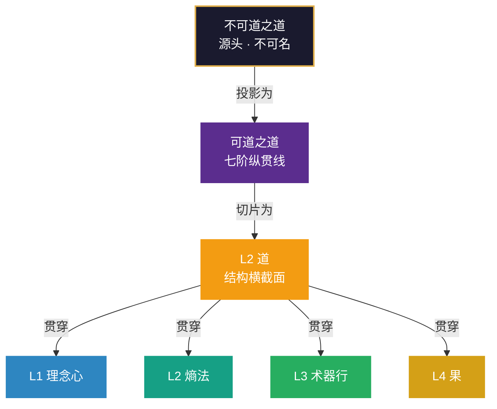

# 第七部分 框架的边界与整体

> *“一个框架真正的成熟，不是说它能装下一切，是它说得出自己装不下什么。”*
> ——作者手记

---

前六个部分完成了三轴的完整展开和诊断优化的闭环：

- **空间轴**（第5-8章）：十维的静态结构——系统由什么构成。
- **动力轴**（第9-12章）：关系矩阵、熵为源、经脉、三循环——系统为什么动、怎么动。
- **时间轴**（第13-16章）：宏观七阶、分维五境、德之五级、三把尺子——系统到了哪一级。
- **诊断与优化**（第17-18章）：六种病态、诊断工具、优化策略、转型路线图——系统出了什么问题、怎么改。

六个部分合拢，框架的主体已经完整：分析者既能“看”（空间轴、动力轴、时间轴），也能“改”（诊断与优化）。

但框架还有“上面”和“外面”需要说清。这就是第七部分的任务。

**第七部分包含两章**：

- **第19章**：道之三层——框架的边界。回答“框架之上是什么”。四层十维里的“道”不是《道德经》那个“道”，它只是“可道之道”在系统结构上的一个切片。在它之上，还有不可道之道——框架只能指向它，不能描述它。
- **第20章**：道与德——源与流，体与用。回答“框架的整体是什么”。德不是第十一维，它是十维协同后涌现的整体蓄养能力。道是源，德是流；道是体，德是用。

**为什么这两章是“框架的边界与整体”？**

因为一个完整的框架，不仅要说清“框架内有什么”，还要说清“框架外有什么”。四层十维能描述“系统怎么运转”，但描述不了“为什么会有系统”；能描述“道在做功”，但描述不了“道本身从哪来”。**框架有边界，道无边界——知道框架的边界，才是真正的“知止”。**

而“德”作为整体蓄养能力，是框架对“整体”的回答——它不是第十一维，而是十维协同后涌现的东西。它补上了框架此前缺的那一块：从“每一维怎么样”到“整体怎么样”。

**第七部分与三轴的关联**：

- **与空间轴的关联**：第19章的“道之三层”是对空间轴L2“道”维度的重新定位——L2道只是可道之道的切片。第20章的“道与德”是对空间轴十维的“整体收束”——德不在任何一个格子里，它在格子之间。
- **与动力轴的关联**：第19章的“可道之道”是一条纵贯七阶的线（第13章已展开），它贯穿动力轴的全生命周期。第20章的“德”是动力轴运转的“整体涌现”——三循环（转·改·通）运转到一定程度，才会涌现出德的蓄养能力。
- **与时间轴的关联**：第15章的德之五级是“整体刻度”，第19-20章是“框架的边界与整体”——两者一内一外，共同构成框架的完整收束。第15章讲“德是什么、有几级”，第20章讲“道与德在整个框架中的位置”。

两章读完，框架才算把话说完整——它不再是“十个格子”，而是一个**有边界、有整体、有生命周期的系统**。它仍然不是道的全部。**框架有边界，道无边界。而知道框架的边界，才是真正的“知止”。**

# 第19章 道之三层——框架的边界

> *“一张地图画得再细，也画不出国土本身。”*
> *“说得出‘我画不了哪里’，地图才算画完了。”*

---

有位读者在读完全书后问了一个很直接的问题：

「你们说四层十维里的 L2 有个『道』，是传动逻辑。那《道德经》开头说『道可道，非常道』——你们这个『道』，岂不是一开口就已经不是道了？」

这个问题不好糊过去。因为按《道德经》的原话，凡是能被说清楚的道，都不是那个恒常的道。而四层十维把「道」写进了一张表格，给了它一个层位（L2）、两个同伴（熵、法）、一句定义（传动逻辑）——这显然是「可道」的做法。

那就得承认：**框架里的「道」，不是《道德经》那个「道」。**

但这句承认之后，问题才真正开始：既然不是，那是什么关系？是完全无关的两样东西，还是一个东西的不同层？

本章要给的答案是后者：**三层，同一件事的三个深度。**

> **【本章与三轴的关联】** 本章是第七部分的“边界章”——它回答“框架之上是什么”。
>
> - **与空间轴的关联**：本章是对空间轴L2“道”维度的重新定位——L2道只是可道之道的切片，不是道的全部。第6章讲“道为枢”（L2道的操作定义），本章讲“道之三层”（L2道在道之三层中的位置）。两章不矛盾——第6章讲“怎么用”，本章讲“在哪个深度用”。
> - **与动力轴的关联**：本章的“可道之道”是一条纵贯七阶的线（第13章已展开），它贯穿动力轴的全生命周期。第13章的七阶，本质上是可道之道在系统生命周期上的展开。
> - **与时间轴的关联**：本章的“道之三层”与第15章的“德之五级”形成呼应——道之三层是“框架的边界”，德之五级是“整体刻度”。两者一外一内，共同构成框架的完整收束。

## 19.1 三层的划分

### 19.1.1 核心观点

**「道」在四层十维里不是一个，是三个——而框架只装得下最浅的那一层。**

三层从上到下：不可道之道（源头）→ 可道之道（纵贯线）→ L2 道（横截面）。

上层不能描述，只能指向；中层能说清它做什么，说不清它是什么；下层能完整描述，因为它是被切下来的一片。

### 19.1.2 三层的划分表

| 层次 | 是什么 | 能否被框架描述 | 位置 | 《道德经》对应 |
|---|---|---|---|---|
| 第一层 **不可道之道** | 与德同一层面的终极之道，不可道、不可名 | 不能，只能「指向」 | 框架之外、框架之上 | 「道可道，非常道」（第1章）、「道常无名」（第32章）、「吾不知其名，强字之曰道」（第25章） |
| 第二层 **可道之道** | 贯穿系统全生命周期的路径与脉络：构建→调适→完善→稳固→诊断→进化→衍化 | 可被「指向」，不可被完全描述 | 贯穿 L1–L4 全生命周期 | 「反者道之动」（第40章）、「道生一，一生二，二生三，三生万物」（第42章）、「大曰逝，逝曰远，远曰反」（第25章） |
| 第三层 **L2 道** | 系统结构层面的传动逻辑：信息、能量、物质如何流动 | 可以，且已被完整描述 | L2 系统框架中的一个维度 | 「道冲而用之或不盈」（第4章）、「道常无为而无不为」（第37章） |

### 19.1.3 三层的方向：越往上越不可用

三层不是三个并存的「道」，是**同一条线的三个深度**。往下走一层，就多一分可描述，少一分本真；往上走一层，就多一分本真，少一分可用。

这个方向和一般人的直觉相反。直觉以为「越抽象越高明」，其实在这个结构里，**最上面那层恰恰是最不可用的**——因为它不可描述，也就无法操作、无法传授、无法验证。框架之所以有用，正因为它肯待在最下面那层。

### 19.1.4 三层与三轴的对应

| 层次 | 对应三轴 | 说明 |
|:---|:---|:---|
| **不可道之道** | 三轴之外 | 框架的源头，不可被框架描述——它不在空间轴、动力轴、时间轴的任何一个格子里 |
| **可道之道** | 时间轴（宏观七阶） | 贯穿系统全生命周期的路径——第13章的七阶，就是可道之道的展开 |
| **L2道** | 空间轴（L2维度） | 系统结构层面的传动逻辑——第6章的“道为枢”，就是L2道的操作定义 |

## 19.2 第一层：不可道之道——框架的底色

### 19.2.1 核心观点

《道德经》第1章开头六个字，是整个三层结构的起点：

> 道可道，非常道。

这句话常被读成神秘主义，其实它是一句**认识论声明**：凡是被语言固定下来的，就已经是被切过一刀的；被切过一刀的，就不是原来那个完整的。

### 19.2.2 经典依据

第25章说得更直白：

> 有物混成，先天地生。寂兮寥兮，独立而不改，周行而不殆，可以为天下母。吾不知其名，强字之曰道，强为之名曰大。

注意「**强**」字用了两次——强字之曰道，强为之名曰大。老子不是在命名，他是在说：**我不得不用一个词指它，但这个词不是它。**

第32章说：

> 道常无名。

「无名」不是「没有名字」，是「不能被名字穷尽」。任何名字都是对道的切割——切一刀，它就变成了「可道之道」。

### 19.2.3 对框架的意义

这一层对四层十维的意义是：**它是框架的地基，而地基不在地图上。**

框架能说的是「系统怎么运转」，说不出「为什么会有系统」；能说「道在做功」，说不出「道从哪来」。这不是框架的缺陷，这是所有框架的共同处境——任何描述系统的东西，都必须站在一个它自己描述不了的东西上面。

所以本章对第一层的处理只有一句话：**指向它，然后停手。** 不定义，不展开，不建模型。谁要是给「不可道之道」画一张结构图，那张图就已经不是它了。

> **【不可道之道与框架边界的关联】** 不可道之道是框架的“封顶”——它告诉读者：框架有边界，边界之外不是“框架还没写到”，而是“框架永远写不到”。这不是框架的缺陷，是框架的诚实。第20章将说明：道与德的关系（源与流，体与用）正是建立在这个“封顶”之上的——道是源（不可道之道），德是流（十维协同后涌现的整体）。

### 19.2.4 实践中的“停手”原则

这一层在实践中怎么用？三个“停手”原则：

**原则一：遇到“为什么”的终极追问，停手。**
「为什么这个系统会存在？」「为什么宇宙是有序的？」——这些问题超出框架范围。硬答会变成玄学，不答反而是诚实。可以做的，是把问题往下拉一层：「这个系统在什么条件下能持续存在？」这就回到框架之内了。

**原则二：不要把“不可道之道”当成“可以操作的东西”。**
有人读了“道可道，非常道”之后，试图“直接合道”——这是不可能的。不可道之道不能被操作，只能被指向。操作层面能做的，是L2道和可道之道。

**原则三：不要在L2道上要求第一层的东西。**
有人抱怨「你们的道讲得太浅，只讲了流动，没讲生成和跃迁」——这个批评对L2道成立，对可道之道不成立。解法不是把L2道写厚，是往上加一层。这正是本章要补的东西。

## 19.3 第二层：可道之道——一条纵贯线

### 19.3.1 核心观点

第二层是本章真正的战场。因为它**可以被说出来**，而且此前从没被说清过。

先看它和第三层的区别，一句话：

- **L2 道是横截面**：系统在某一时刻，信息、能量、物质怎么流。
- **可道之道是纵贯线**：系统从生到衍，一路怎么走。

横截面回答「此刻怎么运转」，纵贯线回答「一生怎么走」。这两个问题不同，答案自然不同。

### 19.3.2 七阶与道的七种角色

可道之道这条纵贯线，有七个阶段（第13章已详细展开）。每个阶段的「核心任务」不同，「道」在里面扮演的角色也不同：

| 阶段 | 核心任务 | 道的显现 | 对应四层十维 |
|---|---|---|---|
| **构建** | 从无到有 | 生成路径——道枢启动 | L1→L2 的传动 |
| **调适** | 反馈校正 | 调整路径——果→道 | L4→L2 的反馈 |
| **完善** | 结构优化 | 精进路径——道→术器行 | L2→L3 的落地 |
| **稳固** | 规则固化 | 稳定路径——道→法 | L2 内部的约束 |
| **诊断** | 堵塞识别 | 诊断路径——果→道 | L4→L2 的归因 |
| **进化** | 相变跃迁 | 跃升路径——道→理念心 | L2→L1 的升维 |
| **衍化** | 自组织涌现 | 衍化路径——道→不器 | 全维度的自衍 |

**这里只取一个关键点**：

**「道」在这七个阶段里，扮演的不是同一个角色，是七种角色。**

在「构建」阶段，道是起点——先有路径，才有系统；在「稳固」阶段，道是约束——把流动固化成规则；在「进化」阶段，道是通道——把系统送到上一层的入口。

同一个「道」字，在七个阶段里指的是七件不同的事。这就是为什么把道理解成「一个维度」会不够用：一个维度只有一种功能，而道在系统一生中有七种功能。

### 19.3.3 可道之道与第13章七阶的关系

第13章详细展开了七阶的每一个阶段——核心任务、道的角色、退出条件、与三循环的对应。本节只做“定位”：可道之道是七阶的“纵贯线”，七阶是可道之道的“展开”。

**七阶是可道之道的“时间切片”**：每一阶都是可道之道在系统生命周期上的一个截面。构建期的道是“生成路径”，稳固期的道是“稳定路径”，进化期的道是“跃升路径”——七种角色，七种切片。

**可道之道是七阶的“统一线索”**：七阶之所以是“一条路”而不是“七个步骤”，是因为可道之道贯穿其中。没有可道之道，七阶就是七个孤立的阶段；有了可道之道，七阶才是一条“系统一生的路”。

> **【可道之道与动力轴的关联】** 可道之道贯穿动力轴的全生命周期——正大周天的每一圈，都是可道之道在系统运转中的“一次呼吸”；反大周天的每一次修正，都是可道之道在系统校准中的“一次纠偏”；小周天的每一次打通，都是可道之道在系统突破中的“一次冲刺”。**可道之道是“路”，三循环是“怎么走”——两者是同一件事的两个视角。**

### 19.3.4 可道之道的实践含义

可道之道在实践中的含义是：**系统分析者不仅要看“此刻怎么运转”（L2道），还要看“一生怎么走”（可道之道）。**

- 如果只看L2道，你会知道“现在的流程哪里堵了”，但不知道“系统现在该做什么”。
- 如果只看可道之道，你会知道“系统现在在哪个阶段”，但不知道“具体的传动哪里出了问题”。

**两者合拢，才是完整的“道”的分析**：L2道告诉你“传动逻辑怎么设计”，可道之道告诉你“这个设计在系统一生中的位置”。

## 19.4 第三层：L2道——一个横截面

### 19.4.1 核心观点

第三层就是第6章那个「道」，不用改一个字。它的定义是：

> **道，传动逻辑：以枢为核心，信息·能量·物质的流动路径与转化规则。**

它在 L2，与「熵」「法」并列：

- **熵**是动力源——压力差、失衡、自组织动力；
- **法**是运行规则——标准化流程、约束、奖惩；
- **道**是传动逻辑——以枢为核心，信息、能量、物质怎么流。

三者构成一个完整的动力系统：熵提供「为什么动」，道提供「往哪动、怎么动」，法提供「动的时候守什么规矩」。

### 19.4.2 L2道与第6章的关系

第6章详细展开了L2道的操作定义——“道为枢”的三层意涵（枢+路径+规则）、道的三境界（控道→合道→忘道）、道的不器（不滞于道）。本节只做“定位”：L2道是道之三层中的“最浅一层”，是“可被框架完整描述”的那一层。

**第6章不用改一个字。** 本章只是补上它没说的“上下两层”——在L2道之上，还有可道之道（纵贯线）和不可道之道（源头）。L2道是“横截面”，可道之道是“纵贯线”，不可道之道是“源头”。

### 19.4.3 L2道的价值与局限

L2道能被完整描述，所以它能被放进表格、被画成图、被写成指标。这正是它的价值：**可描述才可操作。**

但它也正因为可描述，所以只是「道」的一个切片。第4章说「道冲而用之或不盈」，第37章说「道常无为而无不为」——这两句里的「道」，已经不是 L2 那个道了，它们说的是第二层甚至第一层。

**L2道的局限**：它只能回答“此刻怎么传动”，不能回答“系统一生怎么走”（那是可道之道的领域），更不能回答“道本身从哪来”（那是不可道之道的领域）。

> **【L2道与第11章经脉的关联】** 第11章已说明：道是应然设计（以枢为核心的期望路径），经脉是实然轨迹（能量实际流动的习惯性通道）。**脉以道为纲，道以脉为证**——L2道是经脉的“设计蓝图”，经脉是L2道的“实际运行”。两者相互校准，共同演化。

## 19.5 投影与切片：为什么不是替代

### 19.5.1 核心观点

三层之间是**投影关系**：

### 19.5.2 投影与切片的两层含义

「投影」和「切片」这两个词很关键，它们同时说明了两件事：

**第一，下层是真的，不是假的。** 影子是本体的影子，但没有影子你连本体在哪都不知道。L2 道虽然是切片，它描述的传动逻辑是真实有效的——你不能因为「它只是切片」就说传动逻辑不重要。

**第二，下层不是上层的全部。** 地图是国土的投影，但地图不是国土。凡是拿 L2 道去解释「系统为什么存在」「系统为什么能跃迁」的，都会撞墙——因为那两个问题不在这一层。

### 19.5.3 最需要提防的错误

本节最需要提防的错误，是把关系读成替代：以为「既然道有三层，那 L2 道就过时了」。恰恰相反——**把 L2 道说成切片，是为了让它更准，不是为了让它下台。**

L2道仍然是框架中最有用的“道”——因为它是唯一可被完整描述、可被操作的那一层。可道之道告诉你“系统现在该做什么”，不可道之道告诉你“框架的边界在哪”，但只有L2道告诉你“具体的传动逻辑怎么设计”。

## 19.6 框架的边界，就是框架的诚实

### 19.6.1 核心观点

一个框架如果宣称「能描述一切」，它就在说谎。

四层十维的价值，不在于「能描述道」，而在于**知道自己描述不了道**。

### 19.6.2 经典依据

《道德经》第44章有一句：

> 知足不辱，知止不殆，可以长久。

「知止」这两个字，用在框架上格外贴切。框架的成熟不在于覆盖得多，而在于**知道在哪里收手**。

### 19.6.3 边界在实践中怎么用

具体到实践中，这条边界有三个用法：

**用法一：遇到「为什么」的终极追问，停手。**
「为什么这个系统会存在？」「为什么宇宙是有序的？」——这些问题超出框架范围。硬答会变成玄学，不答反而是诚实。可以做的，是把问题往下拉一层：「这个系统在什么条件下能持续存在？」这就回到框架之内了。

**用法二：遇到跨层争论，先分清层。**
「道是不是一个维度？」这个问题之所以吵不清，是因为双方在不同的层上说话。说「是」的人在第三层（L2 道确实是维度），说「不是」的人在第二层（可道之道贯穿全生命周期，不是格子）。把层分清了，争论自己就消失了。

**用法三：不要在 L2 道上要求第二层的东西。**
有人抱怨「你们的道讲得太浅，只讲了流动，没讲生成和跃迁」——这个批评对 L2 道成立，对可道之道不成立。解法不是把 L2 道写厚，是往上加一层。这正是本章要补的东西。

### 19.6.4 框架边界与第20章的关联

第19章讲“框架的边界”（道之三层），第20章讲“框架的整体”（道与德）。两者是同一件事的两面：

- **边界**告诉你“框架之外有什么”——不可道之道，框架只能指向，不能描述。
- **整体**告诉你“框架之内还有什么”——德，十维协同后涌现的整体蓄养能力，它不在任何一个格子里，在格子之间。

**边界是“封顶”，整体是“收束”。** 两者合拢，框架才算把话说完整——它不再是“十个格子”，而是一个有边界、有整体、有生命周期的系统。

> **【框架边界与三把尺子的关联】** 第16章的三把尺子（分维五境、宏观七阶、德之五级）是“系统内部的刻度”，第19章的框架边界是“框架本身的边界”。两者一内一外：三把尺子告诉你“系统到了哪一级”，框架边界告诉你“框架能说到哪一级”。**知道框架的边界，才知道三把尺子的“有效范围”——三把尺子量的是系统内部，量不了不可道之道。**

## 19.7 本章小结

「道」在四层十维里分三层：不可道之道（源头）、可道之道（纵贯线）、L2 道（横截面）。

三者的关系是投影与切片，不是替代。L2 道不必改，它只是被放回了正确的位置——它一直是那个切片，只是此前没人说过上面还有两层。

可道之道是一条纵贯七阶的路（第13章已展开），L2道是这条纵贯线在“系统结构”这个横截面上切下来的一片。

框架的边界不是缺陷，是诚实。一个说得出「我描述不了什么」的框架，比一个宣称无所不能的框架更可信，也更好用——因为你至少知道它什么时候会失效。

**框架有边界，道无边界。知道框架的边界，才是真正的「知止」。**

在下一章中，我们将从“框架的边界”转向“框架的整体”——道与德：源与流，体与用。德不是第十一维，它是十维协同后涌现的整体蓄养能力。道是源，德是流；道是体，德是用。第20章将为全书画上句号。

## 思考与练习

1. **分三层**：找三句你常说「道」的话，分别判断它们落在哪一层。落在第一层的话，通常说不清；落在第二层的话，通常是一个过程；落在第三层的话，通常能画成流程图。

2. **找投影**：拿一张你所在系统的流程图，问自己：这张图是可道之道的哪一段？（构建、调适、完善、稳固，还是诊断？）

3. **试一次停手**：下次有人问你「为什么会这样」，先判断它是框架内的「机制问题」，还是框架外的「终极问题」。如果是后者，试着不答，只把问题往下拉一层。

4. **查越界**：回忆一次你把 L2 道当成全部道的经历——你是不是要求过一个「传动逻辑」去解释「系统为什么能跃迁」？

5. **道之三层与三把尺子**：回顾本章19.6.4节的“框架边界与三把尺子的关联”。你选择的系统，三把尺子（分维五境、宏观七阶、德之五级）的“有效范围”在哪里？哪些问题是三把尺子量不了的？

6. **可道之道与七阶**：回顾第13章的七阶。你选择的系统，当前处于七阶中的哪一段？这一段对应可道之道的哪种角色（生成路径/调整路径/精进路径/稳定路径/诊断路径/跃升路径/衍化路径）？

— **渊 云 不 器 · 循 环 无 端** —
