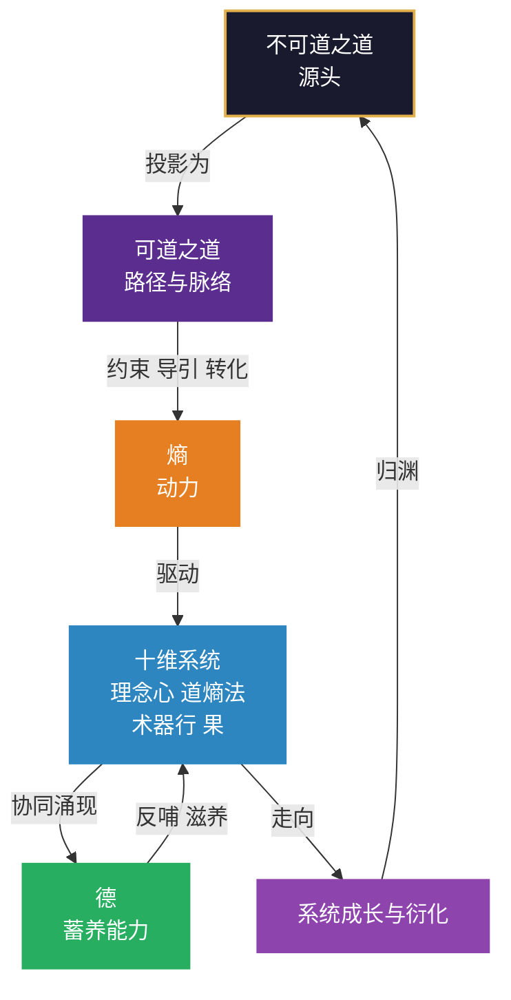

# 第20章 道与德：源与流，体与用

> *“道与德不是四层十维的两个格子。”*
> *“它们是这个框架的脉络与生命力。”*
> *“脉络断了，生命就死了；生命力没了，脉络就空了。”*

---

在第19章中，我们完成了“道之三层”的阐述——不可道之道（源头）、可道之道（纵贯线）、L2道（横截面）。三者是投影与切片关系，不是替代关系。框架有边界，道无边界——知道框架的边界，才是真正的“知止”。

第19章回答的是“框架之上是什么”的问题。本章要回答的是“框架的整体是什么”的问题。

这两个问题，靠“再加两个维度”是回答不了的。加维度只会让框架更大，不会让它更诚实。真正的回答，是把框架的**上面**、**里面**、**下面**各说清一次。第19章说了“上面”（道之三层），本章说“里面”（道与德）和“下面”（源与流，体与用）。

> **【本章与三轴的关联】** 本章是第七部分的“收束章”——它回答“框架的整体是什么”。
>
> - **与空间轴的关联**：本章是对空间轴十维的“整体收束”——德不在任何一个格子里，它在格子之间。道与德不是空间轴的两个格子，而是空间轴的“脉络”（道）与“生命力”（德）。
> - **与动力轴的关联**：本章的“道与德”是动力轴运转的“整体涌现”——三循环（转·改·通）运转到一定程度，才会涌现出德的蓄养能力。道约束熵，德反哺系统——两者是动力轴的“源”与“流”。
> - **与时间轴的关联**：本章与第15章（德之五级）形成呼应——第15章讲“德是什么、有几级”，本章讲“道与德在整个框架中的位置”。第15章是“整体刻度”，本章是“源流体用”。两者一内一外，共同构成框架的完整收束。
> - **与第19章的关联**：第19章讲“道之三层”（框架的边界），本章讲“道与德”（框架的整体）。边界是“封顶”，整体是“收束”。两者合拢，框架才算把话说完整。

## 20.1 五重对照：源与流、体与用

### 20.1.1 核心观点

**道与德不是两个并列的东西，是同一件事的两面：道是路径（源），德是蓄养（流）。**

道约束熵，德反哺系统。道在格子之上，德在格子之间。两者合起来，才是一个活着的系统。

### 20.1.2 五重对照表

| 维度 | 道 | 德 |
|---|---|---|
| **定位** | 源 | 流 |
| **功能** | 路径与脉络 | 蓄养的能力 |
| **与熵的关系** | 约束熵、导引熵、转化熵 | 反哺系统、滋养系统 |
| **在框架中的位置** | 贯穿全生命周期 | 十维协同后涌现 |
| **最高形态** | 不可道之道 | 玄德（不执的蓄养） |

五行对照里，最容易看漏的是第三行。

**道对熵，是「管」；德对系统，是「养」。** 一个是约束，一个是滋养。这两个动作的方向完全不同：约束是往回压，滋养是往外给。

一个系统如果只有约束没有滋养，会变成一台精密但冰冷的机器——它转得很准，但里面的人待不住。反过来，只有滋养没有约束，会变成一团温暖但无力的东西——大家相处很好，但做不成事。

**道与德都必须有，而且不能互相替代。**

### 20.1.3 与三轴的五重对照

| 维度 | 道 | 德 |
|---|---|---|
| **在空间轴中的位置** | 十维的“脉络”——贯穿L1-L4的传动逻辑（L2道）+ 纵贯七阶的可道之道 + 不可道之道 | 十维的“生命力”——不在任何一个格子里，在格子之间 |
| **在动力轴中的位置** | 约束熵、导引熵、转化熵——正大周天的“以道控熵”环节 | 反哺系统、滋养系统——三循环运转后涌现的整体蓄养能力 |
| **在时间轴中的位置** | 可道之道贯穿七阶——第13章的七阶就是可道之道的展开 | 德之五级是“整体刻度”——第15章的德之五级就是德的刻度化 |
| **在框架中的位置** | 框架的“边界”（第19章）——道之三层说明框架能说到哪一层 | 框架的“整体”（本章）——德说明十维协同后整体到了哪一级 |
| **最高形态** | 不可道之道——框架只能指向，不能描述 | 玄德——不执的蓄养，德与系统合一 |

## 20.2 道生之，德畜之：关系的经典依据

### 20.2.1 核心观点

这个关系的经典依据，是《道德经》第51章那六个字：

> 道生之，德畜之。

道负责「生」，德负责「畜」。生是给出一个开始，畜是把它养大。**没有生，无从畜；没有畜，生下来也活不成。**

### 20.2.2 孔德之容，惟道是从

第21章说得更直接：

> 孔德之容，惟道是从。

「孔德」是大德；「容」是样貌、形态；「惟道是从」是只追随道。整句的意思是：**大德长什么样，完全取决于它追随的是什么道。**

这一句把「源与流」的关系定死了：**德不自己定方向，德跟着道走。**

这解释了一件实践里常见的事：一个组织如果方向反复变，它的能力一定长不厚。不是因为它不会蓄养，是因为**它每蓄一点，方向就变了，蓄的东西作废了。** 德不是独立生长的，它长在道给出的那条路上。

### 20.2.3 失道而后德：降级序列

第38章还有一句：

> 失道而后德，失德而后仁，失仁而后义，失义而后礼。

这是一个**降级序列**：道没了才讲德，德没了才讲仁，仁没了才讲义，义没了才讲礼。老子的意思不是贬低德，而是指出一个次序：**德是道失去之后的第一个替补。**

这句话在现代组织里有个精准的对应：一个方向清楚的公司（有道），不太需要天天讲文化（德）；方向一乱，就开始强调价值观；价值观也不管用了，就开始定规矩（礼）。**你越强调什么，往往说明上一级已经丢了什么。**

### 20.2.4 降级序列的实操诊断表

| 当前在强调什么 | 可能说明上一级已丢 | 诊断动作 |
|:---|:---|:---|
| 价值观/文化 | 道（方向） | 检查战略方向是否清晰、是否被相信 |
| 制度/流程 | 德（蓄养能力） | 检查价值观是否被内化、是否被践行 |
| 奖惩/考核 | 仁/义（信任与公正） | 检查制度是否被遵守、是否公正 |
| 口号/形式 | 礼（规则） | 检查规则是否有效、是否被绕过 |

**你越强调什么，往往说明上一级已经丢了什么。** 这是道与德关系最深层的一个诊断信号。

> **【降级序列与第17章目标偏离病的关联】** 第17章将“目标偏离病”列为六种病态之一，并给出了降级序列的诊断信号。本章的降级序列诊断表，是第17章目标偏离病诊断的“深化版”——它不仅告诉你“目标偏离了”，还告诉你“偏离到了哪一级”（道→德→仁→义→礼）。**降级序列是目标偏离病的“分级诊断工具”。**

## 20.3 为什么不是两个格子

### 20.3.1 核心观点

如果有人问「道和德分别是第几维」，这个问题本身就问错了。

**如果道是「一个格子」，它就只是 L2 的一个维度。**
它会有明确的边界、明确的输入输出、明确的成熟度刻度。它就成了一台机器里的一个零件。但道不是零件——它是让所有零件转起来的那条传动线。

**如果德是「一个格子」，它就只是「某一维的能力」。**
比如把它归到「心」（心理文化）或者「法」（规则）。但德不是任何一维的能力，它是十维协同之后才出现的东西——**在任何一个格子里都找不到它。**

### 20.3.2 道与德的位置

它们不在格子里。它们在**格子之间**和**格子之上**：

- **道在格子之上**——它是让格子之间能传递的那条线（第19章已说明：L2道是横截面，可道之道是纵贯线，不可道之道是源头）。
- **德在格子之间**——它是格子协同之后涌现、又流回格子之间的那股力（第15章已说明：德不是第十一维，是十维协同后涌现的整体蓄养能力）。

这个位置很特殊，也很容易让人不适。因为框架的读者习惯了「一个概念对应一个位置」。而道与德是**框架的两个维度之外的东西**：一个是它的边界（道），一个是它的整体（德）。

### 20.3.3 道与德不是第十一维和第十二维

| 问题 | 错误回答 | 正确回答 |
|:---|:---|:---|
| 道是第几维？ | 第几维都不是——道有三层，L2道是空间轴的一个维度，但可道之道和不可道之道不在空间轴里 | 道是框架的“边界”——L2道是空间轴的维度，可道之道贯穿七阶，不可道之道在框架之外 |
| 德是第几维？ | 不是第十一维——德是十维协同后涌现的整体状态，不在任何一个格子里 | 德是框架的“整体”——它不在格子里，在格子之间 |
| 道和德能不能排刻度？ | 道可以排刻度（L2道的三境：控道→合道→忘道），德也可以排刻度（德之五级：无德→下德→常德→上德→玄德） | 但它们的刻度不是“维度刻度”，是“边界刻度”和“整体刻度”——它们量的是框架的“上面”和“里面”，不是框架的“格子” |

## 20.4 道与德的关系图

### 20.4.1 关系图

### 20.4.2 图里必须读出的三件事

**第一，道在上，德在下——但这是一个循环，不是一条阶梯。**
图上有一条从 F 回到 A 的线（归渊）。系统成长到最后会回到源头。这不是修饰：第19章的「知止」讲的就是这个——到了「衍」，系统的动作不再由外部规定，它自己就是自己的规矩，于是它和源头的关系变了。

**第二，德不在十维里面，也不在十维外面，它在「协同」这个动作上。**
注意箭头：D → E 是「协同涌现」，E → D 是「反哺滋养」。德是十维自己长出来的，又回头养十维。**它是系统与自身之间的代谢。**

**第三，道和德都只有一条边连到熵或十维，但那条边是全图最粗的。**
道对熵（约束、导引、转化），德对十维（反哺、滋养）。这两条边，一条管动力能不能定向，一条管动力用完能不能补上。

### 20.4.3 归渊与不器的关联

图上还有一条容易看漏的线：**F → A（归渊）。**

系统成长到最后会「归渊」，回到源头。这不是修辞——第14章的「不器」讲的就是这件事：到了「衍」，系统的动作不再由外部规定，它自己就是自己的规矩。归渊是「不器」在整体层面的说法。

**归渊不是“回到原点”，是“带着经验回到源头”。** 系统经过一整圈的生长，回到源头时，源头已经不同了——它携带了这一轮的经验，进入了新一轮的循环。这正是第15章“德与叶”中“归”的含义——归不是第五级，是“衍”的回环。

## 20.5 体用：脉络断了，生命力就空了

### 20.5.1 核心观点

道与德最后要落到一组关系上：**体用。**

「体用」是中国哲学里一组很老的词：体是本体、是根本；用是作用、是发用。二者不是两样东西，是同一个东西的两种说法。

### 20.5.2 体用对照表

| | 道 | 德 |
|---|---|---|
| **体用** | 体 | 用 |
| **比喻** | 脉络 | 生命力 |
| **断了会怎样** | 生命就死了 | 脉络就空了 |

用在这里：

**道是体。** 它是这个系统的根本结构——路怎么修、动力怎么导、往哪里走。体不对，用一定不对。
**德是用。** 它是这个系统实际发出来的力量——能不能蓄住、能不能养出、能不能长出新东西。用不足，体就只是个空架子。

所以那句话不是修辞：

> **脉络断了，生命就死了；生命力没了，脉络就空了。**

一个方向清楚但没有蓄养能力的系统，是一条断了的脉络——路画得很清楚，没有血在流。
一个蓄养能力很强但方向不清的系统，是一具空了的身体——血是热的，不知道往哪儿送。

两者合一，才是完整的系统。

### 20.5.3 体用与三轴的关联

| 轴 | 道（体） | 德（用） |
|:---|:---|:---|
| **空间轴** | 十维的“脉络”——道在格子之上，让格子之间能传递 | 十维的“生命力”——德在格子之间，让格子协同后能蓄养 |
| **动力轴** | 道约束熵、导引熵、转化熵——正大周天的“以道控熵” | 德反哺系统、滋养系统——三循环运转后涌现的整体蓄养能力 |
| **时间轴** | 可道之道贯穿七阶——第13章的七阶就是可道之道的展开 | 德之五级是“整体刻度”——第15章的德之五级就是德的刻度化 |

**一句话总结**：道是“体”（框架的结构），德是“用”（框架的生命力）。体用合一，框架才是一个活着的系统，而不是一张静态的结构图。

## 20.6 全编收束：框架的边界与框架的完整

### 20.6.1 回答开头那两个问题

走到这里，可以回答开头那两个问题了。

**问题一：四层十维里的「道」，和《道德经》里的「道」，是同一个道吗？**

不是同一个，是同一件事的不同深度。框架里的道是第三层（L2 道，传动逻辑），是「可道之道」在系统结构上的一个切片；而《道德经》说的道，多数时候在第一层（不可道之道），框架只能指向它。

**框架不描述道，这是框架的边界；框架知道自己不描述道，这是框架的诚实。**

**问题二：十个维度都修到「衍」了，这个系统算不算「有德」？**

不一定。十维都到「衍」是一个很强的条件，但德是**协同涌现**的结果，不是加总的结果。十个零件都做到极致，未必能装成一台能转的机器。

反过来说更重要：**德的五级不是第十一维，是十维协同之后的整体刻度。** 它补上了框架此前缺的那一块——从「每一维怎么样」到「整体怎么样」。

### 20.6.2 第七部分做的事：给框架补上两头

所以这一编做的事，其实是给框架补上两头：

- **向上补一个边界**：框架之上有不可道之道，框架不描述它（第19章）。
- **向内补一个整体**：十维之间有德，它是整体蓄养能力（第15章、本章）。
- **向下补一条纵线**：贯穿全生命周期的是可道之道，它是七阶的路径（第13章）。
- **最后收成一组关系**：道是源，德是流；道是体，德是用（本章）。

四层十维至此不再是「十个格子」，而是一个**有边界、有整体、有生命周期的系统**。

它仍然不是道的全部。**框架有边界，道无边界。**

而知道框架的边界，才是真正的「知止」。

### 20.6.3 三轴一体的完整收束

第七部分完成后，三轴一体的框架才算完整：

| 轴 | 核心内容 | 第七部分的收束 |
|:---|:---|:---|
| **空间轴** | 四层十维（第5-8章） | 第19章（道之三层）为空间轴的“道”维度划定了边界——L2道只是可道之道的切片 |
| **动力轴** | 关系矩阵、熵为源、经脉、三循环（第9-12章） | 第20章（道与德）为动力轴提供了“源与流”的整体收束——道约束熵，德反哺系统 |
| **时间轴** | 七阶、五境、德之五级、三把尺子（第13-16章） | 第15章的德之五级是“整体刻度”，第20章是“源流体用”——两者一内一外，共同构成时间轴的整体收束 |
| **诊断与优化** | 六病态、诊断工具、优化策略（第17-18章） | 第七部分的“知止”是诊断与优化的“边界”——知道框架的边界，才知道诊断与优化的“有效范围” |

**三轴一体，框架的完整图景**：

- **空间轴**给了你骨架（十维）。
- **动力轴**给了你血液（熵、经脉、三循环）。
- **时间轴**给了你刻度（七阶、五境、德之五级）。
- **第七部分**给了你边界与整体（道之三层、道与德）。

四者合拢，框架才算真正完整——它不再是“十个格子”，而是一个**有边界、有整体、有生命周期的系统**。

## 20.7 本章小结

道与德不是两个并列的格子，是同一件事的两面：道是路径（源、体），德是蓄养（流、用）。

《道德经》第51章「道生之，德畜之」定了二者的分工；第21章「孔德之容，惟道是从」定了二者的从属：德不自己定方向，德跟着道走。第38章「失道而后德」的降级序列，给出了目标偏离病的分级诊断工具。

所以「方向反复变」和「能力长不厚」是同一件事的两面——每蓄一点方向就变，蓄的东西就作废了。

道在格子之上，德在格子之间。脉络断了生命就死了，生命力没了脉络就空了。两者合一，才是完整的系统。

**第19章与第20章的关系**：第19章讲“框架的边界”（道之三层），第20章讲“框架的整体”（道与德）。边界是“封顶”，整体是“收束”。两者合拢，框架才算把话说完整——它不再是“十个格子”，而是一个有边界、有整体、有生命周期的系统。

它仍然不是道的全部。**框架有边界，道无边界。而知道框架的边界，才是真正的「知止」。**

— **渊 云 不 器 · 循 环 无 端** —

## 思考与练习

1. **查源与流**：你的系统更缺哪一个——是方向不清楚（道弱），还是方向清楚但蓄不住（德弱）？两者的处方完全不同。

2. **找降级序列**：你的组织最近半年在反复强调什么？如果强调的是价值观，是不是说明方向已经不清楚了（失道而后德）？如果强调制度，是不是说明价值观已经不管用了（失德而后仁）？

3. **试一次「不作答」**：下次有人问「你们这套东西能解释一切吗」，试着回答「不能，它解释不了道本身」，然后看对方的反应。

4. **写一句自己的收束**：用一句话说清你所在系统的「源」与「流」分别是什么。说不清，说明这一编还没读完。

5. **体用诊断**：你选择的系统，道（体）和德（用）分别处于什么状态？是“脉络断了”（道弱），还是“生命力空了”（德弱），还是两者都有问题？两者的处方有什么不同？

6. **归渊思考**：回顾本章20.4.3节的“归渊与不器的关联”。你选择的系统，是否经历过“归渊”（带着经验回到源头）？如果没有，它是否一直在原地打转，每一轮都从零开始？

7. **第七部分收束**：回顾第19章和第20章。你选择的系统，在“框架的边界”（道之三层）和“框架的整体”（道与德）上，分别处于什么位置？这两者如何影响你对系统的整体判断？

— **渊 云 不 器 · 循 环 无 端** —

