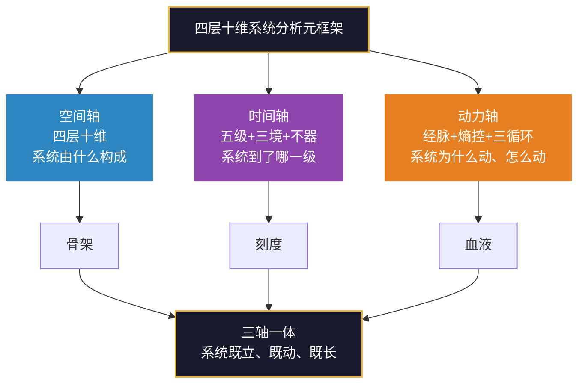
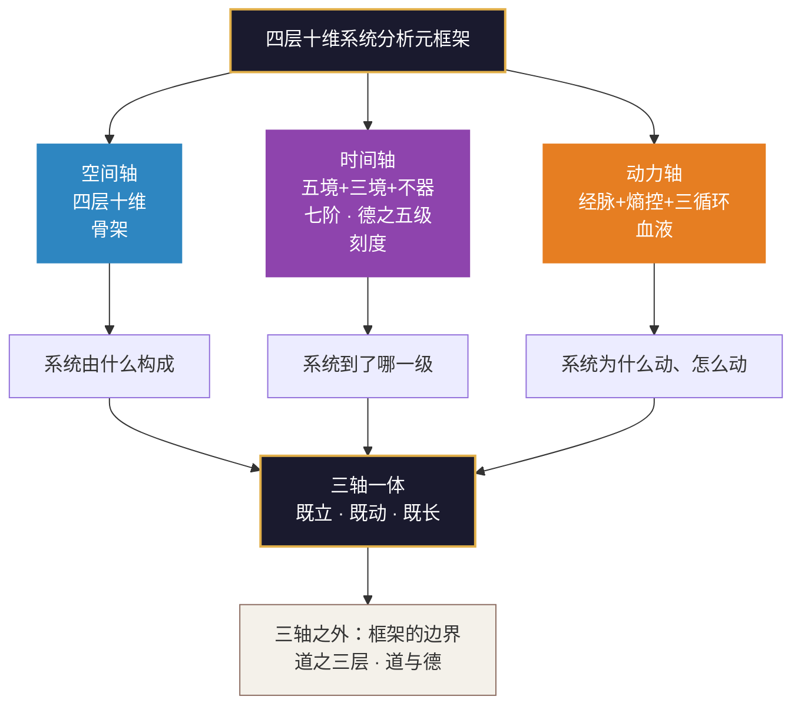

# 四层十维系统分析元框架（三轴一体版）

> **核心主题**：渊云不器 · 四层十维
> **核心思想**：理为基，念为先，心为凭；道为枢，熵为源，法为依；术为体，器为御，行为据；果为证。十维具足，系统自成。十维皆空，不器之境。
> **结构总纲**：空间轴（四层十维）· 时间轴（五级+三境+不器）· 动力轴（经脉+熵控+三循环）——三轴一体，系统既立、既动、既长。

---

## 〇、总纲：三轴一体

四层十维框架不只是一张结构图。要真正理解一个系统，需要同时从三个轴审视它：

| 轴 | 回答的问题 | 核心内容 | 一句话 |
|:---|:---|:---|:---|
| **空间轴** | 系统“由什么构成”？ | 四层十维 | 横截面上的骨架 |
| **时间轴** | 系统“到了哪一级”？ | 五级+三境+不器（含七阶、德之五级） | 纵轴上的刻度与路径 |
| **动力轴** | 系统“为什么动、怎么动”？ | 经脉+熵控+三循环 | 让骨架活起来的血液与呼吸 |

> **术语说明**：为避免与“十维”的“维”混淆，下文将空间、时间、动力这三个审视方向统称为“**三轴**”。“维”专指十个分析维度（理、念、心、道、熵、法、术、器、行、果），“轴”专指三个审视方向。

**三者关系**：空间是骨架，时间是刻度，动力是血液。没有空间，系统没有形状；没有时间，系统不知身在何处；没有动力，系统是死的。

---

## 一、空间轴：四层十维（结构）

### 1. 四层 · 认知架构：从无形到有形

四层不是对系统“本身”的分类，而是对分析者**视角**的分类。同一个系统，可以从四个高度依次审视。

| 层 | 名称 | 三字诀 | 核心问题 | 功能类比 | 内涵 |
|:---:|:---|:---:|:---|:---|:---|
| **L1** | 认知根基 | 理 · 念 · 心 | 系统凭什么存在？ | 大脑与灵魂 | 认知、信念、文化 |
| **L2** | 系统框架 | 道 · 熵 · 法 | 系统如何运转？ | 骨架与引擎 | 结构、规则、动力 |
| **L3** | 执行操作 | 术 · 器 · 行 | 系统做什么？ | 肌肉与手脚 | 操作、工具、纪律 |
| **L4** | 反馈进化 | 果 | 系统如何变好？ | 学习系统 | 度量、学习、迭代 |

**诊断启示**：许多“执行问题”，根子其实在认知层；许多“人心不齐”的问题，根源其实在框架层——结构不合理，人才会变形。

### 2. 十维 · 完整清单：十维具足 · 系统自成

十个维度不是并排的十根木棍，而是一条一环咬一环的链。

- **L1 理为基**：认知地基 · 凭什么判断（知识库、模型假设、判断依据）
- **L1 念为先**：价值导向 · 往哪里去（目标、使命、愿景、价值观）
- **L1 心为凭**：心理文化 · 凭什么凝聚（信任、氛围、心理安全、情绪）
- **L2 道为枢**：传动逻辑 · 怎么传动（**以枢为核心**，信息·能量·物质的流动路径与转化规则）
- **L2 熵为源**：动力源 · 动力何来（压力差、失衡、自组织动力）
- **L2 法为依**：运行规则 · 依何规则（标准化流程、约束、奖惩）
- **L3 术为体**：操作技能 · 如何操作（具体方法、技巧、操作步骤）
- **L3 器为御**：工具平台 · 以何承载（技术、设备、软件、数据）
- **L3 行为据**：执行纪律 · 靠何保障（规范、节奏、责任、纪律）
- **L4 果为证**：结果度量 · 以何验证（绩效、成果、闭环验证）

### 3. 空间轴的关键：道为枢

第5章6.1.1的原定义是：

> **道是系统中信息、能量、物质的流动路径与转化规则，它以关键枢纽（枢）为核心，构建起覆盖整个系统的传动网络。**

“道为枢”这个三字诀本身就在强调“枢”——道不仅是枢本身，更是以枢为中心的完整传动逻辑体系：**枢（中枢节点）+ 路径（传动链路）+ 规则/逻辑（流动的秩序）**，三者缺一不可。

---

## 二、时间轴：五级+三境+不器（演化）

时间轴有三把尺子，分别量三个层次：**分维五境**（每一维到了哪一级）、**宏观七阶**（系统一生走到了哪一段）、**整体德之五级**（十维协同后整体到了哪一级）。

### 1. 分维五级成熟度（微观刻度）

| 级别 | 名称 | 核心特征 | 状态描述 |
|:---:|:---|:---|:---|
| Lv.1 | **无** | 维度缺失或完全混沌 | 尚未建立，没有意识。 |
| Lv.2 | **有** | 初步建立，粗糙不稳定 | 已经做了，但不理解本质，常常失效。 |
| Lv.3 | **定** | 成熟稳定，可量化复现 | 换一个新人来，能照着跑出同样的结果。 |
| Lv.4 | **合** | 归一统一，内外融合 | 内部合一，与其他维度配合贯通。 |
| Lv.5 | **衍** | 自组织、自涌现、自进化 | 具备生命力，无需外部干预。 |

**核心逻辑**：无→有（从0到1的质变）→定（从粗糙到可靠的量变积累）→合（从局部到整体的系统性跃升）→衍（从他组织到自组织的生命力涌现）。

### 2. 分维三境（质变节点）

| 境界 | 区间 | 核心命题 |
|:---|:---|:---|
| **第一境：立基** | 有 → 定 | 建立与巩固，形成稳定框架 |
| **第二境：贯通** | 定 → 合 | 内合归一，外合协同，内外贯通无碍 |
| **第三境：自衍** | 合 → 衍 | 自组织、自涌现，进入不器之境 |

> **关键原则**：当一个维度处于“无”或“有”阶段时，它**尚未进入任何境界**。三境只在“定→合→衍”的跃迁区间内凝聚而成。

### 3. 分维不器（终极指向）

“不器”不是第四境，而是维度达到“衍”之后的本质特征：从“被工具定义”到“以工具为用”。

> **十维不器口诀**：不拘于理，不束于念，不住于心，不滞于道，不困于熵，不囿于法，不碍于术，不器于器，不违于行，不迷于果。

### 4. 宏观七阶：可道之道的生命周期

分维五境量的是“某一维到了哪一级”，七阶量的是“系统一生走到了哪一段”。七阶是时间轴的**宏观刻度**。

| 阶段 | 核心任务 | 道在做什么 | 退出条件 |
|:---|:---|:---|:---|
| **构建** | 从无到有 | 生成路径（道枢启动） | 能持续产出最小结构，不依赖外部输血 |
| **调适** | 反馈校正 | 调整路径（果→道） | 偏离已归因到方向层面，且方向已修正 |
| **完善** | 结构优化 | 精进路径（道→术器行） | 结构在无人盯着的情况下连续三个月产出正常 |
| **稳固** | 规则固化 | 稳定路径（道→法） | 规则被持续遵守，产出稳定可预期 |
| **诊断** | 堵塞识别 | 诊断路径（果→道） | 堵点已定位，结构性问题已诊断清楚 |
| **进化** | 相变跃迁 | 跃升路径（道→理念心） | 新模式已稳定运行，不再需要刻意维持 |
| **衍化** | 自组织涌现 | 衍化路径（道→不器） | 系统自己能长出新的业务线/能力 |

**三条纪律**：
1. **稳固做早了，等于把错误固化成制度**——判断标准：结构在无人盯着的情况下连续三个月产出正常。
2. **可以回退**：某一段路的假设整体换了，退回“构建”重走。
3. **可以并行**：新业务线在构建，老业务在稳固，整体在做诊断——三段可同时进行。

### 5. 整体五境：德之五级（整体刻度）

**德不是品德，是蓄养能力**——十维协同运作之后涌现出来的整体状态，又反过来滋养十维。它不在任何一个格子里，它在格子之间。**整体是协同的产物，不是加总的产物。**

| 德之层次 | 对应刻度 | 德的状态 | 怎么认 |
|:---|:---|:---|:---|
| **无德** | 无 | 系统尚未形成蓄养能力 | 抽掉关键人物就停 |
| **下德** | 有 | 能蓄养，但“执”于蓄养 | 要靠意志维持 |
| **常德** | 定 | 蓄养成为常规功能 | 不需动员，它自己就在做 |
| **上德** | 合 | 蓄养内外贯通，不需刻意 | 说不清怎么做到的，因为它不靠做法 |
| **玄德** | 衍 | 蓄养自组织、自涌现 | “谁在做”已不重要 |

**经典依据**：无德／下德／上德出《道德经》第38章，常德出第28章，玄德出第10、51、65章。
**关键限定**：**德不能拿来自评**——“上德不德，是以有德”，一旦把德当成可自评的指标，当场从“上德”掉回“下德”。德只能用来看系统，不能用来评自己。

### 6. 德之三境与不器

| 境界 | 区间 | 核心命题 |
|:---|:---|:---|
| **立基** | 有→定 | 让蓄养能力立得住 |
| **贯通** | 定→合 | 让蓄养能力通内外 |
| **自衍** | 合→衍 | 让蓄养能力自生长 |

**德的不器**（另立表述，**不进十维口诀**——德不是维度，是整体）：
- **浅层**：不执于德——不把“我有德”当身份，不把蓄养当交易。
- **深层**：德即自然——玄德不是“有德”，是德与系统合一，不再有一个“拥有者”站在德的外面。

### 7. 时间轴的三把尺子：关系总表

| 尺子 | 量什么 | 刻度 | 一句话 |
|:---|:---|:---|:---|
| **分维五境** | 某一维到了哪一级 | 无→有→定→合→衍 | 横截面的高度 |
| **宏观七阶** | 系统一生走到了哪一段 | 构建→调适→完善→稳固→诊断→进化→衍化 | 纵贯线的位置 |
| **德之五级** | 十维协同后整体到了哪一级 | 无德→下德→常德→上德→玄德 | 协同涌现的整体状态 |

> **三把尺子，同一套刻度逻辑（无→有→定→合→衍），量三种对象。** 不是三套标准，是同一根尺子换了刻度上的字。

---

## 三、动力轴：经脉+熵控+三循环（运转）

空间轴回答“系统由什么构成”，时间轴回答“系统到了哪一级”。动力轴回答的是最根本的问题：**系统为什么动、怎么动、怎么持续地动。**

动力轴有三根支柱：**经脉**（能量走哪条路）、**熵控**（能量从哪来、怎么用）、**三循环**（系统怎么转、怎么改、怎么通）。

### 1. 经脉：系统运转的虚无通道

- **定义**：维度关系被反复激活后形成的“习惯性通道”（实然轨迹）。它不是物理管道，却决定了能量往哪走、走多快、走多少。
- **道与脉**：道是应然设计（以枢为核心），脉是实然轨迹。**脉以道为纲，道以脉为证**。
- **八维支撑**：经脉虽虚，但需实撑。**理**给方向，**念**给目标，**心**让它敢走，**法**给边界，**术**给步骤，**器**给载体，**行**让它持续，**果**让它校准。
- **三大功能**：导引方向（防短路）、约束大小（防积压）、控制速度（防震荡）。

### 2. 熵为源：动力源与新陈代谢

- **核心翻转**：完全均衡的系统是死的。不要问“怎么消除熵”，要问“这些压力，能不能被导成推力”。
- **新陈代谢**：熵动力驱动系统持续完成两个关键动作——**纳入生机**（吸入负熵）、**排除废熵**（排出废物），系统在循环中不断更新。
- **熵控结构**（第10章）：**约束为基**（始终在场：边界约束、通道约束、底线约束），**疏导、转化、应用为用**。
- **果的功用扩展**：果不仅是验证，更是新陈代谢的枢纽——**过滤生机以吸纳**，**识别废熵以排除**。

### 3. 三循环：运转、校准、突破

**正大周天管“转”，反大周天管“改”，小周天管“通”**。三者共用同一个诊断器：果的直达反馈。

#### （1）正大周天（转）——常态传动

**方向**：**果 → 理 → 念 → 心 → 道 → 熵 → 法 → 术 → 器 → 行 → 果**
**口诀**：以果证理，以理定念，以念正心，以心合道，以道控熵，以熵缘法，以法构术，以术御器，以器载行，以行纳果。

- **起点是果，不是理**：从“上一轮做出来什么结果”开始，接着上一轮往下走。
- **不可跳跃**：理不能直接到术，中间的念、心、道、熵、法一环都省不掉。**也不可跨轮次**：本轮果未回，不改下一轮的理。
- **三个关键节点**：以果证理（起点）、以心合道（中段）、以行纳果（终点）。

#### （2）反大周天（改）——自我校准

**方向**：理随果修 → 念随理固 → 心随念安 → 道与心合 → 熵随道控 → 法随熵变 → 术随法转 → 器随术校 → 行随器易 → 果随行生。

- **核心翻转**：果告诉你的不是“你的理对不对”，而是“你的理该怎么改”。
- **三种模式**：逐级回流（牵动全局）、越级回流（局部影响）、直达回流（准确锁定）。判据：这次修正会不会改变下游的前提。
- **启动条件（须同时成立）**：① 果持续偏离（连续N个复盘周期同向偏离）；② 链内解释不了（环境未变结果却持续变差）；③ 源头指向上游（理、念、心、道、熵、法）。仅指向术、器、行则直接修，不启动。

#### （3）小周天（通）——局部突破

**四步**：定锚点 → 循环下游 → 打通堵点 → 回到大周天。

- **锚点三问**：最成熟？最稳定？不需再被调校？（**锚点不参与循环**）
- **无锚点退路**：十维大多为“无”时，不存在合格锚点——先跑最小正大周天补到“有”，再谈聚焦。
- **四条纪律**：锚点不参与循环｜一次只打一个堵点｜只走下游不回溯｜打通即回归。
- **循环链长度**：跨度≤3维可一次打通；4–5维建议拆两次；≥6维改走逐级回流或先补中间维度。

### 4. 三循环 × 六病态：处置对照

| 病态 | 首选循环 | 处置要点 |
|:---|:---|:---|
| 维度缺失 | 小周天 | 以上游最成熟维为锚点，集中补该维 |
| 维度失衡 | 小周天 | 定住强项作锚点，只调弱项，解除压制 |
| 传动断裂 | 正大周天 | 找出断点，接上，不加新维度 |
| 目标偏离 | 反大周天 | 追到“念”或“理”，改判断而非改动作 |
| 熵增失控 | 正大周天 + 反大周天 | 先补“以道控熵”结构，再改产生压力的上游判断 |
| 经脉堵塞 | 小周天 | 定位堵点，只循环该段，不重画全图 |

### 5. 动力轴的核心逻辑

> **熵提供动力，道提供路径，经脉提供通道，三循环提供运转形态。**

- 没有熵，系统是死的（没有压力差，没有动力）。
- 没有道，熵是乱爆炸（没有路径，压力到处乱窜）。
- 没有经脉，能量无路可走（通道堵塞，传动断裂）。
- 没有三循环，系统不知怎么转、怎么改、怎么通（有动力但不会用）。

四者缺一，动力轴即失效。

---

## 四、三轴之外：框架的边界与整体

空间、时间、动力三轴构成了元框架的主体。但框架还有“上面”和“外面”需要说清——这就是道之三层与道与德。

### 1. 道之三层：框架的边界

“道”在四层十维里不是一个，是三个——而框架只装得下最浅的那一层。三者是**投影与切片关系，不是替代关系**。

| 层次 | 是什么 | 能否被框架描述 | 位置 |
|:---|:---|:---|:---|
| **不可道之道** | 与德同层面的终极之道，不可道、不可名 | 不能，只能“指向” | 框架之外、之上 |
| **可道之道** | 贯穿系统全生命周期的路径与脉络（七阶） | 可被“指向”，不可被完全描述 | 贯穿L1–L4全生命周期 |
| **L2道** | 系统结构层面的传动逻辑（以枢为核心） | 可以，且已被完整描述 | L2系统框架中的一个维度 |

**框架的边界三条**：
1. **L2道是可道之道的切片，不是替代**——第5章不用改一个字。
2. **框架有边界，道无边界**——知道框架的边界，才是真正的“知止”。
3. **遇到“为什么”的终极追问，停手**——把问题往下拉一层，回到框架之内。

### 2. 道与德：源与流，体与用

**道是源，德是流。道是体，德是用。** 二者不是两个并列的格子，是同一件事的两面。

| 维度 | 道 | 德 |
|:---|:---|:---|
| **定位** | 源 | 流 |
| **功能** | 路径与脉络 | 蓄养的能力 |
| **与熵的关系** | 约束熵、导引熵、转化熵 | 反哺系统、滋养系统 |
| **在框架中的位置** | 贯穿全生命周期 | 十维协同后涌现 |
| **最高形态** | 不可道之道 | 玄德（不执的蓄养） |
| **体用** | 体 | 用 |

**经典依据**：
- “道生之，德畜之”（第51章）——道负责“生”，德负责“畜”。
- “孔德之容，惟道是从”（第21章）——德不自己定方向，德跟着道走。方向反复变，能力一定长不厚。
- “失道而后德，失德而后仁，失仁而后义，失义而后礼”（第38章）——**降级序列**：你越强调什么，往往说明上一级已经丢了什么。

**德与叶**：叶的五个动作——**纳→蓄→养→成→归**——对应德的四级加一个回环：

| 叶的动作 | 德的层次 | 刻度位置 |
|:---|:---|:---|
| 纳 | 下德 | 有 |
| 蓄 | 常德 | 定 |
| 养 | 上德 | 合 |
| 成 | 玄德 | 衍 |
| **归** | **不器（归渊）** | **不是一级，是“衍”的回环** |

> **只讲“纳”，等于只讲呼吸里的“吸”。** 吸收能力再强，蓄不住、养不出、成不了、归不回，德就停在“下德”。

### 3. 哲学意象：渊 · 心 · 叶 · 莲 · 云（元意境）

从根基到自由的衍化之链：

- **渊**：根基静默如渊，深不可测（L1认知根基；不可道之道的蓄积地）。
- **心**：约束熵的力量，使熵不无序释放（系统成长的凭借）。
- **叶**：生机光合转化，**纳蓄养成归**（德的五动作：纳→蓄→养→成→归，对应下德→常德→上德→玄德→归渊）。
- **莲**：境界空间与时间，法则与运转（道枢与经脉的结构）。
- **云**：自由衍化涌现，不器之境（不器之境）。

> 渊是静的，云是动的。渊是守，云是放。水从渊中流出，蒸腾为云，降落为雨，复归渊中——循环无端，衍化不息。

**层级说明**：意象属**元意境**（渊·心·叶·莲·云），不属元框架。**意象负责让你看见，结构负责让你判断。** 混用会两头都失效。

---

## 五、三轴关系：一横一纵一动力

| 轴 | 管什么 | 核心工具 | 一句话 |
|:---|:---|:---|:---|
| **空间轴** | 系统由什么构成 | 四层十维、关系矩阵 | 横截面上的骨架 |
| **时间轴** | 系统到了哪一级 | 五境+三境+不器、七阶、德之五级 | 纵轴上的刻度与路径 |
| **动力轴** | 系统为什么动、怎么动 | 经脉、熵控、三循环 | 让骨架活起来的血液与呼吸 |

**三条边界**：
1. **空间轴管“有什么”，时间轴管“到没到”，动力轴管“转不转”**——三者不能互相替代。
2. **动力轴是“处置”，六病态是“诊断”**——先诊断，再决定走哪条循环。
3. **循环只保证“能转”，不保证“越转越好”**——升级靠时间轴的五境；整体健康靠德之五级。

**三轴一体的完整图景**：

---

— **渊 云 不 器 · 循 环 无 端** —
