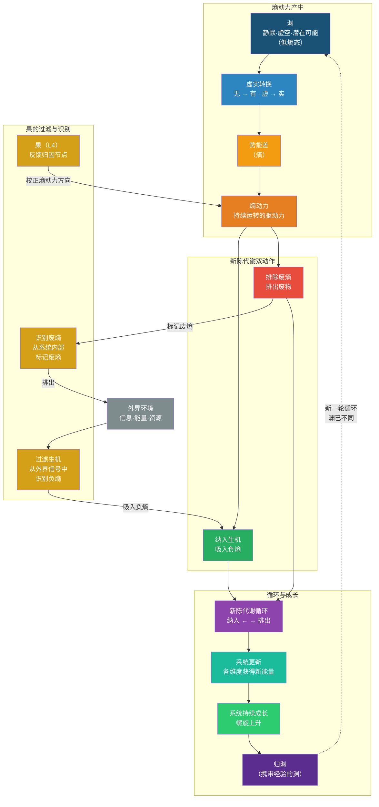
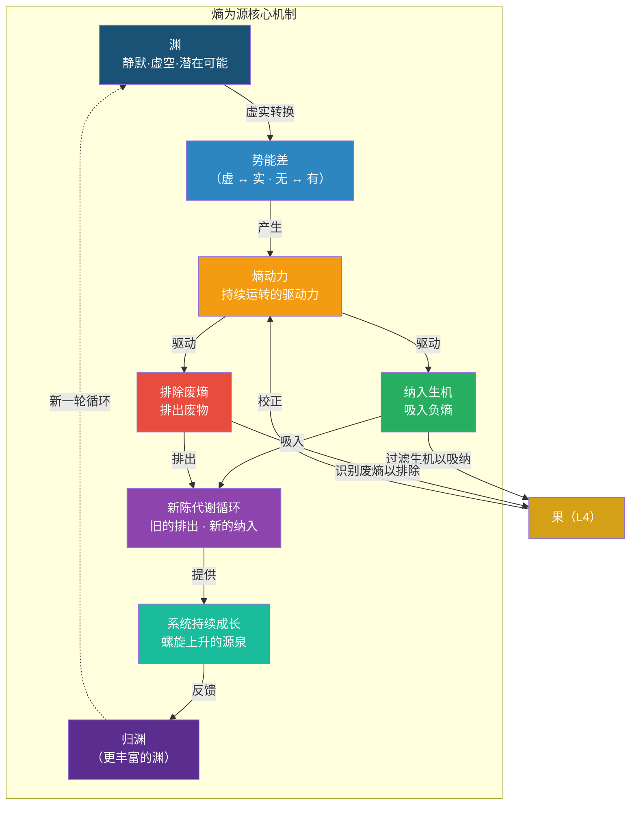

# 《系统之析：四层十维分析框架》· 增补一

## ——熵为源维度的精确定位：运转动力与生机循环的统一

### 增补性质说明

本次增补为四层十维框架中 **“熵为源”** 维度的**深化与精确定位**，不改变原有维度结构，不新增维度，不修改已有定义。增补旨在澄清熵产生的动力“用在哪里”这一关键问题，使熵为源从“让系统动起来”升级为“让系统动起来并且动得有方向、有意义”。

**增补范围**：

1. 熵为源维度内部：明确“纳入生机”与“排除废熵”作为熵动力的应用方向
2. 果维度的功用扩展：过滤生机以吸纳，识别废熵以排除（详见增补二）
3. 经脉的多维度支撑：理、念、心、法、术、器、行、果对经脉的共同维护（详见增补三）

**本文为增补一的完整内容。**

## 一、熵为源维度的原定义

### 原定义

> **熵为源**：系统内部无序度、压力差、失衡状态的总和，是系统演化的内在动力。熵为系统的运转提供驱动力，熵增本身不是需要被消灭的敌人，而是需要被约束、疏导、转化和应用的动力源。

### 原表述中的隐含问题

原定义正确，但存在一个未被充分阐述的环节：**熵产生的动力用于做什么？**

如果熵只是“让系统动起来”，那么系统可能在原地空转。真正的系统不应该只是“动”，而应该“动得有方向、动得有意义”——即通过运动实现自我更新。

这个缺失的环节，就是“纳入生机”与“排除废熵”。

## 二、增补内容：熵为源的精确定位

### 2.1 核心表述

> **熵为源**，提供系统持续运转的动力。该动力驱动系统完成两个关键动作：
>
> 1. **纳入生机**：从外界吸入负熵（新的信息、能量、资源、认知、秩序）
> 2. **排除废熵**：将系统内部产生的废物、冗余信息、过时规则、无效能量排出
>
> 两者合在一起，构成系统的**新陈代谢循环**——如同人体的呼吸、消化与排泄，旧的排出，新的纳入，系统在循环中不断更新，获得持续成长的源泉。

### 2.2 精确定位

| 概念 | 在“熵为源”中的定位 | 功能 |
|:---|:---|:---|
| **熵（势能差）** | 动力来源 | 产生运转的动力 |
| **纳入生机** | 动力的应用方向一 | 吸入负熵，为系统提供成长源泉 |
| **排除废熵** | 动力的应用方向二 | 排出废熵，防止系统被自身废物堵塞 |

### 2.3 新旧表述对比

| 维度 | 原表述 | 修正表述 |
|:---|:---|:---|
| 熵为源 | 提供系统持续运转的动力 | 提供系统持续运转的动力——该动力驱动系统**纳入生机**与**排除废熵**，形成新陈代谢循环，为系统提供持续成长的源泉 |

### 2.4 原表述为何不完整

原表述“熵为源，提供系统持续运转的动力”——这句话本身是正确的，但它只回答了“系统为什么会动”，没有回答“系统动起来之后做了什么”。

一个持续空转的系统，即使一直在动，也会在循环中逐渐耗散：

- 没有新信息输入 → 认知停滞（理退化）
- 没有新能量输入 → 执行疲软（行松散）
- 没有排出废物 → 内部堵塞（经脉堵）
- 没有淘汰过时规则 → 制度僵化（法固化）

“纳入生机”和“排除废熵”解决的正是这个问题——熵产生的动力，不是让系统原地空转，而是驱动系统完成“换血”：

- 纳入生机 = 给系统“输血”
- 排除废熵 = 给系统“清淤”

一个持续换血的系统，才能在循环中不耗散，反而不断壮大。

## 三、纳入生机与排除废熵的机制

### 3.1 纳入生机：吸入负熵

| 维度 | 吸入的“负熵”类型 | 作用 |
|:---|:---|:---|
| 理 | 新知识、新模型、新认知 | 更新判断依据 |
| 念 | 新愿景、新意义、新方向 | 校准价值导向 |
| 心 | 新信任、新关系、新安全感 | 增强心理资本 |
| 道 | 新流程、新路径、新连接 | 优化传动结构 |
| 法 | 新规则、新制度、新标准 | 更新运行规则 |
| 术 | 新方法、新技能、新操作 | 提升执行效率 |
| 器 | 新工具、新技术、新平台 | 增强承载能力 |
| 行 | 新习惯、新节奏、新纪律 | 强化执行保障 |

### 3.2 排除废熵：排出废物

| 维度 | 排出的“废熵”类型 | 作用 |
|:---|:---|:---|
| 理 | 过时知识、错误假设 | 腾出认知空间 |
| 念 | 过时目标、冲突价值观 | 凝聚方向共识 |
| 心 | 不信任、恐惧、焦虑 | 释放心理负担 |
| 道 | 堵塞路径、冗余环节 | 畅通传动网络 |
| 法 | 僵化规则、冲突制度 | 简化规则体系 |
| 术 | 过时方法、低效操作 | 精简操作流程 |
| 器 | 过时工具、故障设备 | 升级工具平台 |
| 行 | 坏习惯、无效节奏 | 重塑执行纪律 |

### 3.3 新陈代谢循环的完整流程

## 四、对“熵为源”三境的修正

### 4.1 原三境

| 境界 | 内容 |
|:---|:---|
| 第一境：识熵 | 识别熵增信号——知道熵在哪里 |
| 第二境：控熵 | 建立熵控结构——约束、疏导、转化、应用 |
| 第三境：熵控 | 以熵为控，熵成为系统的永续引擎 |

### 4.2 增补后的三境

| 境界 | 内容 | 增补点 |
|:---|:---|:---|
| 第一境：识熵 | 识别熵增信号——知道熵在哪里 | 不变 |
| 第二境：控熵 | 建立熵控结构——约束、疏导、转化、应用 | 明确“应用”的具体方向：**纳入生机**与**排除废熵** |
| 第三境：熵控 | 以熵为控。熵的动力驱动系统持续完成新陈代谢循环——纳入生机、排除废熵、系统更新、归渊重生 | 明确熵成为永续引擎的**具体运作方式**：不是空转，是持续的自我更新 |

## 五、与“渊 · 心 · 叶 · 莲 · 云”意象的对应

| 意象 | 在熵为源增补中的定位 |
|:---|:---|
| **渊** | 熵动力的来源——势能差的蓄积地 |
| **心** | 约束熵的力量，使熵不无序释放 |
| **叶** | **纳入生机**的意象载体——光合转化，吸入外部能量，排出废物 |
| **莲** | 系统完整运转的结构——道枢、经脉在其中运行 |
| **云** | 系统完成新陈代谢循环后的自由涌现状态 |

本次增补深化了对 **“叶”** 的理解：叶不仅是“生机”的象征，更是“纳入生机与排除废熵”这一新陈代谢机制的精确意象。

## 六、应用指导

### 6.1 在系统分析中的使用

当你分析一个系统的健康状况时，使用增补后的熵为源框架：

1. **检查“熵动力”是否存在**：系统内部是否有持续的虚实转换？是否存在势能差？
2. **检查“纳入生机”是否发生**：系统是否在从外界吸入新的信息/能量/资源？每个维度是否都在更新？
3. **检查“排除废熵”是否发生**：系统是否在排出废物、冗余、过时规则？哪些东西在消耗能量却不产生价值？
4. **检查新陈代谢循环是否完整**：纳入→更新→排出→再纳入，这个循环是否在持续进行？

### 6.2 诊断信号

| 健康信号 | 病态信号 |
|:---|:---|
| 系统持续从外界学习新知识 | 认知停滞，重复使用旧框架 |
| 系统定期淘汰过时规则 | 规则堆积，制度越来越僵化 |
| 系统有清晰的废物排出机制 | 内部积压越来越多，运转越来越慢 |
| 系统每次循环都有新产出 | 系统在空转，产出一成不变 |

## 七、核心要义 Mermaid 图

## 八、总结

| 概念 | 核心定义 | 一句话定位 |
|:---|:---|:---|
| **熵为源** | 系统内部虚实转换产生的势能差，驱动系统持续运转 | 让系统“动”起来 |
| **纳入生机** | 熵动力驱动的第一个动作——从外界吸入负熵 | 给系统“输血” |
| **排除废熵** | 熵动力驱动的第二个动作——排出系统内部废物 | 给系统“清淤” |
| **新陈代谢循环** | 纳入与排出的持续交替 | 系统“换血”的过程 |
| **果（新增功用）** | 过滤生机以吸纳，识别废熵以排除 | 新陈代谢循环的“质检站” |

> *熵为源，让系统不停。*  
> *纳入生机，让系统有新鲜的血液。*  
> *排除废熵，让系统不被自身的废物堵死。*  
> *新陈代谢，让系统在每一次循环中都更新自己。*  
> *果过滤、识别，让该进的进、该出的出。*  
> *归渊时，渊已不是出发时的渊——它更丰富了。*

**增补一 · 完**

> *本次增补为四层十维框架的深化与精确定位，不改变原有维度结构，不新增维度，不修改已有定义。增补内容将统一纳入四层十维知识库，作为后续写作和扩展的依据。*

—— 渊云不器 · 循环无端