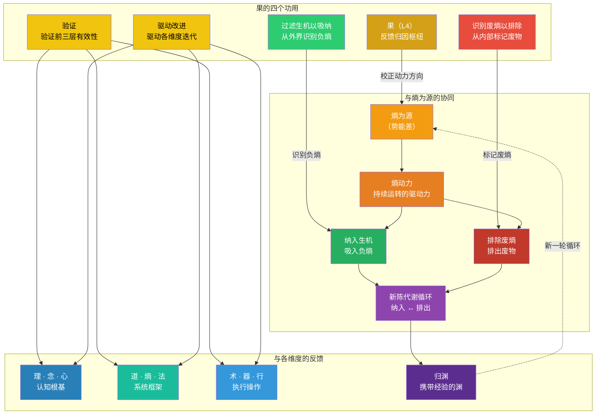

# 《系统之析：四层十维分析框架》· 增补二

## ——果维度的功用扩展：过滤生机以吸纳，识别废熵以排除

### 增补性质说明

本次增补为四层十维框架中 **“果”** 维度的**功用扩展**，不改变原有维度结构，不新增维度，不修改已有定义。增补的背景是：在“熵为源”增补中，我们明确了熵产生的动力驱动系统完成“纳入生机”与“排除废熵”两个动作。这两个动作的实现，依赖于“果”作为反馈枢纽承担新的过滤与识别功能。

**增补范围**：

1. 果维度的功用扩展：过滤生机以吸纳，识别废熵以排除
2. 果在新陈代谢循环中的枢纽定位
3. 果在各层级的功用总览与三境修正

## 一、果维度的原定义

### 原定义

> **果**：系统的输出、绩效指标和成果评价的总和。果是前三层运行的输出，也是驱动前三层改进的输入。果使系统从“一次性运行”升级为“持续进化”。

### 原定义中的隐含缺口

原定义将果定位为“输出”与“反馈输入”，这是正确的。但在“熵为源”增补明确了“纳入生机”与“排除废熵”之后，果需要承担两个更具体的功能：

1. **从外界信号中识别什么是有序的（负熵）、什么是无序的（正熵）** ——以便系统决定吸纳什么
2. **从系统内部识别什么是需要排除的废物** ——以便系统决定排出什么

这两个功能在原定义中未被明确，导致果在“新陈代谢循环”中的枢纽作用未被充分阐述。

## 二、增补内容：果的功用扩展

### 2.1 核心表述

> **果**，是系统新陈代谢循环的枢纽节点。它承担四个核心功用：
>
> 1. **验证**：验证前三层（认知根基、系统框架、执行操作）的有效性
> 2. **驱动改进**：驱动各维度的迭代与优化
> 3. **过滤生机以吸纳**：从外界信号中识别负熵（有序的、有价值的信息/能量/资源），过滤后纳入系统
> 4. **识别废熵以排除**：从系统内部识别废物（冗余、过时规则、无效能量），标记后驱动排出

### 2.2 果的四个功用总览

| 功用 | 方向 | 功能 | 对应循环阶段 | 原定义中是否已有 |
|:---|:---|:---|:---|:---|
| 验证 | 向内 | 验证前三层的有效性 | 反馈归因 | ✅ 已有 |
| 驱动改进 | 向内 | 驱动各维度迭代 | 反馈归因 | ✅ 已有 |
| **过滤生机以吸纳** | 向外→向内 | 从外界识别负熵并吸入 | 纳入生机 | ❌ 新增 |
| **识别废熵以排除** | 向内→向外 | 识别系统内部废熵并标记排除 | 排除废熵 | ❌ 新增 |

### 2.3 新旧表述对比

| 维度 | 原表述 | 修正表述 |
|:---|:---|:---|
| 果 | 系统的输出、绩效指标和成果评价的总和。是前三层运行的输出，也是驱动前三层改进的输入。 | 系统的输出、绩效指标和成果评价的总和。它既是前三层运行的输出，也是驱动前三层改进的输入。同时，果承担**过滤生机以吸纳**（从外界识别并吸入负熵）和**识别废熵以排除**（标记系统内部废物并驱动排出）的双重功用，是系统新陈代谢循环的枢纽节点。 |

## 三、果的过滤与识别机制

### 3.1 过滤生机以吸纳

果作为系统的“质检站”，需要从外界信号中识别什么是有序的、有价值的信息。

| 过滤维度 | 判断标准（负熵） | 判断标准（正熵/应过滤） |
|:---|:---|:---|
| 信息 | 与系统目标一致、可验证、有结构 | 与目标无关、无法验证、碎片化 |
| 能量 | 可被系统利用、可持续、可控 | 无法利用、一次性、破坏性 |
| 资源 | 与系统能力匹配、可转化、可积累 | 无法转化、消耗大于产出 |
| 反馈 | 可归因、可操作、有洞察 | 不可归因、不可操作、无洞察 |

**果的过滤功能不是“拒绝一切”，而是“区分后吸纳”。** 它让该进的东西进，不该进的东西被挡在系统边界之外。

### 3.2 识别废熵以排除

果需要从系统内部识别什么已经变成了“废物”——不再产生价值、反而消耗系统能量。

| 识别维度 | 废熵信号 | 排除动作 |
|:---|:---|:---|
| 理 | 知识过时、假设被证伪 | 更新认知框架 |
| 念 | 目标已达成或不再适用 | 校准价值导向 |
| 心 | 信任崩塌、安全感丧失 | 重建信任机制 |
| 道 | 路径堵塞、环节冗余 | 优化传动网络 |
| 法 | 规则僵化、制度冲突 | 简化规则体系 |
| 术 | 方法低效、操作过时 | 升级操作技能 |
| 器 | 工具故障、平台落后 | 更新工具平台 |
| 行 | 习惯变坏、节奏失序 | 重塑执行纪律 |

**果的识别功能不是“指责”，而是“标记”。** 它标记出哪些东西需要被排除，然后由熵动力驱动排出动作。

## 四、果与熵为源的协同

### 4.1 果在新陈代谢循环中的位置

~~~mermaid
flowchart TD
    subgraph 熵动力产生
        A["熵为源 （势能差）"]
        B["熵动力 持续运转的驱动力"]
    end

    subgraph 果的过滤与识别
        C["果（L4） 反馈归因枢纽"]
        C1["过滤生机 从外界信号中识别负熵"]
        C2["识别废熵 从系统内部标记废物"]
    end

    subgraph 新陈代谢双动作
        D["纳入生机 吸入负熵"]
        E["排除废熵 排出废物"]
    end

    subgraph 循环与成长
        F["系统更新 各维度获得新能量"]
        G["新陈代谢循环 纳入 ↔ 排出"]
        H["归渊 （携带经验的渊）"]
    end

    I["外界环境 信息·能量·资源"]

    A -->|"产生"| B
    B -->|"驱动"| D
    B -->|"驱动"| E

    I --> C1
    C1 -->|"吸入负熵"| D

    E -->|"标记废物"| C2
    C2 -->|"排出废熵"| I

    D --> G
    E --> G
    G --> F
    F --> H
    H -.->|"新一轮循环 渊已不同"| A

    C -->|"校正熵动力方向"| B

    style A fill:#f39c12,color:#fff
    style B fill:#e67e22,color:#fff
    style C fill:#d4a017,color:#fff
    style C1 fill:#2ecc71,color:#fff
    style C2 fill:#e74c3c,color:#fff
    style D fill:#27ae60,color:#fff
    style E fill:#c0392b,color:#fff
    style F fill:#1abc9c,color:#fff
    style G fill:#8e44ad,color:#fff
    style H fill:#5b2d8e,color:#fff
    style I fill:#7f8c8d,color:#fff
~~~

### 4.2 果与其他维度的协同

| 维度 | 果对它的反馈 | 反馈内容 |
|:---|:---|:---|
| 理 | 果→理 | 验证认知正确性，驱动知识更新 |
| 念 | 果→念 | 校准方向，确认目标是否仍然适用 |
| 心 | 果→心 | 反馈信任水平，提示文化问题 |
| 道 | 果→道 | 显示传动效率，提示路径优化 |
| 熵 | 果→熵 | 显示熵控效果，校正动力方向 |
| 法 | 果→法 | 显示规则有效性，驱动规则迭代 |
| 术 | 果→术 | 显示操作效果，驱动技能升级 |
| 器 | 果→器 | 显示工具效能，驱动工具迭代 |
| 行 | 果→行 | 显示执行质量，强化纪律 |

## 五、对“果”三境的修正

### 5.1 原三境

| 境界 | 内容 |
|:---|:---|
| 第一境：结果 | 能够记录和报告结果——知道“发生了什么” |
| 第二境：归因 | 能够进行归因分析——理解“为什么会这样” |
| 第三境：涌果 | 反馈闭环高度成熟，结果自动流向各维度，驱动迭代 |

### 5.2 增补后的三境

| 境界 | 内容 | 增补点 |
|:---|:---|:---|
| 第一境：结果 | 能够记录和报告结果——知道“发生了什么” | 不变 |
| 第二境：归因 | 能够进行归因分析——理解“为什么会这样”。同时开始承担**过滤与识别**功能 | 新增：在归因过程中，识别什么是“值得纳入的生机”，什么是“应该排除的废熵” |
| 第三境：涌果 | 反馈闭环高度成熟，果自动流向各维度，驱动迭代。同时，果的**过滤与识别**功能已内化为系统的默认能力——该进的自动进，该出的自动出，新陈代谢循环顺畅无碍 | 新增：果的过滤与识别成为系统默认能力，新陈代谢循环自动化 |

## 六、应用指导

### 6.1 在系统分析中的使用

当你分析一个系统的反馈机制时，使用增补后的果维度框架：

1. **检查“验证”功能**：系统是否有度量指标？是否在验证前三层的有效性？
2. **检查“驱动改进”功能**：反馈信息是否真正驱动了各维度的迭代？还是仅停留在“报告”层面？
3. **检查“过滤生机”功能**：系统是否有能力从外界信号中识别有价值的信息并吸纳？是否存在“什么都吸”或“什么都不吸”的问题？
4. **检查“识别废熵”功能**：系统是否有能力识别内部废物并驱动排出？是否存在“积压越来越多”的问题？

### 6.2 诊断信号

| 健康信号 | 病态信号 |
|:---|:---|
| 系统能区分有价值和无价值的外部信号 | 系统要么封闭排斥一切，要么不加区分地吸纳一切 |
| 系统定期清理过时规则和冗余流程 | 过时规则堆积，制度越来越臃肿 |
| 反馈信息被用于实际改进 | 反馈信息只被“记录”和“汇报” |
| 系统能识别“努力没有产出”的环节 | 系统在无效环节持续投入资源 |

## 七、核心要义 Mermaid 图

### Mermaid 图解读

| 节点 | 含义 | 在果维度增补中的位置 |
|:---|:---|:---|
| **果** | 反馈归因枢纽 | 四个功用的汇聚点 |
| **验证** | 验证前三层有效性 | 原功用，向内反馈 |
| **驱动改进** | 驱动各维度迭代 | 原功用，向内反馈 |
| **过滤生机以吸纳** | 从外界识别负熵 | 新增功用，向外→向内 |
| **识别废熵以排除** | 从内部标记废物 | 新增功用，向内→向外 |
| **熵为源** | 势能差 | 动力来源 |
| **熵动力** | 持续运转的驱动力 | 驱动双动作 |
| **纳入生机** | 吸入负熵 | 新陈代谢的“吸气” |
| **排除废熵** | 排出废物 | 新陈代谢的“呼气” |
| **新陈代谢循环** | 纳入 ↔ 排出 | 系统的自我更新 |
| **各维度反馈** | 理·念·心·道·熵·法·术·器·行 | 验证与驱动改进的目标 |
| **归渊** | 携带经验的渊 | 循环完成，进入下一轮 |

## 八、总结

### 8.1 果维度增补前后对比

| 维度 | 原功用 | 增补后功用 |
|:---|:---|:---|
| 果 | 验证 + 驱动改进 | 验证 + 驱动改进 + **过滤生机以吸纳** + **识别废熵以排除** |

### 8.2 与熵为源增补的关联

| 熵为源增补 | 果维度增补 |
|:---|:---|
| 纳入生机 | 过滤生机以吸纳（果提供过滤功能） |
| 排除废熵 | 识别废熵以排除（果提供识别功能） |
| 新陈代谢循环 | 果是循环的“质检站”与“枢纽节点” |
| 归渊 | 果反馈到渊，携带经验完成归渊 |

> *果不仅仅是产出，更是系统的“质检站”。*  
> *果不仅仅是反馈，更是新陈代谢的“枢纽”。*  
> *过滤生机，让该进的进；识别废熵，让该出的出。*  
> *有进有出，系统才能持续更新；能过滤能识别，系统才能精准更新。*

**增补二 · 完**

> *本次增补为四层十维框架的深化与精确定位，不改变原有维度结构，不新增维度，不修改已有定义。增补内容将统一纳入四层十维知识库，作为后续写作和扩展的依据。*

—— 渊云不器 · 循环无端