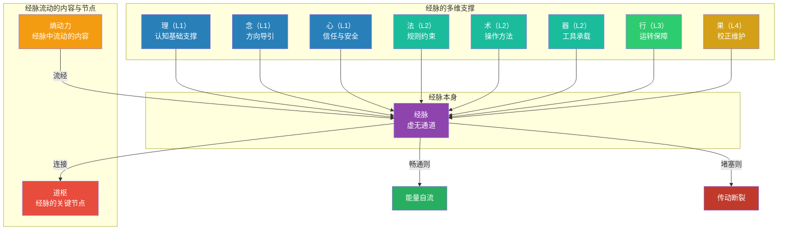

# 《系统之析：四层十维分析框架》· 增补三

## ——经脉的多维度支撑：虚无通道何以成为能量流动的路径

### 增补性质说明

本次增补为四层十维框架中 **“经脉”** 概念的**深化与完整化**，不改变原有维度结构，不新增维度，不修改已有定义。增补的背景是：在“熵为源”增补（增补一）和“果”维度增补（增补二）之后，经脉作为熵动力流动的“通道”，其运行机制需要更清晰的阐述——尤其是：**经脉是虚无的，但它并非没有支撑。相反，它依赖多个维度的共同维护才能保持畅通。**

**增补范围**：

1. 经脉的多维度支撑：理、念、心、法、术、器、行、果对经脉的共同维护
2. 经脉与熵动力、道枢、果的关系定位
3. 经脉三境的修正

## 一、经脉的原定义

### 原定义

> **经脉**：系统内部信息、能量、物质流动的习惯性路径。它是维度间关系在被反复激活后所形成的“通道”——不是物理意义上的管道，而是系统行为模式中可被识别和预测的流动轨迹。
>
> 经脉的三大功能：**导引方向**、**约束大小**、**控制速度**。
>
> 经脉堵塞，则传动断裂；经脉畅通，则能量自流。

### 原定义中的隐含缺口

原定义正确地将经脉定位为“虚无通道”——它不是实体管道，而是能量流经的惯性轨迹。但原定义缺少一个关键阐述：**虚无通道如何得以存在和持续运行？**

“虚无”不等于“没有支撑”。一条河床是土石（实体），但河道是水冲出来的轨迹（虚无）。水停了，河道就消失了。同样，经脉之所以能成为能量流动的路径，是因为多个维度在持续维护它——提供认知、方向、信任、规则、方法、工具、执行和反馈。没有这些支撑，经脉会堵塞、废弃、消失。

这个缺口需要在增补中填补。

## 二、增补内容：经脉的多维度支撑

### 2.1 核心表述

> **经脉是虚无通道**——它不是实体管道，而是能量流经的惯性轨迹。但它并非没有支撑。经脉的运行依赖八个维度的共同维护：
>
> | 维度 | 对经脉的支撑功能 | 具体作用 |
> |:---|:---|:---|
> | **理（L1）** | 认知基础支撑 | 提供对“能量应该流向哪里”的判断依据——认知决定经脉的方向设计 |
> | **念（L1）** | 方向导引 | 系统的目标和价值导向决定了能量流动的优先级——念引导经脉朝向目标方向 |
> | **心（L1）** | 信任与安全 | 心理安全是能量敢于流动的前提——没有信任，经脉是“不敢走”的路 |
> | **法（L2）** | 规则约束 | 规则框定能量流动的范围和边界——法防止能量漫流 |
> | **术（L2）** | 操作方法 | 提供沿经脉流动的具体操作步骤——术让能量知道“怎么走” |
> | **器（L2）** | 工具承载 | 提供支撑能量流动的物理或数字载体——器让经脉有了“可触摸”的依托 |
> | **行（L2）** | 顺畅运转 | 执行的持续性和纪律性保证经脉不被废弃——行让经脉“一直通” |
> | **果（L4）** | 校正与维护 | 反馈信息修正经脉的路径、宽度和方向——果让经脉“不走偏” |
>
> **经脉畅通 = 八个维度持续支撑；经脉堵塞 = 某个或多个维度的支撑失效。**

### 2.2 多维度支撑详表

| 维度 | 支撑类型 | 对经脉的具体贡献 | 若此维度缺失 |
|:---|:---|:---|:---|
| **理** | 认知基础 | 判断能量应该流向哪里、什么路径最有效 | 经脉方向盲目，能量流向错误 |
| **念** | 方向导引 | 确保能量流动服务于系统目标 | 经脉方向偏离系统目标 |
| **心** | 信任与安全 | 让能量敢于沿经脉流动 | 经脉“不敢走”，流动停滞 |
| **法** | 规则约束 | 防止能量漫流，框定流动边界 | 能量漫流，经脉消失 |
| **术** | 操作方法 | 提供沿经脉流动的具体步骤 | 能量“不知道怎么走”，经脉阻塞 |
| **器** | 工具承载 | 提供流动的物理或数字载体 | 经脉“无处依托”，无法形成 |
| **行** | 运转保障 | 保证经脉被持续使用，不被废弃 | 经脉“没人走”，逐渐消失 |
| **果** | 校正维护 | 反馈修正经脉路径、宽度、方向 | 经脉“走偏”，逐渐偏离目标 |

### 2.3 新旧表述对比

| 概念 | 原表述 | 增补后表述 |
|:---|:---|:---|
| 经脉 | 虚无通道——维度间关系被反复激活后形成的可识别轨迹 | 虚无通道——不是实体管道，而是能量流经的惯性轨迹。经脉的运行依赖多维度支撑：**理**提供认知基础，**念**提供方向导引，**心**提供信任安全，**法**提供规则约束，**术**提供操作方法，**器**提供工具承载，**行**提供运转保障，**果**提供校正维护。经脉畅通，则能量自流；经脉堵塞，则传动断裂。 |

## 三、经脉的“虚无”本质与“多维支撑”的关系

### 3.1 核心洞察

经脉是虚无的，但它不是“凭空存在”的。它是一个**涌现现象**——当八个维度持续施加作用时，经脉作为它们的汇聚点涌现出来。

类比：

| 类比 | 实体部分 | 虚无部分 | 涌现现象 |
|:---|:---|:---|:---|
| 河道 | 土石、水流 | 河道的“轨迹” | 水冲出来的路径 |
| 经脉 | 理·念·心·法·术·器·行·果 | 经脉本身 | 多维支撑汇聚出的流动轨迹 |

**经脉不是被“设计”出来的，而是被“冲刷”出来的。** 每当你依据“理”做了一次正确判断、按照“念”选择了一个方向、凭借“心”建立了信任、遵守“法”的规则、使用“术”的操作、借助“器”的工具、坚持“行”的执行、根据“果”的反馈进行了校正——你就在冲刷一次经脉。冲刷的次数多了，经脉就形成了。

### 3.2 经脉与道枢的关系

| 概念 | 定义 | 关系 |
|:---|:---|:---|
| **道枢** | 传动的枢纽节点——能量汇聚、转向、分发的位置 | 经脉的“关键节点” |
| **经脉** | 能量流动的路径——连接各枢纽的通道 | 道枢的“连接线” |

道枢是节点，经脉是连线。两者共同构成系统的传动网络。经脉的多维支撑在道枢处汇聚——道枢是各维度支撑强度最大的位置。

### 3.3 经脉与熵动力的关系

| 概念 | 定义 | 关系 |
|:---|:---|:---|
| **熵动力** | 系统持续运转的驱动力 | 经脉中流动的“内容” |
| **经脉** | 能量流动的路径 | 熵动力流动的“通道” |

熵是动力，经脉是通道。没有经脉，熵是无序的爆炸；有了经脉，熵被导引为有序的做功。经脉的“约束大小”功能（原三大功能之一），本质上是对熵动力的容量限制——防止熵流过大冲垮通道。

## 四、对“经脉”三境的修正

### 4.1 原三境

经脉在四层十维框架中原本没有独立的三境表述。本次增补为其建立三境。

| 境界 | 内容 |
|:---|:---|
| 第一境：有脉 | 能量流动有可识别的路径——经脉初步形成，但脆弱、不稳定 |
| 第二境：通脉 | 经脉畅通，能量流动顺畅——多维支撑基本到位，经脉稳定运行 |
| 第三境：化脉 | 经脉已融入系统本能——无需刻意维护，经脉自适应、自修复、自优化 |

### 4.2 增补后的三境（含多维支撑视角）

| 境界 | 内容 | 多维支撑状态 |
|:---|:---|:---|
| 第一境：有脉 | 能量流动有可识别的路径——经脉初步形成，但脆弱、不稳定，容易堵塞 | 部分维度有支撑，但不完整、不稳定 |
| 第二境：通脉 | 经脉畅通，能量流动顺畅——多维支撑基本到位，经脉稳定运行 | 八个维度均有支撑，形成稳定合力 |
| 第三境：化脉 | 经脉已融入系统本能——无需刻意维护，经脉自适应、自修复、自优化 | 多维支撑已内化为系统的默认能力，无需刻意调用 |

## 五、经脉与四层十维的整体关系图

## 六、应用指导

### 6.1 在系统分析中的使用

当你分析一个系统的能量流动是否畅通时，使用增补后的经脉框架：

1. **检查“理”的支撑**：能量流动的方向是否有正确的认知依据？
2. **检查“念”的支撑**：能量流动是否服务于系统的目标方向？
3. **检查“心”的支撑**：能量是否敢于流动？是否存在信任缺失导致的停滞？
4. **检查“法”的支撑**：能量流动是否有规则约束？是否在漫流？
5. **检查“术”的支撑**：能量是否知道“怎么走”？是否有操作方法？
6. **检查“器”的支撑**：能量是否有工具承载？是否有可依托的载体？
7. **检查“行”的支撑**：经脉是否被持续使用？是否正在被废弃？
8. **检查“果”的支撑**：经脉的路径是否在被校正？是否在走偏？

### 6.2 诊断信号

| 健康信号 | 病态信号 |
|:---|:---|
| 能量能顺畅地从源头流向目标 | 能量在某处停滞或积压 |
| 八个维度都在支撑经脉的运转 | 某个或多个维度的支撑缺失 |
| 经脉在持续被使用，越来越深 | 经脉在逐渐废弃，越来越浅 |
| 果的反馈在持续校正经脉方向 | 经脉路径偏离目标却未被校正 |

## 七、总结

### 7.1 经脉增补前后对比

| 概念 | 原表述 | 增补后表述 |
|:---|:---|:---|
| 经脉 | 虚无通道 | 虚无通道 + 八个维度的共同支撑 |

### 7.2 与熵为源增补（增补一）和果增补（增补二）的关联

| 增补 | 核心内容 | 与经脉的关系 |
|:---|:---|:---|
| 增补一：熵为源 | 熵动力驱动纳入生机与排除废熵 | 熵动力是经脉中流动的“内容” |
| 增补二：果的功用扩展 | 过滤生机以吸纳，识别废熵以排除 | 果是经脉的“校正维护”者 |
| 增补三：经脉的多维支撑 | 八个维度共同维护经脉畅通 | 经脉是熵动力流动的“通道” |

> *经脉是虚无的，但不是没有支撑的。*  
> *理给它方向，念给它目标，心让它敢走。*  
> *法给它边界，术给它步骤，器给它载体。*  
> *行让它持续，果让它校准。*  
> *八个维度共同支撑，经脉才能畅通。*  
> *经脉畅通，能量自流；经脉堵塞，传动断裂。*

**增补三 · 完**

> *本次增补为四层十维框架的深化与精确定位，不改变原有维度结构，不新增维度，不修改已有定义。增补内容将统一纳入四层十维知识库，作为后续写作和扩展的依据。*

—— 渊云不器 · 循环无端
